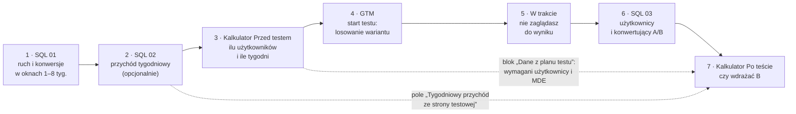

# ab-test-bigquery

SQL pod BigQuery (eksport GA4) do dwóch kalkulatorów testów A/B na pmdata.pl, plus skrypty GTM losujące wariant:

- [Przed testem](https://pmdata.pl/kalkulatory/wielkosc-proby-test-ab/) — ilu użytkowników potrzebujesz i ile tygodni potrwa test,
- [Po teście](https://pmdata.pl/kalkulatory/istotnosc-testu-ab/) — czy różnica jest istotna i jak duża może naprawdę być.

Scenariusz: e-commerce testuje kartę produktu, wejście do testu to `view_item`, konwersja to `purchase`. Metryka: konwersja albo przychód na użytkownika (`01` i `03` zwracają jego średnią i odchylenie, przychód osoby przycięty do 99,9 percentyla). Zapytania zwracają kolumny do kalkulatora, `03` także kontrolę jakości (`excluded_mixed`, `reassigned`, `no_assignment`); przykład wyniku na końcu pliku.

| Folder | Co tam jest |
|---|---|
| [`sql/`](sql/README.md) | zapytania `01`–`03`, opis pól obu kalkulatorów, zrzuty z BigQuery i kalkulatorów |
| [`gtm/`](gtm/README.md) | tagi losujące wariant |
| [`dbt/`](dbt/README.md) | wynik `03` dla wszystkich testów naraz, z testami danych, CI/CD i danymi syntetycznymi |

## Kroki

1. **Przed testem** · [`01`](sql/01_przed_testem.sql) — wiersz z planowaną liczbą tygodni: Użytkownicy i Konwertujący w tygodniu.
2. **Przed testem** · [`02`](sql/02_przychod_tygodniowy.sql) — średnia albo mediana (przy piku sezonowym): Tygodniowy przychód ze strony testowej (opcjonalnie).
3. **Przed testem** · kalkulator — pozostałe pola ([opis](sql/README.md#kalkulator-przed-testem)); inny czas testu → wiersz `01` z tym czasem.
4. **Start testu** · GTM — tag losujący ([`gtm/`](gtm/README.md)) publikujesz w poniedziałek, bo `03` liczy pełne tygodnie.
5. **W trakcie** — nie zaglądasz do wyniku. Jak z monetą: licząc orły po każdym rzucie i przerywając przy przewadze, prędzej czy później „udowodnisz”, że uczciwa moneta jest krzywa.
6. **Po teście** · [`03`](sql/03_po_tescie_warianty.sql) — najwcześniej 3 dni po końcu testu (GA4 dopisuje dane do 72 h): Użytkownicy A/B, Konwertujący A/B.
7. **Po teście** · kalkulator — w Dane z planu testu wymagani użytkownicy na wariant i MDE z kroku 3; zapisz je, bo „Wstaw z planu” działa tylko w tej samej karcie, a test trwa tygodnie. Przychód z kroku 2, bez ponownego `02`: w okresie testu zmienia go już wariant B.
