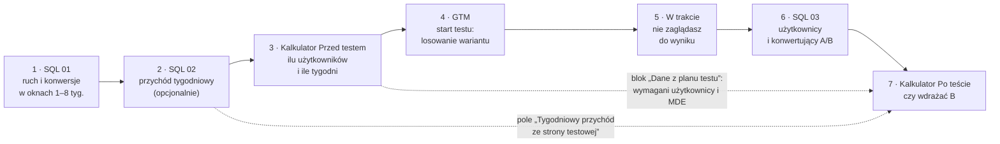
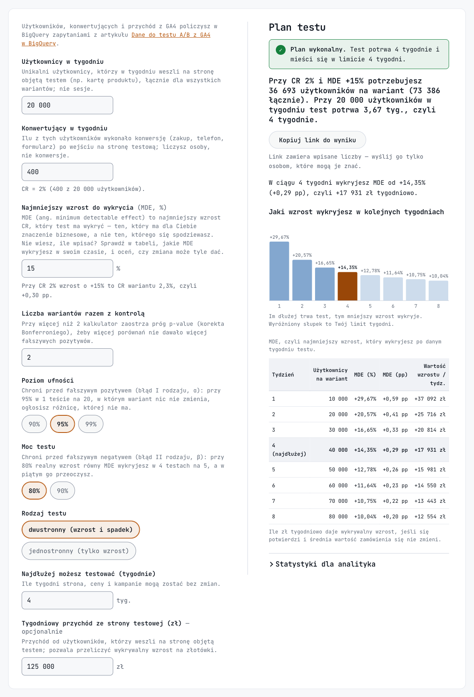
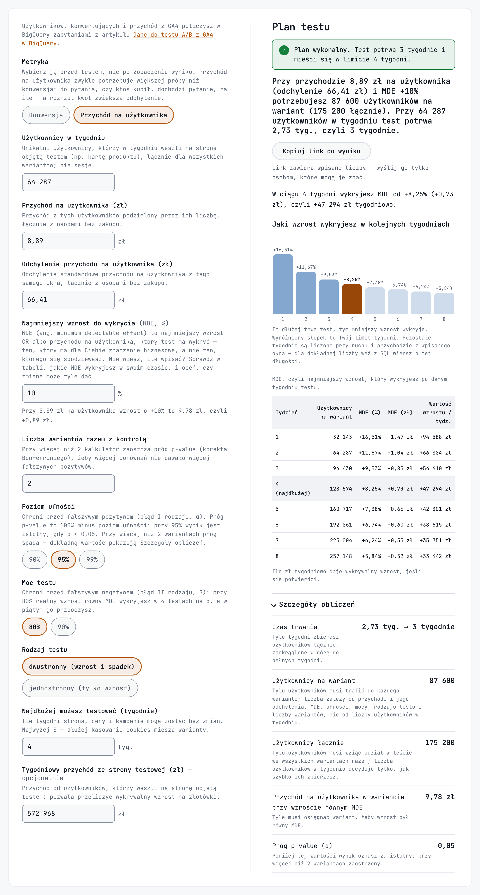
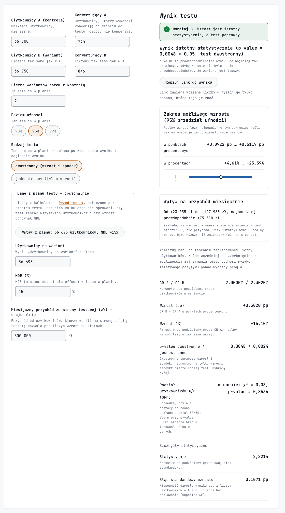
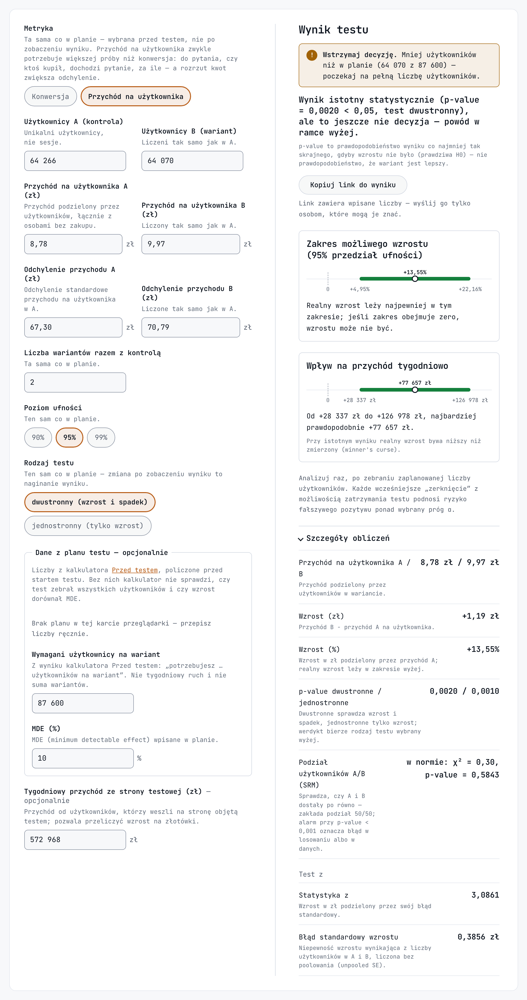

# ab-test-bigquery

SQL pod BigQuery (eksport GA4) do dwóch kalkulatorów testów A/B na pmdata.pl, plus [skrypty GTM](#skrypty-gtm) losujące wariant:

- [Przed testem](https://pmdata.pl/kalkulatory/wielkosc-proby-test-ab/) — ilu użytkowników potrzebujesz i ile tygodni potrwa test,
- [Po teście](https://pmdata.pl/kalkulatory/istotnosc-testu-ab/) — czy różnica jest istotna i jak duża może naprawdę być.

Scenariusz: e-commerce testuje kartę produktu, wejście do testu to `view_item`, konwersja to `purchase`. Metryka: konwersja albo przychód na użytkownika (`01` i `03` zwracają jego średnią i odchylenie, przychód osoby przycięty do 99,9 percentyla). Zapytania zwracają kolumny do kalkulatora, `03` także kontrolę jakości (`excluded_mixed`, `reassigned`, `no_assignment`); przykład wyniku na końcu pliku.

Wynik `03` dla wszystkich testów naraz, z testami danych: [projekt dbt](dbt/README.md).

## Szybki start

1. Podmień `twoj-projekt.analytics_123456789.events_*` na swój eksport GA4 — w każdym pliku w dwóch miejscach.
2. Ustaw `DECLARE` (opis w nagłówku pliku); `ASSERT` zatrzyma zapytanie przy złej wartości albo brakujących dniach eksportu.
3. Uruchom i przepisz liczby do kalkulatora według kroków.

## Kroki

1. **Przed testem** · [`01`](sql/01_przed_testem.sql) — wiersz z planowaną liczbą tygodni: Użytkownicy i Konwertujący w tygodniu.
2. **Przed testem** · [`02`](sql/02_przychod_tygodniowy.sql) — średnia albo mediana (przy piku sezonowym): Tygodniowy przychód ze strony testowej (opcjonalnie).
3. **Przed testem** · kalkulator — pozostałe pola ([opis](#kalkulator-przed-testem)); inny czas testu → wiersz `01` z tym czasem.
4. **Start testu** · GTM — tag losujący ([Skrypty GTM](#skrypty-gtm)) publikujesz w poniedziałek, bo `03` liczy pełne tygodnie.
5. **W trakcie** — nie zaglądasz do wyniku. Jak z monetą: licząc orły po każdym rzucie i przerywając przy przewadze, prędzej czy później „udowodnisz”, że uczciwa moneta jest krzywa.
6. **Po teście** · [`03`](sql/03_po_tescie_warianty.sql) — najwcześniej 3 dni po końcu testu (GA4 dopisuje dane do 72 h): Użytkownicy A/B, Konwertujący A/B.
7. **Po teście** · kalkulator — w Dane z planu testu wymagani użytkownicy na wariant i MDE z kroku 3; zapisz je, bo „Wstaw z planu” działa tylko w tej samej karcie, a test trwa tygodnie. Przychód z kroku 2, bez ponownego `02`: w okresie testu zmienia go już wariant B.

Dlaczego okna, a nie tydzień: ludzie wracają, a każdy liczy się w oknie raz. Unikalnych „na tydzień” ubywa z długością okna, a CR rośnie, bo jest więcej czasu na zakup. Efekty się znoszą częściowo, więc liczysz je na danych, w oknie długości testu.

## Skrypty GTM

| Plik [`gtm/`](gtm/) | Slot | Co robi |
|---|---|---|
| [`01_dwa_warianty`](gtm/01_dwa_warianty.html) | `ab1` (A/A), `ab2`, `ab5` | `v0`/`v1` po 50% |
| [`02_trzy_warianty`](gtm/02_trzy_warianty.html) | `ab3` | `v0`/`v1`/`v2` po 1/3 |
| [`03_dwa_warianty_50_procent`](gtm/03_dwa_warianty_50_procent.html) | `ab4` | 50% ruchu w teście, reszta `out` |
| [`04_rozszerzenie_do_100_procent`](gtm/04_rozszerzenie_do_100_procent.html) | `ab4` | zamiast `03`: przydziały zostają, `out` dostaje wariant |

## Konwersja czy przychód na użytkownika

Oba kalkulatory mają przełącznik „Metryka”: wybierasz ją w planie i tę samą bierzesz do oceny.

- **Konwersja (CR)** = konwertujący / użytkownicy: czy więcej osób kupuje. Nie widzi koszyka — upsell z CR −2% i koszykiem +10% wyjdzie jako przegrana.
- **Przychód na użytkownika (RPU)** = przychód wariantu / jego użytkownicy = CR × przychód na kupującego. Łapie obie zmiany, bliżej mu do sprzedaży. Mianownik to wszyscy użytkownicy, także z 0 zł.
- **RPU potrzebuje więcej użytkowników**, bo przychód ma większy rozrzut niż „kupił / nie kupił”. Kohavi, Tang i Xu (*Trustworthy Online Controlled Experiments*) pokazują na kuponie, że wskaźnik zakupu (0/1) ma mniejszą wariancję niż przychód i szybciej wykrywa efekt; w rozdziale 18 (wariancja i czułość) zalecają przycinanie (capping) wartości skrajnych. Ile więcej, zależy od rozrzutu kwot: przy typowym nawet 2× przy tym samym MDE.
- **Przykład:** ta sama strona i MDE +15% to przy CR 36 693 użytkowników na wariant (4 tygodnie), przy RPU 41 905 (5 tygodni). Wynik `03`, który przy CR daje „Wdrażaj B”, przy RPU daje „Wstrzymaj decyzję”: 36 700 użytkowników to za mało dla planu RPU (zrzuty niżej).
- **Jedno duże zamówienie** potrafi przesądzić średnią, więc `01`, `03` i dbt przycinają przychód osoby do 99,9 percentyla kupujących, a zamówienie liczą raz na `transaction_id`. Metrykę ustalasz przed startem: wybór po wyniku tej, która wyszła istotna, to dwa testy zamiast jednego i większa szansa na fałszywego zwycięzcę.

## Kalkulator Przed testem

[pmdata.pl/kalkulatory/wielkosc-proby-test-ab](https://pmdata.pl/kalkulatory/wielkosc-proby-test-ab/) — ilu użytkowników potrzebuje test i ile tygodni potrwa przy Twoim ruchu.

- **MDE** — próg biznesowy, nie prognoza: najmniejszy wzrost wart czasu testu. Względny: +15% przy CR 2% to +0,30 pp. Optymizm skraca test, który przeoczy realny, mniejszy wzrost.
- **Poziom ufności i moc** — ufność chroni przed fałszywym alarmem (α = 1 − ufność: przy 95% co 20. test bez efektu pokaże różnicę), moc przed przeoczeniem (przy 80% wzrost równy MDE wykryjesz w 4 testach na 5). Wyższe = dłuższy test.
- **Liczba wariantów z kontrolą** — każde porównanie to kolejna szansa na fałszywy alarm, więc przy 3+ próg p-value to α / (k − 1) (Bonferroni): 3 warianty przy 95% → 0,025 i więcej użytkowników.
- **Rodzaj testu** — jednostronny wymaga ~21% mniej użytkowników, ale nie wykaże, że wariant szkodzi. Wybierasz przed testem: zmiana po wyniku robi z p = 0,09 wynik 0,045.
- **Limit tygodni i stan planu** — pełne tygodnie, najwyżej 8: dłużej kasowanie cookies miesza warianty, a sezonowość zmienia mierzone zachowanie. Ponad 6 tygodni = „Plan ryzykowny”, ponad limit = „Plan niewykonalny” z MDE wykrywalnym w limicie. „poza zasięgiem” w tabeli = realistycznego wzrostu nie wykryjesz.
- **RPU** — „Przychód na użytkownika (zł)” i „Odchylenie przychodu na użytkownika (zł)” z `01` (`revenue_per_user`, `revenue_sd`), już przycięte; kalkulator niczego nie przycina. Większy rozrzut wydłuża test, więc częściej wyjdzie „Plan ryzykowny” albo „niewykonalny”.
- **Przekazanie do „Po teście”** — „Użytkownicy na wariant” idą do „Wymagani użytkownicy na wariant”. W tej samej karcie przeglądarki „Po teście” wstawi plan przyciskiem „Wstaw z planu”.

## Kalkulator Po teście

[pmdata.pl/kalkulatory/istotnosc-testu-ab](https://pmdata.pl/kalkulatory/istotnosc-testu-ab/) — co zrobić z wariantem B. Na górze decyzja i skutek w złotówkach, w „Szczegóły obliczeń” liczby.

- **Dane z planu (opcjonalne)** — wymagani użytkownicy na jeden wariant (nie tygodniowy ruch ani suma) i MDE z „Przed testem”. Bez nich werdykt zależy tylko od p-value, łatwego do oszukania zaglądaniem w trakcie; z nimi kalkulator wstrzymuje decyzję, gdy test zatrzymano przed 95% planu albo przedłużono ponad 125%, a ręcznie wpisane liczby sprawdza z MDE przy mocy 80% (rozjazd > 25% = ostrzeżenie).
- **p-value** — prawdopodobieństwo wyniku co najmniej tak skrajnego, gdyby wzrostu nie było, a nie tego, że B jest lepsze. Kalkulator pokazuje dwu- i jednostronne, werdykt bierze rodzaj testu z planu.
- **Zakres możliwego wzrostu** — przedział ufności z planu (przy 3+ wariantach po Bonferronim: 95% → 97,5%; jednostronny: 1 − 2α, czyli 90%). Obejmuje zero = może być wzrost, brak zmiany albo spadek.
- **Wpływ na przychód** — przychód tygodniowy × zakres wzrostu; do budżetu dolna granica. Przy alarmie SRM bez złotówek. Tryb konwersji zakłada niezmienioną wartość zamówienia, tryb RPU obejmuje zmianę koszyka.
- **RPU** — „Przychód na użytkownika A / B (zł)” i „Odchylenie przychodu A / B (zł)” z `03` (`revenue_per_user`, `revenue_sd`), już przycięte. Ocena to test z dla różnicy średnich; werdykt, zakres i SRM czytasz tak samo, zakres jest szerszy niż przy CR.
- **Winner's curse** — istotny wzrost mniejszy niż MDE = słaba moc, a istotne wyniki takich testów zawyżają wzrost. Stąd „Wdrażaj B, ale licz na mniej, niż zmierzono”.
- **SRM (sample ratio mismatch)** — czy A i B dostały po równo (50/50). Alarm przy p < 0,001 = błąd losowania albo danych (np. B ładuje się wolniej i gubi użytkowników); wyniku nie interpretujesz.
- **Mniej niż 10 konwersji** (albo osób bez konwersji) w wariancie, tryb konwersji — test z jest wtedy niewiarygodnym przybliżeniem. Istotny wynik → Wstrzymaj decyzję, nieistotny → ostrzeżenie.
- **Stany wyniku** — pierwszy pasujący wygrywa: ✕ Test zepsuty (SRM) → ✕ Nie wdrażaj B (istotny spadek) → ! Wstrzymaj decyzję (< 10 konwersji przy istotnym wyniku, niespójny plan, poza 95–125% planu albo jednostronny i B gorsze) → ✓ Wdrażaj B, ale licz na mniej (wzrost < MDE albo dolna granica < 1%) → ✓ Wdrażaj B → – Nie wdrażaj B jako zwycięzcy (nieistotny).

## Ograniczenia

- `user_pseudo_id` to przeglądarka, nie osoba (telefon i laptop to dwóch użytkowników). Test obejmuje tylko osoby ze zgodą na ciasteczka.
- Ocena to test z (przybliżenie normalne). SRM zakłada 50/50, przy 3+ wariantach kalkulator ocenia jedną parę z kontrolą.
- Najwyżej 10 testów naraz (sloty `ab1`–`ab10`, limit 25 parametrów na event w GA4). Równoległe testy losują niezależnie; problem to tylko silna interakcja, np. dwa testy zmieniają ten sam element.
- Safari (ITP) skraca ciasteczka z JavaScriptu do 7 dni, także `_ga`. Skutki liczą `reassigned`, `excluded_mixed` i `no_assignment`; utraty obu ciasteczek naraz żadna kolumna nie pokaże. Pomaga przedłużanie ciasteczek z serwera (np. Cookie Extender od Stape), ale tylko przy server-side GTM pod adresem strony (same-origin albo subdomena na IP strony); serwer z innego IP Safari też ogranicza do 7 dni.
