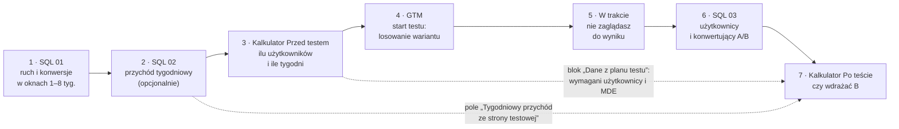

# ab-test-bigquery

SQL pod BigQuery (eksport GA4) do dwóch kalkulatorów testów A/B na pmdata.pl, plus [skrypty GTM](#skrypty-gtm), które losują wariant:

- [Przed testem](https://pmdata.pl/kalkulatory/wielkosc-proby-test-ab/) — ilu użytkowników potrzebujesz i ile tygodni potrwa test,
- [Po teście](https://pmdata.pl/kalkulatory/istotnosc-testu-ab/) — czy różnica jest istotna i jak duża może naprawdę być.

Scenariusz: e-commerce testuje kartę produktu. Wejście do testu to `view_item`, konwersja to `purchase`. Metryka do wyboru przed testem: współczynnik konwersji albo przychód na użytkownika (`01` i `03` zwracają też średni przychód na użytkownika i jego odchylenie, z przychodem osoby przyciętym do 99,9 percentyla, żeby jedno duże zamówienie nie przesądziło wyniku). Każde zapytanie zwraca kolumny do wpisania w kalkulator (`03` dodatkowo kontrolę jakości `excluded_mixed`, `reassigned`, `no_assignment`); opis i przykład wyniku stoją tuż nad końcowym `SELECT`.

Wynik `03` dla wszystkich testów naraz, z testami danych, liczy też projekt dbt — konfiguracja i działanie w osobnym [README](dbt/README.md).

## Szybki start

1. Podmień `twoj-projekt.analytics_123456789.events_*` na swój eksport GA4 — w każdym pliku w dwóch miejscach.
2. Ustaw parametry `DECLARE` na górze pliku — opis każdego stoi w komentarzu obok, a `ASSERT` pod nimi zatrzyma zapytanie przy złej wartości albo brakujących dniach eksportu.
3. Uruchom zapytanie i przepisz liczby do pól kalkulatora według kroków.

## Kroki

1. **Przed testem** · [`01`](sql/01_przed_testem.sql) — wiersz z planowaną liczbą tygodni wpisujesz w Przed testem: Użytkownicy w tygodniu, Konwertujący w tygodniu.
2. **Przed testem** · [`02`](sql/02_przychod_tygodniowy.sql) — średnią albo medianę (gdy w oknie był pik sezonowy) wpisujesz w Przed testem: Tygodniowy przychód ze strony testowej (opcjonalnie).
3. **Przed testem** · kalkulator — ustawiasz pozostałe pola ([opis](#kalkulator-przed-testem)); gdy kalkulator policzy inny czas testu, wracasz do wyniku `01` i bierzesz wiersz z tym czasem.
4. **Start testu** · GTM — publikujesz tag losujący wariant ([Skrypty GTM](#skrypty-gtm)) w poniedziałek, bo `03` liczy pełne tygodnie.
5. **W trakcie** — nie zaglądasz do wyniku. Rzucasz uczciwą monetą 100 razy, ale liczysz po każdym rzucie i przerywasz, gdy orłów jest wyraźnie więcej — prędzej czy później trafisz na taką serię i ogłosisz, że moneta jest krzywa.
6. **Po teście** · [`03`](sql/03_po_tescie_warianty.sql) — uruchamiasz najwcześniej 3 dni po końcu testu (GA4 dopisuje dane do 72 h); wynik wpisujesz w Po teście: Użytkownicy A/B, Konwertujący A/B.
7. **Po teście** · kalkulator — w Dane z planu testu wstawiasz z kroku 3 wymaganych użytkowników na wariant i MDE — zapisz je po kroku 3, bo „Wstaw z planu” działa tylko w tej samej karcie przeglądarki, a test trwa tygodnie; przychód wpisujesz ten sam co z kroku 2 (nie liczysz `02` ponownie): przychód z okresu testu zmienia już wariant B.

Dlaczego okna, a nie jeden tydzień: test trwa kilka tygodni, a ludzie wracają. Każdy użytkownik liczy się w oknie raz, więc w oknie 4 tygodni unikalnych jest mniej niż 4 × tydzień — wartość „na tydzień” (okno / liczba tygodni) spada z długością okna. CR rośnie, bo użytkownik ma więcej czasu na zakup. Oba efekty działają w przeciwne strony, więc liczysz je na danych, w oknie tak długim jak test.

## Skrypty GTM

| Plik [`gtm/`](gtm/) | Slot | Co robi |
|---|---|---|
| [`01_dwa_warianty`](gtm/01_dwa_warianty.html) | `ab1` (A/A), `ab2`, `ab5` | `v0`/`v1` po 50% |
| [`02_trzy_warianty`](gtm/02_trzy_warianty.html) | `ab3` | `v0`/`v1`/`v2` po 1/3 |
| [`03_dwa_warianty_50_procent`](gtm/03_dwa_warianty_50_procent.html) | `ab4` | 50% ruchu w teście, reszta `out` |
| [`04_rozszerzenie_do_100_procent`](gtm/04_rozszerzenie_do_100_procent.html) | `ab4` | zamiast `03`: przydziały zostają, `out` dostaje wariant |

## Konwersja czy przychód na użytkownika

Oba kalkulatory mają przełącznik „Metryka”. Wybierasz go przed testem, w planie, i tę samą metrykę bierzesz do oceny.

- **Konwersja (CR)**, czyli konwertujący / użytkownicy, odpowiada na pytanie, czy więcej osób kupuje. Nie widzi zmiany wartości koszyka. Upsell, który obniża CR o 2%, a podnosi koszyk o 10%, wyjdzie w CR jako przegrana.
- **Przychód na użytkownika (RPU)**, czyli przychód wariantu / jego użytkownicy, to to samo co CR × przychód na kupującego. Łapie obie zmiany naraz, bliżej mu do pieniędzy, które biznes widzi w sprzedaży. Mianownik się nie zmienia: wszyscy użytkownicy, także ci bez zakupu z przychodem 0 zł.
- **RPU potrzebuje więcej użytkowników**, bo przychód ma większy rozrzut niż informacja „kupił / nie kupił”. Kohavi, Tang i Xu w *Trustworthy Online Controlled Experiments* pokazują to na przykładzie kuponu: wskaźnik zakupu (0/1) ma mniejszą wariancję niż przychód, więc szybciej wykrywa efekt. W rozdziale 18 (wariancja i czułość testu) zalecają przycinanie (capping) wartości skrajnych. Rachunek: przy CR = p i zmienności koszyka CV = odchylenie / średnia względna wariancja CR to ok. 1 / p, a RPU ok. (1 + CV²) / p. Przy CV = 1 to 2× więcej użytkowników przy tym samym MDE.
- **Na przykładowych danych** ta sama strona i to samo MDE +15% dają przy CR 36 693 użytkowników na wariant (4 tygodnie), a przy RPU 41 905 (5 tygodni). Wynik testu z `03`, który przy CR kończy się „Wdrażaj B”, przy RPU kończy się „Wstrzymaj decyzję”: 36 700 użytkowników to za mało dla planu RPU (zrzuty niżej).
- **Jedno duże zamówienie** potrafi przesądzić średnią, dlatego `01`, `03` i model dbt przycinają przychód osoby do 99,9 percentyla przychodu kupujących, a zamówienie liczą raz na `transaction_id`. Która metryka decyduje, ustalasz przed startem: sprawdzanie po wyniku, która wyszła istotna, to dwa testy zamiast jednego i większa szansa na fałszywego zwycięzcę.

## Kalkulator Przed testem

[pmdata.pl/kalkulatory/wielkosc-proby-test-ab](https://pmdata.pl/kalkulatory/wielkosc-proby-test-ab/) — ilu użytkowników potrzebuje test i ile tygodni potrwa przy Twoim ruchu.

- **MDE (najmniejszy wzrost do wykrycia)** — próg biznesowy, nie prognoza: najmniejszy wzrost wart czasu testu, a nie ten, którego się spodziewasz. Względny: +15% przy CR 2% to +0,30 pp (2% → 2,3%). Optymizm skraca test, a potem test nie wykrywa realnego, mniejszego wzrostu.
- **MDE rządzi długością testu** — liczba użytkowników rośnie z 1 / MDE²: przy CR 2% +15% → 36 693 na wariant, +10% → 80 682, +5% → 315 206. Słupki i tabela pokazują, jakie MDE wykryjesz po każdym tygodniu. Gdy w limicie wykryjesz najwyżej +25%, a zmiana realnie da +5%, test niczego nie rozstrzygnie.
- **Poziom ufności i moc** — ufność chroni przed fałszywym alarmem (α = 1 − ufność: przy 95% co 20. test bez efektu pokaże różnicę), moc przed przeoczeniem (przy 80% realny wzrost równy MDE wykryjesz w 4 testach na 5). Wyższe wartości = dłuższy test.
- **Liczba wariantów razem z kontrolą** — każde porównanie z kontrolą to kolejna szansa na fałszywy alarm, więc przy 3+ próg p-value to α / (k − 1) (korekta Bonferroniego): 3 warianty przy 95% → 0,025 i więcej użytkowników.
- **Rodzaj testu** — jednostronny wymaga ~21% mniej użytkowników, ale nie wykaże, że wariant szkodzi. Wybierasz przed testem: zmiana po wyniku robi z p = 0,09 wynik 0,045.
- **Limit tygodni i stan planu** — pełne tygodnie, najwyżej 8: dłużej kasowanie cookies miesza warianty, a sezonowość zmienia to, co mierzysz. Ponad 6 tygodni = „Plan ryzykowny”, ponad limit = „Plan niewykonalny” z MDE, które wykryjesz w limicie. „poza zasięgiem” w tabeli = przy tej liczbie użytkowników nie wykryjesz realistycznego wzrostu.
- **Metryka: przychód na użytkownika (RPU)** — pola „Przychód na użytkownika (zł)” i „Odchylenie przychodu na użytkownika (zł)” bierzesz z `01` (`revenue_per_user`, `revenue_sd`). Próbę liczy wzór dla średniej: n = 2·(z_α + z_β)²·σ² / (RPU × MDE)². Większy rozrzut przychodu wydłuża test (sekcja wyżej), więc częściej zobaczysz „Plan ryzykowny” albo „Plan niewykonalny”.
- **Przekazanie do „Po teście”** — „Użytkownicy na wariant” wpisujesz w „Wymagani użytkownicy na wariant”. Plan zapisuje się w karcie przeglądarki, więc „Po teście” otwarty w tej samej karcie wstawi go przyciskiem „Wstaw z planu”.

## Kalkulator Po teście

[pmdata.pl/kalkulatory/istotnosc-testu-ab](https://pmdata.pl/kalkulatory/istotnosc-testu-ab/) — co zrobić z wariantem B. Na górze decyzja i jej skutek w złotówkach, pod „Szczegóły obliczeń” liczby, z których wynika.

- **Dane z planu (opcjonalne)** — „Wymagani użytkownicy na wariant” (na jeden wariant, nie tygodniowy ruch ani suma) i MDE z „Przed testem”. Bez nich werdykt zależy tylko od p-value, które najłatwiej oszukać zaglądaniem do wyniku w trakcie. Z nimi kalkulator wstrzymuje decyzję, gdy test zatrzymano przed 95% planu albo przedłużano ponad 125%. Liczby wpisane ręcznie sprawdza z MDE przy mocy 80% — rozjazd ponad 25% to ostrzeżenie o niespójnym planie.
- **p-value** — prawdopodobieństwo wyniku co najmniej tak skrajnego, gdyby wzrostu nie było; nie prawdopodobieństwo, że B jest lepsze. Kalkulator pokazuje dwu- i jednostronne, werdykt bierze rodzaj testu z planu.
- **Zakres możliwego wzrostu** — przedział ufności na poziomie z planu (przy 3+ wariantach po korekcie Bonferroniego: 95% → 97,5%). Obejmuje zero = realnie może być wzrost, brak zmiany albo spadek. Przy teście jednostronnym to przedział 1 − 2α (przy 95% ufności: 90%), zgodny z progiem testu.
- **Wpływ na przychód** — przychód tygodniowy × zakres wzrostu; do budżetu bierz dolną granicę. Przy alarmie SRM kalkulator nie pokazuje złotówek. W trybie konwersji zakłada niezmienioną wartość zamówienia, bo test mierzył CR; w trybie przychodu na użytkownika zakres obejmuje też zmianę koszyka.
- **Metryka: przychód na użytkownika** — pola „Przychód na użytkownika A / B (zł)” i „Odchylenie przychodu A / B (zł)” bierzesz z `03` (`revenue_per_user`, `revenue_sd`). Ocena to test z dla różnicy średnich, SE = √(sd_A²/n_A + sd_B²/n_B), zamiast testu dla dwóch proporcji; werdykt, zakres i SRM czytasz tak samo. Z tych samych danych zakres wychodzi szerszy niż przy CR.
- **Winner's curse (klątwa zwycięzcy)** — istotny wzrost mniejszy niż MDE z planu znaczy, że test miał słabą moc, a istotne wyniki takich testów zawyżają wzrost. Stąd stan „Wdrażaj B, ale licz na mniej, niż zmierzono”.
- **SRM (sample ratio mismatch)** — sprawdza, czy A i B dostały po równo (50/50). Alarm przy p < 0,001 = błąd w losowaniu albo w danych, np. B ładuje się wolniej i gubi użytkowników; wtedy wyniku nie interpretujesz.
- **Mniej niż 10 konwersji** (albo osób bez konwersji) w którymś wariancie, tryb konwersji — test z to przybliżenie, przy tak małych liczbach p-value i zakres są niewiarygodne. Istotny wynik → Wstrzymaj decyzję, nieistotny → tylko ostrzeżenie.
- **Stany wyniku** — sprawdzane po kolei, pierwszy pasujący wygrywa: ✕ Test zepsuty (SRM) → ✕ Nie wdrażaj B (istotny spadek) → ! Wstrzymaj decyzję (< 10 konwersji przy istotnym wyniku, niespójne dane z planu, poza 95–125% planu albo test jednostronny i B gorsze) → ✓ Wdrażaj B, ale licz na mniej (wzrost < MDE albo dolna granica zakresu < 1%) → ✓ Wdrażaj B → – Nie wdrażaj B jako zwycięzcy (wynik nieistotny).

## Ograniczenia

- `user_pseudo_id` to przeglądarka, nie osoba: ten sam człowiek na telefonie i laptopie to dwóch użytkowników.
- Test obejmuje tylko osoby ze zgodą na ciasteczka: tag losuje po zgodzie, a eventy bez zgody (Consent Mode) nie mają `user_pseudo_id` i zapytania je pomijają. Wynik mówi o tej grupie, nie o całym ruchu.
- SRM zakłada podział 50/50; przy 3+ wariantach kalkulator ocenia jedną parę z kontrolą.
- Ocena to test z (przybliżenie normalne): przy kilku konwersjach w wariancie wynik jest przybliżony, a granice zakresu są ucinane tak, żeby CR B mieścił się między 0 a 100% (spadek najwyżej −100%).
- Wariant w `03` pochodzi z `ab_assign` (`ab_test`, `ab_variant`) i z parametru slotu, który zmienna GTM czyta z first-party cookie i dokleja do eventów ([artykuł](https://pmdata.pl/artykuly/wlasne-testy-ab-gtm-firebase/)). Konwersja liczy się z każdego `purchase` (parametr `conversion_event`) po ekspozycji, także bez parametru `ab_variant` — wariant bierze się z przypisania użytkownika, nie z eventu zakupu.
- Najwyżej 10 testów naraz (sloty `ab1`–`ab10`), bo GA4 przyjmuje do 25 parametrów na event — sprawdź, ile już wysyłasz. Równoległe testy losują niezależnie, więc wynik jednego jest uśredniony po wariantach drugiego; problemem jest tylko silna interakcja, np. oba zmieniają ten sam element.
- Safari (ITP) skraca ciasteczka ustawione z JavaScriptu do 7 dni, także `_ga`. Gdy po tygodniu wygaśnie tylko ciasteczko testu, tag losuje ponownie — `reassigned` liczy wszystkich takich, `excluded_mixed` tych z innym wariantem. Gdy wygaśnie tylko `_ga`, użytkownik wraca z ciasteczkiem testu pod nowym `user_pseudo_id` — to `no_assignment`. Gdy wygasną oba, ten sam człowiek wraca z nowym `user_pseudo_id` i nowym losowaniem, a zapytanie widzi dwóch użytkowników i żadna kolumna tego nie pokaże. Ciasteczka ustawiane z serwera (server-side GTM) usuwają ten problem.
