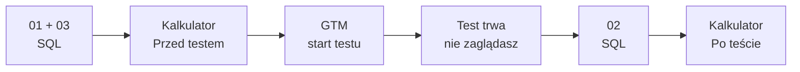

# ab-test-bigquery

SQL pod BigQuery (eksport GA4) do dwóch kalkulatorów testów A/B na pmdata.pl, plus [skrypty GTM](#skrypty-gtm), które losują wariant:

- [Przed testem](https://pmdata.pl/kalkulatory/wielkosc-proby-test-ab/) — ilu użytkowników potrzebujesz i ile tygodni potrwa test,
- [Po teście](https://pmdata.pl/kalkulatory/istotnosc-testu-ab/) — czy różnica jest istotna i jak duża może naprawdę być.

Scenariusz: e-commerce testuje kartę produktu. Wejście do testu to `view_item`, konwersja to `purchase`. Każde zapytanie zwraca tylko kolumny do wpisania w kalkulator; opis i przykład wyniku stoją tuż nad końcowym `SELECT`.

## Szybki start

1. Podmień tabelę `bigquery-public-data.ga4_obfuscated_sample_ecommerce.events_*` na swój eksport GA4 (`<projekt>.analytics_<id>.events_*`) we wszystkich trzech plikach — w `02` w dwóch miejscach.
2. Ustaw parametry `DECLARE` na górze pliku (lista niżej).
3. Uruchom zapytanie i przepisz liczby do pól kalkulatora według kroków.

Bez zmian zapytania liczą na publicznym przykładowym eksporcie GA4 (2020-11-01 – 2021-01-31) — wystarczy, żeby zobaczyć kształt wyniku.

- `01` · `window_start` — poniedziałek, od którego liczysz okna (zapytanie sprawdza dzień tygodnia)
- `01` · `max_weeks` — ile okien policzyć: 1, 2, … tygodni, najwyżej 8 (tyle co limit w kalkulatorze); okno nie może sięgać w okres testu (domyślnie 5 — przykładowy test startuje 2020-12-07)
- `01` · `test_start` — pierwszy dzień testu; zapytanie przerywa się, gdy okno w niego sięga
- `02` · `test_start`, `test_end` — pierwszy (poniedziałek) i ostatni (niedziela) dzień testu; zapytanie sprawdza oba
- `02` · `test_name` — wartość parametru `ab_test`, czyli klucz ciasteczka z tagu GTM: numer testu `ab1`, `ab2`, `ab3`… ([wariant z first-party cookie](https://pmdata.pl/artykuly/wlasne-testy-ab-gtm-firebase/))
- `02` · `control_variant` — wartość `ab_variant` grupy kontrolnej: `v0`, czyli wersja dotychczasowa; gdy nie ma jej w danych, zapytanie przerywa się błędem
- `02` · `exposure_events` — eventy, od których użytkownik wchodzi do testu (punkt ekspozycji), domyślnie `ab_assign` i `view_item`; `ab_assign` usuń, gdy losujesz wcześniej niż na stronie testowej
- `02` · `demo_mode` — `TRUE` tylko na danych przykładowych: nie mają testu, więc wariant symuluje hash `user_pseudo_id`; na własnych `FALSE` — wariant losuje GTM, a zapytanie czyta go z `ab_variant`. Gdy przy `TRUE` dane mają parametr `ab_variant`, zapytanie przerywa się błędem
- `03` · `window_end` — dzień przed startem testu
- `03` · `window_weeks` — ile pełnych tygodni przed testem uśrednić, domyślnie 4

## Kroki

1. **Przed testem** · [`01`](sql/01_przed_testem.sql) — wiersz z planowaną liczbą tygodni wpisujesz w Przed testem: Użytkownicy w tygodniu, Konwertujący w tygodniu.
2. **Przed testem** · [`03`](sql/03_przychod_tygodniowy.sql) — wynik wpisujesz w Przed testem: Tygodniowy przychód ze strony testowej (opcjonalnie).
3. **Przed testem** · kalkulator — ustawiasz pozostałe pola ([opis](#kalkulator-przed-testem)); gdy kalkulator policzy inny czas testu, wracasz do wyniku `01` i bierzesz wiersz z tym czasem.
4. **W trakcie** — nie zaglądasz do wyniku.
5. **Po teście** · [`02`](sql/02_po_tescie_warianty.sql) — wynik wpisujesz w Po teście: Użytkownicy A/B, Konwertujący A/B.
6. **Po teście** · wynik `03` z kroku 2 — wpisujesz w Po teście: Tygodniowy przychód ze strony testowej. Ta sama liczba, bo okno kończy się przed startem testu.

Dlaczego okna, a nie jeden tydzień: test trwa kilka tygodni, a ludzie wracają. Każdy użytkownik liczy się w oknie raz, więc w oknie 4 tygodni unikalnych jest mniej niż 4 × tydzień — wartość „na tydzień” (okno / liczba tygodni) spada z długością okna. CR rośnie, bo użytkownik ma więcej czasu na zakup. Oba efekty działają w przeciwne strony, więc liczysz je na danych, w oknie tak długim jak test.

## Skrypty GTM

Folder [`gtm/`](gtm/) losuje wariant w przeglądarce, zapisuje go w first-party cookie i wysyła `ab_assign` ([metoda z artykułu](https://pmdata.pl/artykuly/wlasne-testy-ab-gtm-firebase/)). SQL niczego nie losuje — `02` czyta wariant z parametru `ab_variant`.

| Plik | Klucz | Co robi | Gdzie w GTM |
|---|---|---|---|
| [`01_dwa_warianty.html`](gtm/01_dwa_warianty.html) | `ab1` | `v0`/`v1` po 50%, cały ruch strony testowej | Tag → Custom HTML |
| [`02_trzy_warianty.html`](gtm/02_trzy_warianty.html) | `ab2` | `v0`/`v1`/`v2` po 1/3 | Tag → Custom HTML |
| [`03_dwa_warianty_50_procent.html`](gtm/03_dwa_warianty_50_procent.html) | `ab3` | 50% ruchu w teście (`v0`/`v1` po 25%), reszta `out` — poza analizą | Tag → Custom HTML |
| [`04_rozszerzenie_do_100_procent.html`](gtm/04_rozszerzenie_do_100_procent.html) | `ab3` | podmiana kodu tagu z `03`: przydziały zostają, `out` i nowi dostają wariant | ten sam tag co `03` |
| [`zmienna_ab_variant.js`](gtm/zmienna_ab_variant.js) | jedna kopia na klucz | wariant z ciasteczka albo `undefined` (dla `out` i śmieci) | Zmienna → Custom JavaScript |

Konfiguracja:

1. Tag Custom HTML z jednym ze skryptów; wyzwalacz: strona testowa (np. karta produktu). Ustawienia zgody tagu: wymagaj zgody — ciasteczko testu nie jest niezbędne, więc losujesz dopiero po zgodzie.
2. Tag GA4 Event `ab_assign` na zdarzeniu niestandardowym `ab_assign`, parametry `ab_test` i `ab_variant` z warstwy danych.
3. Zmienna Custom JavaScript z `zmienna_ab_variant.js`; w tagach GA4 `view_item` i `purchase` dodaj parametry `ab_test` (stała: klucz testu, np. `ab1`) i `ab_variant` (ta zmienna).
4. Tag `view_item`: Sekwencjonowanie tagów → najpierw tag z kroku 1. Bez tego pierwszy `view_item` może pójść, zanim ciasteczko powstanie — `02` złapie usera dopiero na `ab_assign`.
5. Klucz testu i wariant kontrolny w skrypcie = `test_name` i `control_variant` w `02`. Konwencja: klucz ciasteczka to kolejny numer testu małymi literami (`ab1` w `01`, `ab2` w `02`, `ab3` w `03` i `04` — jeden test, więc ten sam klucz), wartości `v0` — zawsze wersja dotychczasowa (kontrola) — oraz `v1`, `v2` — warianty testowe.

Rozszerzenie `03` → `04` zmienia skalę testu, nie jego przebieg: kto miał wariant, zostaje w nim. Dawni `out` wchodzą do analizy od dnia rozszerzenia, ale wcześniej widzieli obecną wersję strony — gdy to przeszkadza, `INCLUDE_OUT = false` wpuszcza tylko nowych. Plan z kalkulatora Przed testem liczyłeś dla 50% ruchu — po rozszerzeniu użytkownicy zbierają się 2× szybciej, więc kończysz po pierwszym pełnym tygodniu, w którym każdy wariant ma liczbę użytkowników z planu.

## Kalkulator Przed testem

[pmdata.pl/kalkulatory/wielkosc-proby-test-ab](https://pmdata.pl/kalkulatory/wielkosc-proby-test-ab/) odpowiada na dwa pytania: ilu użytkowników potrzebuje test i ile tygodni potrwa przy Twoim ruchu. Nazwy poniżej są dokładnie takie jak na stronie, w tej samej kolejności.

Puste pole liczy się jako przykład (szara liczba w polu). Dopóki choć jedno pole z przykładem jest puste, nad wynikiem stoi „Przykładowe dane — wpisz swoje, a wynik przeliczy się od razu.” Pola opcjonalne działają inaczej. Chodzi o przychód, a w „Po teście” także o dane z planu. Ich przykład pokazuje się tylko wtedy, gdy nie wpisałeś jeszcze żadnej liczby. Gdy wpiszesz własne liczby, a pole opcjonalne zostawisz puste, przykład z niego znika. Inaczej kalkulator policzyłby złotówki z przykładowego przychodu, który nie pasuje do Twojego ruchu.

### Pola

1. **Użytkownicy w tygodniu** Przykład: 20 000 · skąd: `01` → `users_per_week`

   Unikalni użytkownicy, którzy w tygodniu weszli na stronę objętą testem, łącznie dla wszystkich wariantów. Nie sesje: test losuje ludzi, a kilka sesji jednej osoby to nie są niezależne obserwacje. Bierzesz wiersz z planowaną liczbą tygodni, bo powracający użytkownicy liczą się w oknie raz — wartość „na tydzień” spada z długością okna.

2. **Konwertujący w tygodniu** Przykład: 400 · skąd: `01` → `converters_per_week` (ten sam wiersz)

   Ilu z tych użytkowników wykonało konwersję po wejściu na stronę testową. Osoby, nie zamówienia: ktoś, kto kupił dwa razy, liczy się raz. Pod polem kalkulator pokazuje CR (konwersja, *conversion rate*) = konwertujący / użytkownicy, np. „CR = 2% (400 z 20 000 użytkowników)”. CR liczony z dwóch liczb, nie wpisywany ręcznie, wymusza tę samą populację w planie i w ocenie.

3. **Najmniejszy wzrost do wykrycia (MDE, %)** Przykład: 15 · skąd: decyzja

   Patrz [MDE](#mde--najmniejszy-wzrost-do-wykrycia) niżej. Wzrost względny: +15% przy CR 2% to CR wariantu 2,3%, czyli +0,30 pp — kalkulator pokazuje to pod polem.

4. **Liczba wariantów razem z kontrolą** Przykład: 2 · skąd: decyzja

   A/B = 2, A/B/C = 3. Każde dodatkowe porównanie z kontrolą to kolejna szansa na fałszywy pozytyw, więc przy 3+ kalkulator zaostrza próg p-value (korekta Bonferroniego): α dzielone przez liczbę porównań, k − 1. Przy 3 wariantach i 95% ufności próg to 0,05 / 2 = 0,025 — i potrzeba więcej użytkowników.

5. **Poziom ufności** Przykład: 95% · skąd: decyzja

   Chroni przed fałszywym pozytywem (błąd I rodzaju, α = 1 − poziom ufności). Próg p-value to 100% minus poziom ufności: przy 95% wynik jest istotny, gdy p < 0,05 (przy 3+ wariantach niższy — patrz pole 4). Przy 95% w 1 teście na 20, w którym wariant nic nie zmienia, ogłosisz różnicę, której nie ma. 99% = mniej fałszywych alarmów, ale dłuższy test; 90% = odwrotnie.

6. **Moc testu** Przykład: 80% · skąd: decyzja

   Chroni przed fałszywym negatywem (błąd II rodzaju, β = 1 − moc). Przy 80% realny wzrost równy MDE wykryjesz w 4 testach na 5, a w piątym go przeoczysz. 90% = rzadziej przeoczysz, ale test dłuższy.

7. **Rodzaj testu** Przykład: dwustronny (wzrost i spadek) · skąd: decyzja

   Dwustronny sprawdza wzrost i spadek. Jednostronny (tylko wzrost) wymaga ~21% mniej użytkowników, ale spadku nie sprawdza: sam test nie wykaże, że wariant szkodzi — kalkulator Po teście tylko ostrzega, gdy B wypada gorzej. Kalkulator ostrzega o tym pod polem. Wybierasz przed testem — zmiana po zobaczeniu wyniku to naginanie wyniku.

8. **Najdłużej możesz testować (tygodnie)** Przykład: 4 · skąd: decyzja

   Ile pełnych tygodni strona, ceny i kampanie mogą zostać bez zmian. Pełne tygodnie, bo w poniedziałek i w sobotę kupują inni ludzie. Najwyżej 8: dłużej kasowanie cookies miesza warianty (ten sam człowiek wraca jako nowy użytkownik i może trafić do drugiego wariantu), a sezonowość zmienia to, co test mierzy. Wpisanie 9 i więcej kalkulator odrzuca komunikatem przy polu. Powyżej 6 tygodni plan jest „ryzykowny”.

9. **Tygodniowy przychód ze strony testowej (zł)** — opcjonalnie Przykład: 125 000 · skąd: `03` → `weekly_revenue`

   Przychód od użytkowników, którzy weszli na stronę objętą testem. Kalkulator przelicza na nim wykrywalny wzrost na złotówki: kolumna „Wartość wzrostu / tydz.” w tabeli i kwota w zdaniu o limicie. Pole puste przy własnych danych = bez kolumny i bez kwoty. Tydzień, nie miesiąc — jak pozostałe dane wejściowe; miesiąc to ok. 4,3 tygodnia.

### MDE — najmniejszy wzrost do wykrycia

MDE to skrót od *minimum detectable effect*, po polsku najmniejszy wykrywalny efekt. To najmniejszy wzrost CR, który test ma wykryć z wybraną mocą.

- **MDE to próg biznesowy, nie prognoza.** Wpisujesz najmniejszy wzrost wart czasu testu, a nie wzrost, którego się spodziewasz. Im mniejsze MDE, tym dłuższy test, a w tym czasie na stronie nie ruszy żaden inny eksperyment. Praca programistów jest już wykonana — przy MDE się jej nie liczy. Optymizm w tym polu skraca test, a potem test nie wykrywa realnego, mniejszego wzrostu.
- **MDE decyduje o długości testu bardziej niż cokolwiek innego.** Liczba użytkowników rośnie z odwrotnością kwadratu MDE: 2× mniejsze MDE = ok. 4× więcej użytkowników. Przy CR 2%: +15% → 36 693 na wariant, +10% → 80 682, +5% → 315 206.
- **Względne, nie w punktach procentowych.** +15% przy CR 2% to +0,30 pp (2% → 2,3%). Punkty procentowe (pp) to różnica dwóch procentów; tabela pokazuje obie jednostki.
- **Nie wiesz, ile wpisać?** Zacznij od słupków i tabeli: pokazują, jakie MDE wykryjesz po każdym tygodniu, a z wpisanym przychodem — ile ten wzrost jest wart w złotówkach na tydzień. Jeśli w Twoim limicie wykryjesz najwyżej +25%, a zmiana realnie może dać +5%, test niczego nie rozstrzygnie — lepiej testować na stronie z większym ruchem albo odważniejszą zmianę.

### Wynik: Plan testu

Kolejność jak na stronie. Biznes czyta do tabeli MDE; punkty 7–11 są zwinięte pod „Szczegóły obliczeń” — klik rozwija.

1. **Stan planu** (ramka z ikoną) Na stronie: ✓ **Plan wykonalny** · ! **Plan ryzykowny** · ✕ **Plan niewykonalny**

   Wykonalny: test mieści się w limicie tygodni (gdy wystarczy mniej niż 2 tygodnie, kalkulator i tak radzi pełne 2, o ile limit na to pozwala). Ryzykowny: test potrwa ponad 6 tygodni — wynik mogą zaburzyć cookies i sezonowość; rozważ większe MDE. Niewykonalny: test potrzebuje więcej tygodni niż limit; kalkulator podaje MDE, które wykryjesz w limicie. Gdy test zmieści się w 8 tygodniach, dodaje „albo wydłuż test do N tygodni”; gdy potrzebuje więcej niż 8 — „albo testuj na stronie z większym ruchem”, bo dłuższego testu i tak nie warto robić.

2. **Zdanie wyniku** Na stronie: „Przy CR 2% i MDE +15% potrzebujesz 36 693 użytkowników na wariant (73 386 łącznie). Przy 20 000 użytkowników w tygodniu test potrwa 3,67 tyg., czyli 4 tygodnie.”

   Liczba użytkowników zależy od CR, MDE, ufności, mocy, rodzaju testu i liczby wariantów. Ruch w tygodniu zmienia tylko czas.

3. **Kopiuj link do wyniku** Na stronie: link z wpisanymi liczbami

   Otwiera kalkulator z tymi samymi danymi. Liczby siedzą w części adresu po `#`, której przeglądarka nie wysyła na serwer — ale każdy, kto dostanie link, je zobaczy.

4. **Zdanie o limicie** Na stronie: „W ciągu 4 tygodni wykryjesz MDE od +14,35% (+0,29 pp), czyli +17 931 zł tygodniowo.”

   Najmniejszy wzrost, jaki wykryjesz, jeśli test potrwa tyle, ile wpisałeś w „Najdłużej możesz testować”. Kwota tylko z wpisanym przychodem: przychód tygodniowy × to MDE.

5. **Jaki wzrost wykryjesz w kolejnych tygodniach** (słupki) Na stronie: słupek na tydzień, nad nim MDE (%); wyróżniony słupek = limit, przygaszone = tygodnie ponad limit

   Te same liczby co kolumna MDE (%) w tabeli, pokazane jako kształt: im dłuższy test, tym niższy słupek, ale każdy kolejny tydzień daje mniej. Gdy kolumny są węższe niż etykiety (wąski ekran), wartość stoi tylko nad limitem.

6. **Tabela MDE po tygodniach** Na stronie: kolumny: **Tydzień**, **Użytkownicy na wariant**, **MDE (%)**, **MDE (pp)**, z przychodem także **Wartość wzrostu / tydz.**

   Wiersz = „gdybyś zakończył test po tym tygodniu”. Użytkownicy na wariant = ruch × tygodnie / liczba wariantów. MDE (%) i MDE (pp) = najmniejszy wzrost wykrywalny przy tej liczbie użytkowników, względnie i w punktach procentowych. Wartość wzrostu / tydz. = przychód tygodniowy × MDE (%): ile zł tygodniowo daje wykrywalny wzrost, jeśli się potwierdzi i średnia wartość zamówienia się nie zmieni. Wiersz „(najdłużej)” to Twój limit. „poza zasięgiem” = przy tej liczbie użytkowników nie wykryjesz realistycznego wzrostu. Tabela ma zawsze 8 tygodni — tyle wynosi najdłuższy dopuszczalny limit. Ruch i CR są stałe, z wpisanego okna, więc dokładny jest tylko wiersz o długości tego okna; pozostałe to przybliżenie. W dłuższym oknie ubywa unikalnych użytkowników, ale rośnie CR, więc błąd działa w obie strony — na przykładowych danych z `01` najwyżej ok. 1 pp MDE. Dla dokładnej liczby weź z `01` wiersz o tej długości.

7. **Szczegóły obliczeń**: **Czas trwania** Na stronie: „3,67 tyg. → 4 tygodnie”

   Tyle tygodni zbierasz użytkowników łącznie, zaokrąglone w górę do pełnych tygodni.

8. **Szczegóły obliczeń**: **Użytkownicy na wariant** Na stronie: 36 693

   Tylu użytkowników musi trafić do każdego wariantu. Tę liczbę wpisujesz potem w „Po teście” w pole „Wymagani użytkownicy na wariant”. Ta sama liczba stoi w zdaniu wyniku (punkt 2).

9. **Szczegóły obliczeń**: **Użytkownicy łącznie** Na stronie: 73 386

   Użytkownicy na wariant × liczba wariantów. Ruch w tygodniu decyduje tylko, jak szybko ich zbierzesz.

10. **Szczegóły obliczeń**: **CR wariantu przy wzroście równym MDE** Na stronie: 2,30%

   Tyle musi osiągnąć wariant, żeby wzrost był równy MDE.

11. **Szczegóły obliczeń**: **Próg p-value (α)** Na stronie: 0,05

   Poniżej tej wartości wynik w „Po teście” uznasz za istotny. Przy 3+ wariantach zaostrzony, np. „0,05 / 2 = 0,025”.

Plan zapisuje się w tej karcie przeglądarki (`sessionStorage`) po pierwszej zmianie pola albo po otwarciu linku do wyniku. Strona „Po teście” w tej samej karcie odczyta go przyciskiem „Wstaw z planu”.

## Kalkulator Po teście

[pmdata.pl/kalkulatory/istotnosc-testu-ab](https://pmdata.pl/kalkulatory/istotnosc-testu-ab/) odpowiada na pytanie: co zrobić z wariantem B. Wynik ma dwie warstwy — na górze decyzja i jej skutek w złotówkach, na dole, zwinięte pod „Szczegóły obliczeń”, liczby, z których wynika decyzja.

### Pola

1. **Użytkownicy A (kontrola)** Przykład: 36 700 · skąd: `02` → `users` (wiersz A)

   Unikalni użytkownicy od pierwszej ekspozycji w wariancie A. Nie sesje. Osoby przypisane do 2+ wariantów zapytanie wyklucza.

2. **Konwertujący A** Przykład: 734 · skąd: `02` → `converters` (wiersz A)

   Użytkownicy z konwersją po pierwszej ekspozycji. Osoby, nie konwersje. Zakup sprzed ekspozycji nie zależał od wariantu, więc się nie liczy.

3. **Użytkownicy B (wariant)** Przykład: 36 750 · skąd: `02` → `users` (wiersz B)

   Liczeni tak samo jak w A.

4. **Konwertujący B** Przykład: 846 · skąd: `02` → `converters` (wiersz B)

   Liczeni tak samo jak w A.

5. **Liczba wariantów razem z kontrolą** Przykład: 2 · skąd: z planu

   Ta sama co w planie. Przy 3+ zaostrza próg p-value tak samo jak w „Przed testem”.

6. **Poziom ufności** Przykład: 95% · skąd: z planu

   Ten sam co w planie.

7. **Rodzaj testu** Przykład: dwustronny (wzrost i spadek) · skąd: z planu

   Ten sam co w planie. Zmiana po zobaczeniu wyniku to naginanie wyniku: test jednostronny zrobi z p-value 0,09 wynik 0,045.

8. **Dane z planu testu — opcjonalnie** Przykład: 36 693 · 15 · skąd: kalkulator Przed testem

   Grupa dwóch pól: **Wymagani użytkownicy na wariant** (z wyniku „Przed testem”: „potrzebujesz … użytkowników na wariant” — nie tygodniowy ruch i nie suma wariantów) i **MDE (%)** (MDE wpisane w planie). Przycisk **Wstaw z planu** przenosi oba z „Przed testem”, jeśli liczyłeś plan w tej samej karcie przeglądarki; inaczej przepisz je ręcznie. Po co — niżej.

9. **Tygodniowy przychód ze strony testowej (zł)** — opcjonalnie Przykład: 125 000 · skąd: `03` → `weekly_revenue`

   Ta sama liczba co w „Przed testem”. Przychód od użytkowników, którzy weszli na stronę objętą testem. Kalkulator przelicza na nim zakres wzrostu na złotówki. Pole puste przy własnych danych = bez bloku „Wpływ na przychód tygodniowo”.

### Dane z planu testu — po co

Wynik testu policzysz bez nich. Bez nich werdykt zależy jednak tylko od p-value, a p-value najłatwiej oszukać, zaglądając do wyniku w trakcie testu. Dane z planu włączają trzy kontrole:

- **Test zatrzymany przy 70% zaplanowanych użytkowników, bo wynik akurat był istotny** Bez planu: „Wdrażaj B” Z planem: „Wstrzymaj decyzję” — wynik sprzed końca testu częściej daje fałszywy pozytyw
- **Test przedłużany ponad plan (> 125% użytkowników), aż wynik wyjdzie istotny** Bez planu: „Wdrażaj B” Z planem: „Wstrzymaj decyzję” — ryzyko fałszywego pozytywu wyższe niż wybrane α
- **Istotny wzrost +11%, a plan zakładał MDE +15%** Bez planu: „Wdrażaj B” Z planem: „Wdrażaj B, ale licz na mniej, niż zmierzono” — przy wzroście mniejszym niż MDE test miał słabą moc, a istotne wyniki takich testów zawyżają wzrost (*winner's curse*, klątwa zwycięzcy)
- **Ręcznie wpisane liczby z planu do siebie nie pasują (rozjazd > 25%)** Bez planu: — Z planem: ostrzeżenie „Dane z planu wyglądają na niespójne” — pomyłka albo plan liczony z inną mocą lub innym CR

Progi: mniej niż 95% planu = za mało (każdy brakujący użytkownik to mniejsza moc), ponad 125% = za dużo (lekki nadmiar jest normalny, bo test kończy się w pełnym tygodniu). Plan wstawiony przyciskiem jest spójny z definicji — kontrola spójności dotyczy tylko liczb wpisanych ręcznie.

### Wynik testu

Kolejność jak na stronie: najpierw to, co czyta biznes, statystyka na dole. Punkty 8–14 są zwinięte pod „Szczegóły obliczeń” — klik rozwija.

1. **Stan wyniku** (ramka z ikoną) Na stronie: decyzja o wariancie B, jeden z sześciu stanów

   Lista stanów niżej.

2. **Werdykt** Na stronie: „Wynik istotny statystycznie (p-value = 0,0048 < 0,05, test dwustronny).” albo „Wynik nieistotny statystycznie (…). Nie da się odróżnić wzrostu od przypadku.”

   Porównanie p-value z progiem α. Pod spodem przypomnienie: p-value to nie prawdopodobieństwo, że wariant jest lepszy.

3. **Kopiuj link do wyniku** Na stronie: link z wpisanymi liczbami

   Jak w „Przed testem”.

4. **Zakres możliwego wzrostu (95% przedział ufności)** Na stronie: oś — nad nią zmierzony wzrost (+15,10%), pod nią „0” i granice zakresu (+4,61%, +25,59%); odcinek zielony, gdy cały zakres jest powyżej zera, szary — gdy obejmuje zero, czerwony — gdy jest poniżej zera

   Realny wzrost leży najpewniej w tym zakresie. Zakres obejmuje zero = realnie może być wzrost, brak zmiany albo spadek. Dolna granica poniżej 1% = wzrost jest, ale może być bliski zera. Przy teście jednostronnym zakres to przedział na poziomie 1 − 2α (przy 95% ufności: 90%), zgodny z progiem testu.

5. **Wpływ na przychód tygodniowo** Na stronie: ta sama oś w złotówkach (nad nią +18 878 zł, pod nią „0”, +5 764 zł i +31 991 zł) i zdanie „Od +5 764 zł do +31 991 zł, najbardziej prawdopodobnie +18 878 zł.”

   Przychód tygodniowy × zakres wzrostu. Zawsze przedział, nigdy jedna liczba — do budżetu bierz dolną granicę. Zakłada, że wartość konwersji się nie zmienia (test mierzył CR, nie przychód). Przy teście zepsutym (SRM) blok się nie pokazuje.

6. **Ostrzeżenia** Na stronie: lista pod wynikiem

   Kolejne powody ostrożności, gdy jest ich więcej niż jeden (pierwszy stoi w stanie wyniku), zastrzeżenie o *winner's curse* oraz „Za mało konwersji na ten test”, gdy w którymś wariancie jest mniej niż 10 konwersji albo osób bez konwersji — test z to przybliżenie, przy tak małych liczbach p-value i zakres są niewiarygodne. Przy wyniku istotnym ten powód stoi w stanie wyniku („Wstrzymaj decyzję”), nie w ostrzeżeniach.

7. **„Analizuj raz…”** Na stronie: stała zasada

   Analizuj raz, po zebraniu zaplanowanej liczby użytkowników. Każde wcześniejsze „zerknięcie” z możliwością zatrzymania testu podnosi ryzyko fałszywego pozytywu ponad wybrany próg α.

8. **Szczegóły obliczeń**: **CR A / CR B** Na stronie: 2,0000% / 2,3020%

   Konwertujący podzieleni przez użytkowników w wariancie.

9. **Szczegóły obliczeń**: **Wzrost (pp)** Na stronie: +0,3020 pp

   CR B − CR A w punktach procentowych.

10. **Szczegóły obliczeń**: **Wzrost (%)** Na stronie: +15,10%

   Wzrost w pp podzielony przez CR A. To pojedyncza, zmierzona wartość — realny wzrost leży w zakresie z punktu 4.

11. **Szczegóły obliczeń**: **p-value dwustronne / jednostronne** Na stronie: 0,0048 / 0,0024

   Prawdopodobieństwo wyniku co najmniej tak skrajnego, gdyby wzrostu nie było (prawdziwa H0) — nie prawdopodobieństwo, że wariant jest lepszy. Kalkulator pokazuje oba, ale werdykt bierze rodzaj testu wybrany w polu „Rodzaj testu”.

12. **Szczegóły obliczeń**: **Podział użytkowników A/B (SRM)** Na stronie: „w normie: χ² = 0,03, p-value = 0,8536”

   SRM (*sample ratio mismatch*) sprawdza, czy A i B dostały po równo — zakłada podział 50/50. „alarm” przy p-value < 0,001 = błąd w losowaniu albo w danych (np. wariant B ładuje się wolniej i gubi część użytkowników). Wtedy wyniku nie interpretujesz.

13. **Szczegóły obliczeń** → **Test z**: **Statystyka z** Na stronie: 2,8214

   Wzrost w pp podzielony przez swój błąd standardowy. Im dalej od zera, tym mniejsze p-value; ±1,96 to granica istotności przy 95% w teście dwustronnym.

14. **Szczegóły obliczeń** → **Test z**: **Błąd standardowy wzrostu** Na stronie: 0,1071 pp

   Niepewność wzrostu wynikająca z liczby użytkowników w A i B, liczona bez poolowania (*unpooled SE*). Z niej powstaje zakres z punktu 4.

### Stany wyniku

Sprawdzane po kolei — pierwszy pasujący wygrywa.

- ✕ **Test zepsuty — powtórz test.** Kiedy: SRM: p-value < 0,001 Co zrobić: Szukaj błędu w losowaniu albo w danych. Żadnych złotówek, żadnej decyzji.
- ✕ **Nie wdrażaj B.** Kiedy: B ma istotnie niższy CR niż A Co zrobić: Zostań przy A.
- ! **Wstrzymaj decyzję.** Kiedy: istotny wynik przy mniej niż 10 konwersjach (albo osobach bez konwersji) w którymś wariancie, dane z planu niespójne, za mało (< 95%) albo za dużo (> 125%) użytkowników względem planu, albo test jednostronny i B gorsze od A Co zrobić: Powód stoi obok stanu. Najczęściej: poczekaj na pełną liczbę użytkowników.
- ✓ **Wdrażaj B, ale licz na mniej, niż zmierzono.** Kiedy: istotny wzrost poniżej MDE z planu albo dolna granica zakresu < 1% Co zrobić: Wdrażaj, ale do prognoz bierz dolną granicę zakresu, nie zmierzony wzrost.
- ✓ **Wdrażaj B.** Kiedy: istotny wzrost bez zastrzeżeń Co zrobić: Wdrażaj.
- – **Nie wdrażaj B jako zwycięzcy.** Kiedy: wynik nieistotny Co zrobić: Wzrostu nie da się odróżnić od przypadku. Jeśli chcesz wdrożyć B z innych powodów (koszt, UX), kalkulator podaje zakres zmiany CR — to Twój najgorszy i najlepszy scenariusz.

## Definicje metryk

- **Użytkownicy** — unikalni `user_pseudo_id` od pierwszego `view_item` w oknie (przed testem; na tydzień = okno / liczba tygodni) albo od pierwszej ekspozycji (`exposure_events` z parametrem `ab_variant`) w okresie testu (po teście). Nie sesje: sesje jednej osoby nie są niezależne. Kolumna: `users_per_week`, `users`.
- **Konwertujący** — użytkownicy z `purchase` po pierwszym wejściu; osoby, nie zamówienia. Kolumna: `converters_per_week`, `converters`.
- **CR** — konwertujący / użytkownicy; liczy kalkulator, nie zapytanie.
- **Przychód tygodniowy** — przychód z `purchase` po pierwszym `view_item` w `window_weeks` pełnych tygodniach przed testem, podzielony przez liczbę tygodni; zdublowane `purchase` z tym samym `transaction_id` liczą się raz (bez ID każdy event to osobne zamówienie); w przykładzie `purchase_revenue_in_usd`, na własnym eksporcie `purchase_revenue`. Kolumna: `weekly_revenue`.
- **Wielokrotnie przypisani** — użytkownicy z 2+ wartościami `ab_variant` na dowolnym evencie testu, np. Safari skasowało ciasteczko testu, a `_ga` przetrwało, więc ten sam użytkownik został wylosowany ponownie. Wykluczeni z `users` i `converters`; ich liczba stoi w kolumnie `excluded_mixed`, w wierszu wariantu pierwszej ekspozycji. To ok. połowa ponownie wylosowanych — reszta trafiła przypadkiem w ten sam wariant. Przy podobnych `users` różnica `excluded_mixed` między wariantem a kontrolą większa niż 2 × √(suma obu) jest podejrzana (410 vs 398: różnica 12, próg ≈ 57 — w normie). Przyczyną może być błąd w tagu albo efekt wariantu, który zmienia, jak często ludzie wracają; w obu przypadkach wynik jest obciążony, dopóki różnicy nie wyjaśnisz.

## Ograniczenia

- `user_pseudo_id` to przeglądarka, nie osoba: ten sam człowiek na telefonie i laptopie to dwóch użytkowników.
- SRM zakłada podział 50/50; przy 3+ wariantach kalkulator ocenia jedną parę z kontrolą.
- Ocena to test z (przybliżenie normalne): przy kilku konwersjach w wariancie wynik jest przybliżony, a granice zakresu są ucinane tak, żeby CR B mieścił się między 0 a 100% (spadek najwyżej −100%).
- Wariant w `02` pochodzi z parametrów `ab_test` i `ab_variant`, które tag GTM czyta z first-party cookie i dokleja do eventów ([artykuł](https://pmdata.pl/artykuly/wlasne-testy-ab-gtm-firebase/)). Konwersja liczy się z każdego `purchase` po ekspozycji, także bez parametru — wariant bierze się z przypisania użytkownika, nie z eventu zakupu.
- Jeden parametr `ab_test` = jeden test na event. Przy dwóch testach naraz na tej samej stronie para `ab_test`/`ab_variant` nie pomieści obu — potrzebny osobny parametr na test.
- Safari (ITP) skraca ciasteczka ustawione z JavaScriptu do 7 dni, także `_ga`. Gdy po tygodniu wygaśnie tylko ciasteczko testu, `excluded_mixed` to wyłapie. Gdy wygaśnie też `_ga`, ten sam człowiek wraca z nowym `user_pseudo_id` i nowym losowaniem, a zapytanie widzi dwóch użytkowników. Ciasteczka ustawiane z serwera (server-side GTM) usuwają ten problem.

## Rozbudowa: najpierw testy sekwencyjne, CUPED dopiero po pomiarze korelacji

Na anonimowym ruchu e-commerce testy sekwencyjne dają korzyść niezależnie od danych, a CUPED tylko wtedy, gdy zachowanie sprzed testu przewiduje wynik testu (korelacja ρ). Większość osób na karcie produktu nie ma historii pod tym samym `user_pseudo_id` — nowi, skasowane ciasteczka, inne urządzenie. Kolejność: zmierz ρ jednym zapytaniem → testy sekwencyjne → CUPED, jeśli ρ ≥ 0,3.

| | Testy sekwencyjne (podgląd co tydzień) | CUPED |
|---|---|---|
| Co daje | Wcześniejszy koniec, gdy efekt jest duży albo wariant szkodzi; podglądanie bez zawyżania fałszywych alarmów | Ta sama moc przy próbie mniejszej o ρ² (ρ = 0,3 → −9%, ρ = 0,5 → −25%) |
| Czy zysk jest pewny | Ochrona przed podglądaniem — zawsze; krótszy test — tylko przy dużym efekcie | Zależy od ρ; na ruchu anonimowym zwykle niskie |
| Dane | Te same co `02`, narastająco tydzień po tygodniu | Historia każdego użytkownika z 2–4 tygodni przed testem |
| Złożoność / praca | Statystyka 4/5, wdrożenie 3/5, ok. 4–6 dni | Statystyka 3/5, wdrożenie 3/5, ok. 3–4 dni |
