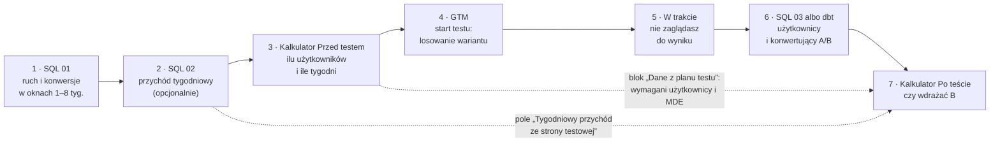

# ga4-ab-testing

SQL pod BigQuery (eksport GA4) do dwóch kalkulatorów testów A/B na pmdata.pl, plus skrypty GTM losujące wariant:

- [Przed testem](https://pmdata.pl/kalkulatory/wielkosc-proby-test-ab/) — ilu użytkowników potrzebujesz i ile tygodni potrwa test,
- [Po teście](https://pmdata.pl/kalkulatory/istotnosc-testu-ab/) — czy różnica jest istotna i jak duża może naprawdę być.

Scenariusz: e-commerce testuje kartę produktu, wejście do testu to `view_item`, konwersja to `purchase`. Metryka: konwersja albo przychód na użytkownika (`01` i `03` zwracają jego średnią i odchylenie, przychód osoby przycięty do 99,9 percentyla). Zapytania zwracają kolumny do kalkulatora, `03` także kontrolę jakości (`excluded_mixed`, `reassigned`, `no_assignment`); przykład wyniku na końcu pliku.

| Folder | Co tam jest |
|---|---|
| [`sql/`](sql/README.md) | zapytania `01`–`03`, opis pól obu kalkulatorów, zrzuty z BigQuery i kalkulatorów |
| [`gtm/`](gtm/README.md) | tagi losujące wariant |
| [`dbt/`](dbt/README.md) | wynik `03` dla wszystkich testów naraz, z testami danych, CI/CD i danymi syntetycznymi |

## Dwie ścieżki

Obie zaczynają się tak samo: [`01`](sql/01_przed_testem.sql) i [`02`](sql/02_przychod_tygodniowy.sql) dają ruch, konwersje i przychód, z których kalkulator Przed testem liczy, ilu użytkowników potrzebujesz i ile tygodni potrwa test (kroki 1–3), a GTM losuje wariant (krok 4). Różni się liczenie wyniku (krok 6):

| Ścieżka | Dla kogo | Co robisz | Co zyskujesz |
|---|---|---|---|
| Ręczna: GTM + SQL | analityk, który zna SQL i BigQuery, a nie zna dbt ani gita | przed testem `01`–`02`, po teście [`03`](sql/03_po_tescie_warianty.sql) z parametrami testu w `DECLARE` | **Trzy zapytania w konsoli BigQuery** dają komplet liczb do obu kalkulatorów, bez repo, CI i serwera; działa nawet w darmowym sandboxie BigQuery. **Wynik w polach kalkulatora:** kolumna `calculator_field` mówi, gdzie co wpisać, obok kontrola jakości (`excluded_mixed`, `reassigned`, `no_assignment`). **`ASSERT` zatrzymuje zapytanie przy złych parametrach:** start nie w poniedziałek, koniec nie w niedzielę albo mniej niż 3 dni temu, kontroli brak wśród wariantów, w danych wariant spoza listy. **Długość testu z danych:** `01` liczy ruch i konwersje w oknach od 1 do 8 tygodni. **Ta sama logika co dbt i kalkulator:** pierwsza ekspozycja, zamówienie raz na `transaction_id`, przychód osoby przycięty do 99,9 percentyla. |
| Automatyczna: GTM + SQL + dbt + GitHub Actions | analytics engineer: wynik testu A/B jako pipeline | przed testem `01`–`02`, potem test dopisujesz do [`rejestr_testow.csv`](dbt/seeds/rejestr_testow.csv), a harmonogram codziennie przelicza [`fct_wyniki_testow_ab`](dbt/models/marts/fct_wyniki_testow_ab.sql) dla wszystkich testów | **Nowy test to jeden wiersz w CSV:** wszystkie testy liczy ta sama logika, a błędna konfiguracja zatrzymuje build. **25 testów danych:** `unique`, `not_null`, unikalna para `id_testu` + `wariant`, SRM, komplet dziennych tabel GA4, poprawna konfiguracja testu; do tego 8 unit testów logiki. **Przyrost:** co dzień nadpisuje tylko ostatnie 3 dni (GA4 dopisuje dane do 72 h), liczone od najnowszej partycji, więc przerwa w harmonogramie nie zostawia dziury; staging trzyma tylko zdarzenia testów i konwersje, a nie cały eksport. **Limit kosztów:** `maximum_bytes_billed` (1 GiB w CI, 100 GiB na prod) — zapytanie ponad limit pada bez opłaty. **Na prod tylko sprawdzony kod:** harmonogram buduje z ostatniego commita z zielonym CI, a CI/CD wdraża tylko zmienione modele i to, co od nich zależy. **Bez kluczy:** GitHub loguje się do GCP przez Workload Identity Federation. **Wynik ostateczny widać w danych:** `czy_koncowy` = 3 dni po końcu testu. |

Ścieżka automatyczna wymaga jednorazowej konfiguracji GCP i GitHuba: [krok po kroku](dbt/README.md#konfiguracja-gcp).

Wynik ścieżki automatycznej w [Data Studio](https://datastudio.google.com/reporting/c45c9272-2566-4ebf-a257-d2ed7ba516c0) (do kwietnia 2026 Looker Studio): rejestr testów i `fct_wyniki_testow_ab` z opisem, co wpisać do kalkulatora. Liczby z danych syntetycznych; raport skopiujesz i podepniesz pod własne tabele.

## Kroki

1. **Przed testem** · [`01`](sql/01_przed_testem.sql) — wiersz z planowaną liczbą tygodni: Użytkownicy i Konwertujący w tygodniu.
2. **Przed testem** · [`02`](sql/02_przychod_tygodniowy.sql) — średnia albo mediana (przy piku sezonowym): Tygodniowy przychód ze strony testowej (opcjonalnie).
3. **Przed testem** · kalkulator — pozostałe pola ([opis](sql/README.md#kalkulator-przed-testem)); inny czas testu → wiersz `01` z tym czasem.
4. **Start testu** · GTM — tag losujący ([`gtm/`](gtm/README.md)) publikujesz w poniedziałek, bo `03` liczy pełne tygodnie. Ścieżka dbt: przed startem dopisujesz test do rejestru.
5. **W trakcie** — nie zaglądasz do wyniku. Jak z monetą: licząc orły po każdym rzucie i przerywając przy przewadze, prędzej czy później „udowodnisz”, że uczciwa moneta jest krzywa.
6. **Po teście** · [`03`](sql/03_po_tescie_warianty.sql) albo wiersze testu z `czy_koncowy = true` w `fct_wyniki_testow_ab` — najwcześniej 3 dni po końcu testu (GA4 dopisuje dane do 72 h): Użytkownicy A/B, Konwertujący A/B.
7. **Po teście** · kalkulator — w Dane z planu testu wymagani użytkownicy na wariant i MDE z kroku 3; zapisz je, bo „Wstaw z planu” działa tylko w tej samej karcie, a test trwa tygodnie. Przychód z kroku 2, bez ponownego `02`: w okresie testu zmienia go już wariant B.
