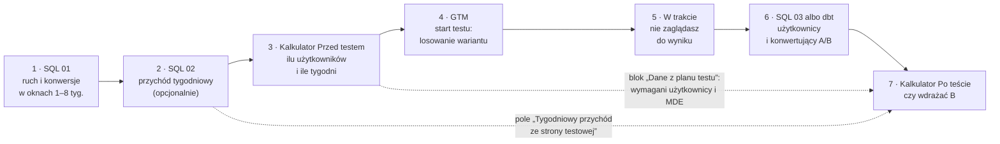
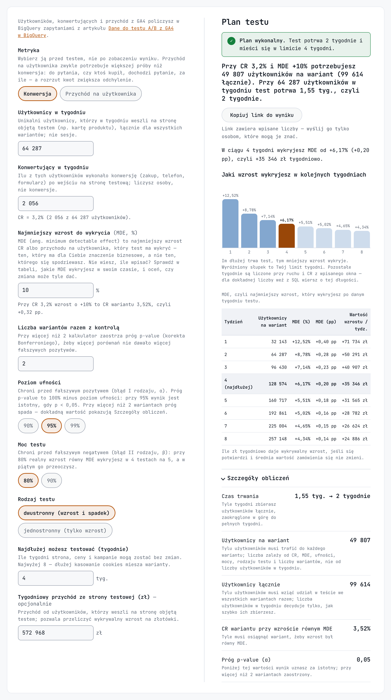
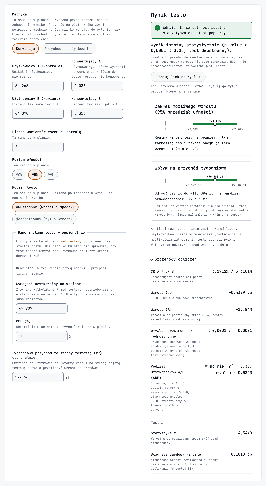

# ga4-ab-testing-template

Testy A/B na eksporcie GA4 w BigQuery: tagi GTM losują wariant, SQL i dbt liczą liczby do kalkulatorów [Przed testem](https://pmdata.pl/kalkulatory/wielkosc-proby-test-ab/?utm_source=github&utm_medium=referral) i [Po teście](https://pmdata.pl/kalkulatory/istotnosc-testu-ab/?utm_source=github&utm_medium=referral).

| Ścieżka | Co robisz | Dla kogo |
|---|---|---|
| Ręczna: GTM + SQL | przed testem `sql/01` i `02`, po teście `sql/03` z parametrami testu w `DECLARE`, wszystko w konsoli BigQuery | analityk, który zna SQL i BigQuery, a nie zna dbt ani gita |
| Automatyczna: GTM + SQL + dbt + GitHub Actions | przed testem `sql/01` i `02`, potem wiersz w `rejestr_testow.csv`; harmonogram codziennie przelicza `fct_wyniki_testow_ab` dla wszystkich testów | analytics engineer: 25 testów danych (klucze, SRM, komplet dziennych tabel GA4, konfiguracja testu), 8 unit testów logiki, CI/CD wdraża tylko zmienione modele, GitHub loguje się do GCP bez kluczy |

Obie ścieżki liczą tak samo: użytkownik wchodzi do testu przy pierwszej ekspozycji, konwersja liczy się dopiero po niej, zamówienie raz na `transaction_id`, przychód osoby jest przycięty do 99,9 percentyla, a `(not set)` i pusty tekst to NULL.

## Wymagania

- Projekt GCP z włączonym billingiem. BigQuery bez billingu nie wystarczy ścieżce automatycznej: staging nadpisuje partycje (`insert_overwrite`), a bez billingu BigQuery nie ma DML ([ograniczenia](https://docs.cloud.google.com/bigquery/docs/sandbox#limitations)).
- Usługa GA4 z uprawnieniem edytora i konto z rolą Owner w projekcie GCP — tego wymaga [połączenie z BigQuery](https://support.google.com/analytics/answer/9823238).
- Kontener GTM (web) na stronie, na której testujesz.
- Ścieżka automatyczna: konto GitHub, [uv](https://docs.astral.sh/uv/) i [gcloud](https://cloud.google.com/sdk/docs/install).

## 1. Eksport GA4 do BigQuery

1. W GA4: Admin → Product Links → BigQuery Links → Link. Wybierz projekt GCP i lokalizację danych, zaznacz eksport **dzienny** ([instrukcja Google](https://support.google.com/analytics/answer/9823238)).
2. Zapisz lokalizację (np. `EU`). Ta sama musi trafić do `profiles.yml` w ścieżce automatycznej. Lokalizacji nie zmienisz bez usunięcia połączenia i zbioru danych.
3. GA4 tworzy zbiór `analytics_<ID usługi>`, a w nim co dzień tabelę `events_YYYYMMDD` z poprzedniego dnia ([schemat eksportu](https://support.google.com/analytics/answer/7029846)).

Eksport nie ma danych wstecz: pierwsze dane przychodzą do 24 h po połączeniu, starszych dni w BigQuery nie będzie. Test i ruch do planu (`sql/01`) policzysz najwcześniej od dnia połączenia.

Sprawdzenie, dzień po połączeniu, w konsoli BigQuery:

```sql
SELECT table_name
FROM `twoj-projekt.analytics_123456789.INFORMATION_SCHEMA.TABLES`
WHERE table_name LIKE 'events_%'
ORDER BY table_name DESC
```

Powinieneś zobaczyć co najmniej jedną tabelę `events_YYYYMMDD`.

## 2. GTM: losowanie wariantu

Model: jeden tag Custom HTML na slot (`ab1`–`ab10`), zmienna „Własny plik cookie” `abN` i event `ab_assign` w GA4.

| Plik | Co robi |
|---|---|
| [`gtm/01_dwa_warianty.html`](gtm/01_dwa_warianty.html) | `v0`/`v1` po 50% |
| [`gtm/02_trzy_warianty.html`](gtm/02_trzy_warianty.html) | `v0`/`v1`/`v2` po 1/3 |
| [`gtm/03_dwa_warianty_50_procent.html`](gtm/03_dwa_warianty_50_procent.html) | połowa ruchu w teście, reszta dostaje `out` i nie wchodzi do analizy |
| [`gtm/04_rozszerzenie_do_100_procent.html`](gtm/04_rozszerzenie_do_100_procent.html) | zamiast `03` w tym samym tagu: przydziały zostają, `out` i nowi dostają wariant |

Tag losuje wariant raz, zapisuje go w first-party cookie `abN` na 60 dni i wysyła do `dataLayer` event `ab_assign` z `ab_test` i `ab_variant`. W kodzie tagu ustawiasz `TEST` (slot) i `VARIANTS`.

1. **Tag Custom HTML** z pliku `gtm/`, z wyzwalaczem na stronie testowej (np. karta produktu). Advanced Settings → Consent Settings → „Require additional consent for tag to fire”: `analytics_storage` ([ustawienia zgody w GTM](https://support.google.com/tagmanager/answer/10718549)). Tag zapisuje cookie i wysyła dane do GA4, więc bez zgody nie może się odpalić.
2. **Zmienne typu Data Layer Variable** `ab_test` i `ab_variant`, **wyzwalacz Custom Event** `ab_assign` ([dataLayer w GTM](https://developers.google.com/tag-platform/tag-manager/datalayer)) i **tag zdarzenia GA4** `ab_assign` z parametrami `ab_test` i `ab_variant`.
3. **Zmienna „Własny plik cookie”** o nazwie `abN` (np. `ab1`) jako parametr zdarzenia `abN` we wszystkich tagach zdarzeń GA4 lejka: ekspozycji (np. `view_item`) i konwersji (np. `purchase`). Dodaj ją w polu ustawień zdarzenia każdego tagu, nie licz na dziedziczenie z tagu Google.
4. **Publikacja w poniedziałek** — `sql/03` i dbt liczą pełne tygodnie.

Sprawdzenie:

- Podgląd GTM bez zgody: tag testu się nie odpala, w przeglądarce nie ma cookie `abN`, a w `dataLayer` eventu `ab_assign`.
- Podgląd po zgodzie: tag się odpala, w przeglądarce jest cookie `abN` z wariantem, a w GA4 DebugView event `ab_assign`.
- Dzień później w eksporcie:

```sql
SELECT event_name, COUNT(*) AS events
FROM `twoj-projekt.analytics_123456789.events_*`
WHERE _TABLE_SUFFIX = FORMAT_DATE('%Y%m%d', CURRENT_DATE() - 1)
  AND (event_name = 'ab_assign'
    OR EXISTS (SELECT 1 FROM UNNEST(event_params) WHERE key = 'ab1'))
GROUP BY event_name
```

Powinieneś zobaczyć `ab_assign` i eventy lejka z parametrem `ab1`.

Ograniczenia: najwyżej 10 testów naraz (sloty `ab1`–`ab10`; GA4 przyjmuje 25 parametrów na event). Safari skraca cookie zapisane z JavaScriptu do 7 dni, także `_ga` — skutki pokazują kolumny jakości z `sql/03` i dbt.

## 3. Plan testu: `sql/01` i `sql/02`

Oba pliki uruchamiasz w konsoli BigQuery przed startem. W każdym podmień tabelę `twoj-projekt.analytics_123456789.events_*` (dwa miejsca) i ustaw `DECLARE` na górze. `ASSERT` zatrzyma zapytanie przy złej dacie albo brakującej dziennej tabeli.

| Plik | `DECLARE` | Do kalkulatora Przed testem |
|---|---|---|
| [`sql/01_przed_testem.sql`](sql/01_przed_testem.sql) | `window_start` — poniedziałek, `test_start` minus 7 × `max_weeks` dni; `max_weeks` — ile tygodni okna (1–8); `test_start` — poniedziałek startu testu | wiersz z planowaną liczbą tygodni: `users_per_week` → Użytkownicy w tygodniu, `converters_per_week` → Konwertujący w tygodniu; przy metryce przychodu `revenue_per_user` i `revenue_sd` |
| [`sql/02_przychod_tygodniowy.sql`](sql/02_przychod_tygodniowy.sql) | `window_end` — niedziela przed startem; `window_weeks` — tyle co `max_weeks` | `weekly_revenue` → Tygodniowy przychód ze strony testowej; przy piku w oknie (np. Black Friday) `weekly_revenue_median` |

Zapytania liczą test karty produktu: wejście `view_item`, konwersja `purchase`. Inny lejek = inne nazwy eventów w `WHERE`.

## 4. Ścieżka ręczna: `sql/03` po teście

[`sql/03_po_tescie_warianty.sql`](sql/03_po_tescie_warianty.sql) uruchamiasz najwcześniej 3 dni po końcu testu — GA4 dopisuje dane do 72 h, a `ASSERT` nie wpuści wcześniej. W `DECLARE` ustaw `test_start` (poniedziałek), `test_end` (niedziela), `test_name` (slot), `control_variant`, `variants`, `conversion_event` i `exposure_events`.

Wynik ma wiersz na wariant. `users` i `converters` idą do pól Użytkownicy i Konwertujący A/B, przy metryce przychodu dochodzą `revenue_per_user` i `revenue_sd`. Kolumny `reassigned`, `excluded_mixed` i `no_assignment` nie idą do kalkulatora:

- `reassigned` (zostają, poza `excluded_mixed`): osoby, którym losowanie wariantu odbyło się drugi raz, bo przeglądarka usunęła ciasteczko z wariantem (np. ręcznie), a identyfikator Google Analytics został. To łączna skala tego problemu. Kto za drugim razem wylosował ten sam wariant, zostaje w wyniku.
- `excluded_mixed` (wypadają): część osób z `reassigned`, którym za drugim razem wypadł inny wariant, czyli widziały obie wersje strony. Nie wiadomo, która wersja zadziałała, więc nie wliczamy ich do `users` i `converters`.
- `no_assignment` (zostają): osoby, których wariant znamy z ciasteczka, ale nie mamy zapisu samego losowania. Najczęściej usunęły identyfikator Google Analytics i wróciły jako „nowa” osoba z tym samym wariantem (liczą się wtedy podwójnie) albo zapis losowania zablokował adblock lub zamknięcie strony.

## 5. Ścieżka automatyczna: dbt i GitHub Actions

### 5.1. Repo z szablonu

Na stronie tego repo: **Use this template** → Create a new repository → widoczność **Private** ([instrukcja GitHuba](https://docs.github.com/en/repositories/creating-and-managing-repositories/creating-a-repository-from-a-template)). Repo z szablonu startuje od jednego commita i może być prywatne; fork publicznego repo zawsze jest publiczny.

Powinieneś zobaczyć własne repo z plikami szablonu i zakładką Actions z workflow `dbt CI/CD`, `dbt schedule` i `dbt docs`. W repo prywatnym `dbt docs` się pomija — GitHub Pages na koncie Free działa tylko dla repo publicznych.

### 5.2. Konfiguracja dbt

1. W [`dbt/dbt_project.yml`](dbt/dbt_project.yml) ustaw `vars`: `ga4_projekt` (projekt eksportu GA4), `ga4_zbior_danych` (`analytics_<ID usługi>`) i `ga4_data_startu` (najwcześniejszy `start_testu` z rejestru; od tego dnia czyta pełny rebuild).
2. W [`dbt/profiles.yml.example`](dbt/profiles.yml.example) wpisz projekt w targecie `dev` i ustaw `location` wszystkich targetów na lokalizację zbioru GA4.
3. W [`dbt/seeds/rejestr_testow.csv`](dbt/seeds/rejestr_testow.csv) zastąp przykładowy wiersz swoim testem. Listy rozdziela `|`:

```csv
slot,start_testu,koniec_testu,wariant_kontrolny,warianty,zdarzenie_konwersji,zdarzenia_ekspozycji
ab1,2027-01-04,2027-01-17,v0,v0|v1,purchase,ab_assign|view_item
```

`slot` = `TEST` w tagu, `warianty` = `VARIANTS`. Test `sprawdz_konfiguracje_testow` zatrzyma build, gdy start nie jest poniedziałkiem, koniec niedzielą, kontroli brak na liście wariantów albo slot wraca wcześniej niż 60 dni po poprzednim teście (tyle żyje cookie).

4. Lokalnie, w `dbt/`:

```bash
uv sync
cp profiles.yml.example profiles.yml
gcloud auth application-default login
uv run dbt deps
uv run dbt build --target dev --profiles-dir .
```

Powinieneś zobaczyć `Completed successfully` i tabelę `fct_wyniki_testow_ab` w zbiorze `dbt_dev_testy_ab`. `profiles.yml` jest w `.gitignore`.

### 5.3. GCP: konto serwisowe i Workload Identity Federation

GitHub Actions loguje się do BigQuery krótkotrwałym tokenem przez [Workload Identity Federation](https://github.com/google-github-actions/auth#workload-identity-federation-through-a-service-account), bez pliku klucza w sekretach.

```bash
PROJECT=twoj-projekt
PROJECT_NUMBER=$(gcloud projects describe $PROJECT --format='value(projectNumber)')
REPO=twoj-login/twoje-repo
SA=dbt-prod@$PROJECT.iam.gserviceaccount.com

gcloud services enable iam.googleapis.com sts.googleapis.com iamcredentials.googleapis.com --project=$PROJECT

gcloud iam service-accounts create dbt-prod --project=$PROJECT
for ROLE in roles/bigquery.jobUser roles/bigquery.dataEditor; do
  gcloud projects add-iam-policy-binding $PROJECT --member=serviceAccount:$SA --role=$ROLE
done

gcloud iam workload-identity-pools create github --project=$PROJECT --location=global
gcloud iam workload-identity-pools providers create-oidc github --project=$PROJECT \
  --location=global --workload-identity-pool=github \
  --issuer-uri=https://token.actions.githubusercontent.com \
  --attribute-mapping=google.subject=assertion.sub,attribute.repository=assertion.repository \
  --attribute-condition="assertion.repository=='$REPO'"

gcloud iam service-accounts add-iam-policy-binding $SA --project=$PROJECT \
  --role=roles/iam.workloadIdentityUser \
  --member=principalSet://iam.googleapis.com/projects/$PROJECT_NUMBER/locations/global/workloadIdentityPools/github/attribute.repository/$REPO
```

`bigquery.jobUser` uruchamia zapytania, `bigquery.dataEditor` tworzy i nadpisuje tabele ([role BigQuery](https://docs.cloud.google.com/bigquery/docs/access-control)). `attribute-condition` wpuszcza tokeny tylko z Twojego repo. Eksport GA4 w innym projekcie: `dbt-prod` dostaje tam `roles/bigquery.dataViewer` na zbiorze `analytics_<ID usługi>`.

Sprawdzenie: `gcloud iam service-accounts get-iam-policy $SA` pokazuje `roles/iam.workloadIdentityUser` dla `principalSet` z Twoim repo.

### 5.4. Sekrety GitHuba

Settings → Secrets and variables → Actions, albo z terminala:

```bash
gh secret set GCP_WORKLOAD_IDENTITY_PROVIDER --body "projects/$PROJECT_NUMBER/locations/global/workloadIdentityPools/github/providers/github"
gh secret set GCP_SERVICE_ACCOUNT --body "$SA"
gh secret set BIGQUERY_PROD_PROJECT --body "$PROJECT"
```

### 5.5. Pierwszy przebieg

1. Commit i push zmian z 5.2 na `main`. Workflow `dbt CI/CD` robi `parse`, `unit-tests` (unit testy na pustych tabelach w `dbt_ci_testy_ab`) i `deploy` (pierwszy buduje cały projekt w `dbt_prod_testy_ab`). Powinieneś zobaczyć trzy zielone joby.
2. Actions → `dbt schedule` → Run workflow. Harmonogram buduje kod z ostatniego commita z zielonym CI, więc bez kroku 1 padnie.
3. W BigQuery:

```sql
SELECT id_testu, pole_kalkulatora, uzytkownicy, konwertujacy, czy_koncowy
FROM `twoj-projekt.dbt_prod_testy_ab.fct_wyniki_testow_ab`
ORDER BY id_testu, wariant
```

Powinieneś zobaczyć wiersz na każdy wariant z rejestru. Do kalkulatora bierz tylko wiersze z `czy_koncowy = true` (od końca testu minęły 3 dni).

Zmiana logiki `stg_ga4__zdarzenia`, nowy `zdarzenie_konwersji` albo wcześniejszy `ga4_data_startu` wymagają pełnego rebuildu: Actions → `dbt schedule` → Run workflow z zaznaczonym `full_refresh`. Deploy pomija zmieniony staging i ostrzega o tym w logu.

### 5.6. Utrzymanie

- Harmonogram rusza codziennie o 3:17 czasu polskiego. Godzinę (`cron`) i strefę (`timezone`) zmieniasz w [`.github/workflows/dbt-schedule.yml`](.github/workflows/dbt-schedule.yml).
- Koszt zapytań ograniczają limity `maximum_bytes_billed` w `profiles.yml`: 10 GiB `dev`, 1 GiB `ci`, 100 GiB `prod_ci`. Zapytanie ponad limit pada bez opłaty.
- Repo publiczne: GitHub wyłącza zaplanowane workflow po 60 dniach bez aktywności w repo ([docs GitHuba, `schedule`](https://docs.github.com/en/actions/reference/workflows-and-actions/events-that-trigger-workflows#schedule)) i codzienny `dbt build` staje bez komunikatu. Poznasz to po braku nowych przebiegów `dbt schedule` w zakładce Actions. Włączasz go z powrotem w Actions → `dbt schedule` → Enable workflow albo `gh workflow enable dbt-schedule.yml` ([instrukcja](https://docs.github.com/en/actions/how-tos/manage-workflow-runs/disable-and-enable-workflows)). W repo prywatnym tej reguły nie ma.

## 6. Dokumentacja dbt

[pmackowka.github.io/ga4-ab-testing-template](https://pmackowka.github.io/ga4-ab-testing-template/) — graf lineage, opisy modeli i kolumn oraz SQL modeli (z Jinja, bez typów kolumn). W prywatnej kopii oglądasz ją lokalnie:

```bash
uv run dbt docs generate --target dev --profiles-dir .
uv run dbt docs serve --profiles-dir . --port 8080
```

## 7. Raport Data Studio

[Szablon raportu](https://datastudio.google.com/reporting/c45c9272-2566-4ebf-a257-d2ed7ba516c0/page/U4ADG) pokazuje rejestr testów i `fct_wyniki_testow_ab` z opisem, co wpisać do kalkulatora. Dziś stoi na danych przykładowych z Arkuszy Google.

1. Otwórz raport → menu w prawym górnym rogu → Make a copy ([kopiowanie raportu](https://docs.cloud.google.com/looker/docs/studio/copy-a-report)).
2. W oknie „Create new report” po prawej wybierz albo utwórz nowe źródła BigQuery w miejsce obu oryginalnych: `fct_wyniki_testow_ab` i `rejestr_testow` z Twojego zbioru `dbt_prod_testy_ab`.
3. Kliknij Create report i sprawdź obie tabele. Powinieneś zobaczyć swoje testy we wszystkich kolumnach. Pusta kolumna albo błąd w wykresie znaczy, że nazwa pola w nowym źródle się nie zgadza.

## 8. Kroki testu



1. **Przed testem** · `sql/01` — wiersz z planowaną liczbą tygodni: Użytkownicy i Konwertujący w tygodniu.
2. **Przed testem** · `sql/02` — Tygodniowy przychód ze strony testowej (opcjonalnie).
3. **Przed testem** · [kalkulator Przed testem](https://pmdata.pl/kalkulatory/wielkosc-proby-test-ab/?utm_source=github&utm_medium=referral) — wyszedł inny czas testu? Weź wiersz `01` z tym czasem i przelicz.
4. **Start testu** · GTM — tag publikujesz w poniedziałek. W ścieżce automatycznej wcześniej dopisujesz test do rejestru.
5. **W trakcie** — nie zaglądasz do wyniku. Zatrzymanie testu przy pierwszej istotnej różnicy prędzej czy później „udowodni” efekt, którego nie ma.
6. **Po teście** · `sql/03` albo wiersze z `czy_koncowy = true` w `fct_wyniki_testow_ab` — najwcześniej 3 dni po końcu testu.
7. **Po teście** · [kalkulator Po teście](https://pmdata.pl/kalkulatory/istotnosc-testu-ab/?utm_source=github&utm_medium=referral) — w „Dane z planu testu” wpisz wymaganych użytkowników na wariant i MDE z kroku 3. Zapisz je przed startem: „Wstaw z planu” działa tylko w tej samej karcie przeglądarki, a test trwa tygodnie. Przychód bierz z kroku 2, nie licz `02` ponownie — w okresie testu zmienia go już wariant B.

### Kalkulator Przed testem



- **Metryka** — konwersja (CR) mówi, czy więcej osób kupuje; przychód na użytkownika (RPU) łapie też zmianę koszyka, ale potrzebuje więcej użytkowników. Wybierasz przed startem i tę samą bierzesz do oceny.
- **MDE** — najmniejszy wzrost wart czasu testu, względny: +15% przy CR 2% to +0,30 pp.
- **Poziom ufności i moc** — ufność chroni przed fałszywym alarmem, moc przed przeoczeniem efektu. Wyższe = dłuższy test.
- **Liczba wariantów z kontrolą** — przy 3+ próg p-value to α / (k − 1) (Bonferroni).
- **Rodzaj testu** — jednostronny wymaga mniej użytkowników, ale nie wykaże, że wariant szkodzi.
- **Limit tygodni** — najwyżej 8 pełnych tygodni: dłużej kasowanie cookies miesza warianty.

### Kalkulator Po teście



- **Użytkownicy i Konwertujący A/B** — `users` i `converters` z `sql/03` albo `uzytkownicy` i `konwertujacy` z dbt. Przy RPU przychód i odchylenie na wariant.
- **Dane z planu (opcjonalne)** — wymagani użytkownicy na jeden wariant i MDE. Z nimi kalkulator wstrzyma decyzję, gdy test zatrzymano przed 95% planu albo przedłużono ponad 125%.
- **p-value i zakres możliwego wzrostu** — zakres obejmujący zero znaczy, że może być wzrost, brak zmiany albo spadek.
- **SRM** — czy A i B dostały po równo; alarm przy p < 0,001 znaczy błąd losowania albo danych i wyniku nie interpretujesz.
- **Wpływ na przychód** — przychód tygodniowy × zakres wzrostu; do budżetu bierz dolną granicę.

## Odpowiedzialność

Kod udostępniam „tak jak jest”, bez żadnych gwarancji, a autor nie odpowiada za szkody wynikłe z jego użycia — pełne brzmienie w [`LICENSE`](LICENSE).

Repo samo nie zbiera ani nie przechowuje danych osób odwiedzających stronę. Dane powstają dopiero w Twoim wdrożeniu: w Twoim kontenerze GTM, usłudze GA4 i projekcie BigQuery. Tag testu zapisuje w przeglądarce first-party cookie `abN` z wariantem i wysyła event `ab_assign` do GA4, więc podlega tej samej zgodzie co analityka.

Za wdrożenie odpowiadasz Ty, w szczególności za to, żeby tagi GTM i zdarzenia analityczne odpalały się tylko u osób, które wyraziły zgodę (RODO, ePrivacy, Consent Mode), za koszty BigQuery i za decyzje biznesowe podjęte na podstawie wyników. To nie jest porada prawna.

## Wdrożenie u Ciebie

Chcesz testy A/B na własnym GA4 bez samodzielnej konfiguracji GTM, GCP i GitHub Actions? Wdrażam to jako usługę: [pmdata.pl](https://pmdata.pl/?utm_source=github&utm_medium=referral).

---

Autor: Piotr Maćkówka · [pmdata.pl](https://pmdata.pl/?utm_source=github&utm_medium=referral) · [licencja MIT](LICENSE)
