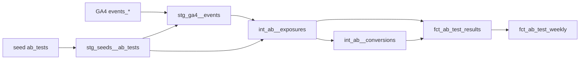
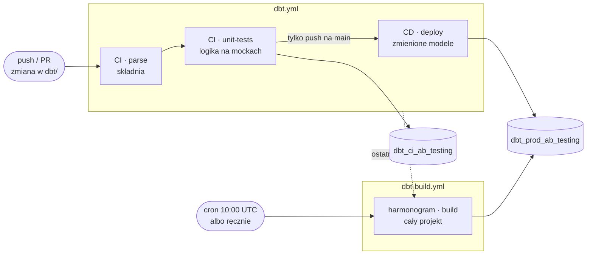

# dbt — wyniki testów A/B

To samo co [`sql/03`](../sql/03_po_tescie_warianty.sql), ale dla wszystkich testów naraz: konfiguracja w seedzie zamiast `DECLARE`, testy danych zamiast `ASSERT`. Tagowanie i kalkulatory: [README główne](../README.md).

## Uruchomienie

Wymaga [uv](https://docs.astral.sh/uv/) i konta serwisowego z rolami BigQuery Data Viewer (GA4), Data Editor (dataset docelowy) i Job User.

```bash
cd dbt
uv sync                                  # Python 3.11 + dbt-bigquery 1.12.0 z uv.lock
cp profiles.yml.example profiles.yml     # profiles.yml jest w .gitignore
export BIGQUERY_PROJECT="twoj-projekt-gcp"
export BIGQUERY_KEYFILE="/sciezka/poza/repo/service-account.json"
uv run dbt deps
uv run dbt build --profiles-dir .
```

Przed pierwszym uruchomieniem ustaw w `dbt_project.yml`:

| Zmienna / pole | Co wpisać |
|---|---|
| `vars.ga4_project`, `vars.ga4_dataset` | projekt i dataset eksportu GA4 (`events_YYYYMMDD`) |
| `vars.ga4_start_date` | najwcześniejszy `test_start` z seeda — od tego dnia czyta `--full-refresh` |
| `location` w `profiles.yml` | region datasetu GA4 (domyślnie `EU`) |

Target `prod` ma osobne zmienne (`BIGQUERY_PROD_*`) bez fallbacku na dev. W dev tabele wygasają po godzinie, z wyjątkiem `stg_ga4__events`.

## Pliki

✍ piszesz ręcznie, ⚙ generuje komenda (nie edytujesz).

```
dbt/
├── pyproject.toml          ✍                wersja Pythona i dbt-bigquery dla uv
├── .python-version         ✍                wersja interpretera (3.11)
├── uv.lock                 ⚙ uv lock        pełne drzewo pakietów Pythona z pyproject.toml
├── .venv/                  ⚙ uv sync        środowisko Pythona z dbt, odtworzone z uv.lock (poza gitem)
├── dbt_project.yml         ✍                nazwa projektu, zmienne GA4, materializacje folderów
├── profiles.yml.example    ✍                szablon połączenia z BigQuery
├── profiles.yml            ✍ cp z .example  Twoje połączenie (poza gitem)
├── packages.yml            ✍                pakiety makr dbt (dbt_utils)
├── package-lock.yml        ⚙ dbt deps       dokładne wersje pakietów z packages.yml
├── dbt_packages/           ⚙ dbt deps       pobrane pakiety dbt (poza gitem)
├── target/                 ⚙ dbt parse/build skompilowany SQL i manifest (poza gitem)
├── .gitignore              ✍                co nie trafia do gita
├── seeds/                  ✍                rejestr testów ab_tests.csv i jego opis
├── models/                 ✍                modele SQL, ich opisy, testy i unit testy (.yml)
└── tests/                  ✍                testy singularne i generyczny variant_in_seed
```

## Rejestr testów: `seeds/ab_tests.csv`

Wiersz = test; nowy test to nowy wiersz + `dbt build`. Listy rozdziela `|`.

```csv
test_name,test_start,test_end,control_variant,variants,conversion_event,exposure_events
ab3,2026-11-02,2026-12-13,v0,v0|v1,purchase,ab_assign|view_item
ab4,2026-11-02,2026-11-29,v0,v0|v1,purchase,ab_assign|begin_checkout
```

`test_name` to slot `ab1`–`ab10`, który wraca w kolejnych testach, więc kluczem jest `test_id` = slot + `test_start` (np. `ab1_20260907`); `test_start` jako RRRRMMDD to `RUN` w tagu GTM. Ekspozycję wyznacza `exposure_events`: `view_item` z parametrem `ab4` nie wciąga nikogo do testu checkoutu.

`assert_ab_tests_config_valid` zatrzyma build, gdy start nie jest poniedziałkiem albo koniec niedzielą, kontroli nie ma wśród wariantów, wariantów jest mniej niż dwa, test zaczyna się przed `ga4_start_date`, `test_name` nie ma postaci `abN` albo okno nakłada się na poprzedni test w tym samym slocie.

## Modele



| Model | Ziarno | Materializacja | Rola |
|---|---|---|---|
| `stg_ga4__events` | event × test | incremental, partycja dzienna | para (slot, wariant) z `ab_assign` albo parametru `abN` + eventy konwersji z seeda |
| `stg_seeds__ab_tests` | test | view | seed z `test_id`, listami jako `ARRAY<STRING>` i flagą `is_final` |
| `int_ab__exposures` | test × użytkownik | view | pierwsza ekspozycja, jej wariant, `variants_seen`, `mixed_date` |
| `int_ab__conversions` | test × użytkownik | view | pierwsza konwersja po ekspozycji, w oknie testu |
| `fct_ab_test_results` | test × wariant | table, kontrakt | liczby do kalkulatora Po teście |
| `fct_ab_test_weekly` | test × wariant × tydzień | table | te same liczby narastająco |

`fct_ab_test_results` ma wiersz dla każdego wariantu z seeda (także z 0 użytkowników) i dla wariantu spoza seeda, żeby testy go wyłapały. W `fct_ab_test_weekly` ponownie wylosowany trafia do `excluded_mixed` od tygodnia losowania.

## Przyrost i pełny rebuild

`stg_ga4__events` (`insert_overwrite`) nadpisuje ostatnie 3 dni od najnowszej partycji w tabeli, bo GA4 dopisuje dane do 72 h, a eksport nie ma klucza eventu do `merge`. Liczenie od partycji, nie od dziś, sprawia, że przerwa w harmonogramie nie zostawia dziury.

`--full-refresh -s stg_ga4__events` jest potrzebny, gdy:
- dodajesz `conversion_event`, którego nie ma jeszcze żaden test;
- przesuwasz `ga4_start_date` wstecz;
- zmieniasz plik stagingu — pilnuje tego strażnik: build zapisuje sumę kontrolną pliku w etykiecie tabeli (`logic_checksum`), a przebieg przyrostowy z inną sumą przerywa się błędem, zamiast zostawić mieszankę starej i nowej logiki. Zmiana samego komentarza też się liczy.

`maximum_bytes_billed`: 10 GiB dev, 100 GiB prod — zapytanie ponad limit pada bez opłaty.

## Testy

| Test | Ważność | Co łapie |
|---|---|---|
| `assert_ab_tests_config_valid` | error | błędna konfiguracja w seedzie |
| `assert_ga4_days_complete` | error | brak dziennej tabeli eksportu w oknie testu (do dziś − 3 dni) |
| `variant_in_seed` (generyczny) | error | wariant spoza seeda: inny tag albo literówka w zmiennej GTM |
| `assert_all_variants_have_users` | error | wariant z 0 użytkowników, gdy inne je mają |
| `assert_weekly_matches_results` | error | rozjazd ostatniego tygodnia z wynikiem końcowym |
| `assert_srm` | warn | para kontrola–wariant, χ² > 10,828 (p < 0,001), jak w kalkulatorze |
| `assert_excluded_mixed_balanced` | warn | różnica `excluded_mixed` względem kontroli > 2 × √(suma) |
| `unique_combination_of_columns`, `not_null` | error | klucze modeli |

Przy warn decyduje człowiek; parę wskaże `dbt test --select assert_srm --store-failures`.

Unit testy (`models/**/_*_unit_tests.yml`) sprawdzają na zamockowanych wierszach: ponowne losowanie, równoległe testy i ten sam slot w dwóch przebiegach, ekspozycję poza oknem, zakup przed ekspozycją, zdublowany `purchase`, wariant bez użytkowników. Typy kolumn biorą z modeli nadrzędnych, więc te muszą istnieć:

```bash
uv run dbt run --select +fct_ab_test_weekly --empty --profiles-dir .
uv run dbt test --select test_type:unit --profiles-dir .
```

## CI/CD i harmonogram



| Plik | Job | Rola | Wyzwalacz | Co robi |
|---|---|---|---|---|
| `dbt.yml` | `parse` | CI | push na `main` / PR zmieniający `dbt/` | `dbt parse`: SQL, Jinja, YAML, `ref()` — bez BigQuery |
| `dbt.yml` | `unit-tests` | CI | zielony `parse` | puste tabele (`--empty`) w `dbt_ci_ab_testing` + unit testy |
| `dbt.yml` | `deploy` | continuous deployment | zielony `unit-tests`, tylko push na `main` | `state:modified+` na prod: zmienione modele i wszystko za nimi, bez zmienionego `stg_ga4__events` |
| `dbt-build.yml` | `build` | harmonogram | cron 10:00 UTC albo ręcznie (opcja `full_refresh`) | cały projekt na prod z ostatniego commita, dla którego `dbt.yml` był zielony; bez unit testów |

- Czerwony job zatrzymuje kolejne, a harmonogram buduje ostatni zielony commit — prod zostaje na dobrym kodzie i dostaje świeże dane. Bez żadnego zielonego przebiegu harmonogram kończy się błędem.
- `deploy` i harmonogram dzielą grupę `concurrency: dbt-prod`: nigdy naraz, czeka najwyżej jeden przebieg, nowszy anuluje starszy oczekujący.
- Po zmianie `stg_ga4__events` deploy ją pomija z ostrzeżeniem, a harmonogram staje na strażniku, dopóki nie odpalisz Actions → dbt build → Run workflow → `full_refresh`.
- Continuous delivery (prod po kliknięciu „Approve”) to tylko benchmark: przy jednej osobie pushującej na `main` zatwierdzałbyś własny commit.
- Alternatywy: GitLab CI/CD i Bitbucket Pipelines (ten sam model YAML), dbt Cloud (wszystko wbudowane, płatny dla zespołu), Jenkins (własny serwer i wtyczki).

### Konfiguracja GCP

Jednorazowo dla CI, deployu i harmonogramu (`PROJECT` = projekt prod, `PROJECT_NUMBER` z `gcloud projects describe $PROJECT`):

```bash
# 1. konto serwisowe, z którego dbt buduje prod
gcloud iam service-accounts create dbt-prod --project=$PROJECT
SA=dbt-prod@$PROJECT.iam.gserviceaccount.com
for ROLE in roles/bigquery.jobUser roles/bigquery.dataEditor roles/bigquery.dataViewer; do
  gcloud projects add-iam-policy-binding $PROJECT --member=serviceAccount:$SA --role=$ROLE
done

# 2. Workload Identity: GCP ufa tokenom GitHuba, ale tylko z tego repo
gcloud iam workload-identity-pools create github --project=$PROJECT --location=global
gcloud iam workload-identity-pools providers create-oidc github --project=$PROJECT \
  --location=global --workload-identity-pool=github \
  --issuer-uri=https://token.actions.githubusercontent.com \
  --attribute-mapping=google.subject=assertion.sub,attribute.repository=assertion.repository \
  --attribute-condition="assertion.repository=='<owner>/ab-test-bigquery'"

# 3. workflow z tego repo może działać jako dbt-prod
gcloud iam service-accounts add-iam-policy-binding $SA --project=$PROJECT \
  --role=roles/iam.workloadIdentityUser \
  --member=principalSet://iam.googleapis.com/projects/$PROJECT_NUMBER/locations/global/workloadIdentityPools/github/attribute.repository/<owner>/ab-test-bigquery
```

| Sekret (Settings → Secrets and variables → Actions) | Wartość |
|---|---|
| `GCP_WORKLOAD_IDENTITY_PROVIDER` | `projects/PROJECT_NUMBER/locations/global/workloadIdentityPools/github/providers/github` |
| `GCP_SERVICE_ACCOUNT` | `dbt-prod@PROJECT.iam.gserviceaccount.com` |
| `BIGQUERY_PROD_PROJECT` | `PROJECT` |

Eksport GA4 w innym projekcie → `roles/bigquery.dataViewer` na tamtym datasecie.

## Niesprawdzone

Poza `dbt parse` nic jeszcze nie biegło — `unit-tests`, `deploy` i harmonogram czekają na WIF. Do potwierdzenia:
- czy `_dbt_max_partition` w filtrze na `_TABLE_SUFFIX` ogranicza czytane tabele (`total_bytes_billed` w `INFORMATION_SCHEMA.JOBS`);
- czy `flags.EMPTY` wyłącza filtry na `_TABLE_SUFFIX` pod `--empty`;
- czy strażnik logiki zapisuje etykietę w `post_hook` i czyta ją z `INFORMATION_SCHEMA.TABLE_OPTIONS`.
