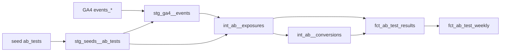

# dbt — wyniki testów A/B

Liczy to samo co [`sql/03`](../sql/03_po_tescie_warianty.sql), ale dla wszystkich testów naraz. Konfigurację testu zapisujesz w seedzie, nie w `DECLARE`, a zamiast `ASSERT` działają testy danych. Tagowanie, kalkulatory i znaczenie kolumn opisuje [README w katalogu głównym](../README.md).

## Uruchomienie

Wymaga [uv](https://docs.astral.sh/uv/) i konta serwisowego z rolami BigQuery Data Viewer na datasecie GA4, Data Editor na datasecie docelowym i Job User w projekcie.

```bash
cd dbt
uv sync                                  # Python 3.11 + dbt-bigquery 1.12.0 z uv.lock
cp profiles.yml.example profiles.yml     # profiles.yml jest w .gitignore
export BIGQUERY_PROJECT="twoj-projekt-gcp"
export BIGQUERY_KEYFILE="/sciezka/poza/repo/service-account.json"
uv run dbt deps
uv run dbt build --profiles-dir .
```

Przed pierwszym uruchomieniem ustaw w `dbt_project.yml`:

| Zmienna / pole | Co wpisać |
|---|---|
| `vars.ga4_project`, `vars.ga4_dataset` | projekt i dataset eksportu GA4 (`events_YYYYMMDD`) |
| `vars.ga4_start_date` | najwcześniejszy `test_start` z seeda — od tego dnia czyta `--full-refresh` |
| `location` w `profiles.yml` | region datasetu GA4 (domyślnie `EU`); BigQuery nie łączy danych między regionami |

Target `prod` ma osobne zmienne (`BIGQUERY_PROD_PROJECT`, `BIGQUERY_PROD_KEYFILE`) bez fallbacku na dev. W dev tabele wygasają po godzinie, z wyjątkiem `stg_ga4__events`.

## Pliki

```
dbt/
├── pyproject.toml          # wersja Pythona i dbt-bigquery, które instaluje uv — piszesz ręcznie
├── .python-version         # wersja interpretera Pythona (3.11) dla uv
├── uv.lock                 # pełne drzewo pakietów Pythona z wersjami; generuje `uv lock`, nie edytujesz
├── dbt_project.yml         # nazwa projektu, zmienne GA4 i domyślne materializacje folderów
├── profiles.yml.example    # szablon połączenia z BigQuery; kopia profiles.yml zostaje poza gitem
├── packages.yml            # pakiety makr dbt (dbt_utils) do pobrania przez `dbt deps`
├── package-lock.yml        # dokładna wersja pobranych pakietów dbt; generuje `dbt deps`
├── .gitignore              # wyklucza z gita .venv, target, dbt_packages i poświadczenia
├── seeds/
│   ├── ab_tests.csv        # rejestr testów A/B — jeden wiersz na test
│   └── _seeds.yml          # typy kolumn i opisy seeda
├── models/
│   ├── staging/ga4/        # źródło GA4 i stg_ga4__events — eventy testów i konwersji z eksportu
│   ├── staging/seeds/      # stg_seeds__ab_tests — seed z listami jako ARRAY
│   ├── intermediate/       # przypisania i konwersje na użytkownika + ich unit testy
│   └── marts/              # wynik do kalkulatora i wynik tygodniowy + ich unit testy
└── tests/
    ├── assert_*.sql        # testy singularne — każdy zwrócony wiersz to problem w danych
    └── generic/            # test variant_in_seed, używany w plikach .yml modeli
```

Poza `dbt/`: `.github/workflows/dbt.yml` uruchamia `dbt parse` przy każdym PR. Lokalnie powstają też `.venv/` (środowisko Pythona z `uv sync`), `dbt_packages/` (z `dbt deps`) i `target/` (skompilowany SQL) — żadnego z nich nie ma w gicie.

## Rejestr testów: `seeds/ab_tests.csv`

Jeden wiersz to jeden test. Nowy test dodajesz nowym wierszem, a potem uruchamiasz `dbt build`. Listy rozdziela się znakiem `|`, bo CSV nie ma typu tablicowego.

```csv
test_name,test_start,test_end,control_variant,variants,conversion_event,exposure_events
ab1,2026-09-07,2026-10-04,v0,v0|v1,purchase,ab_assign|view_item
```

`assert_ab_tests_config_valid` zatrzyma build, gdy:
- `test_start` nie wypada w poniedziałek albo `test_end` nie wypada w niedzielę;
- kontroli nie ma na liście wariantów;
- wariantów jest mniej niż dwa;
- test zaczyna się przed `ga4_start_date`.

## Modele



| Model | Ziarno | Materializacja | Rola |
|---|---|---|---|
| `stg_ga4__events` | event | incremental, partycja dzienna | eventy z `ab_test` + eventy konwersji z seeda; bez pustego `user_pseudo_id` |
| `stg_seeds__ab_tests` | test | view | seed z listami jako `ARRAY<STRING>` i flagą `is_final` |
| `int_ab__exposures` | test × użytkownik | view | pierwsza ekspozycja, jej wariant, `variants_seen`, `mixed_date` |
| `int_ab__conversions` | test × użytkownik | view | pierwsza konwersja po ekspozycji, w oknie testu |
| `fct_ab_test_results` | test × wariant | table, kontrakt | liczby do kalkulatora Po teście |
| `fct_ab_test_weekly` | test × wariant × tydzień | table | te same liczby narastająco; ostatni tydzień = wynik końcowy |

`fct_ab_test_results` ma wiersz dla każdego wariantu z seeda, także gdy wariant ma 0 użytkowników. Ma też wiersz dla wariantu, który jest w danych, ale nie w seedzie — po to, żeby testy go wyłapały, a nie żeby zniknął po cichu. W `fct_ab_test_weekly` użytkownik wylosowany ponownie w tygodniu 3 liczy się w tygodniach 1–2 jako zwykły użytkownik, a od tygodnia 3 trafia do `excluded_mixed`.

## Przyrost i pełny rebuild

`stg_ga4__events` używa strategii `insert_overwrite`. Każdy przebieg nadpisuje ostatnie 3 dni licząc od najnowszej partycji w tabeli, bo GA4 dopisuje dane do 72 h, a eksport nie ma klucza eventu, który pozwoliłby na `merge`. Liczenie od najnowszej partycji, a nie od dzisiejszej daty, sprawia, że kilkudniowa przerwa w harmonogramie nie zostawia dziury.

`--full-refresh -s stg_ga4__events` jest potrzebny, gdy:
- dodajesz test z `conversion_event`, którego nie ma jeszcze żaden test — staging trzyma tylko znane eventy konwersji;
- przesuwasz `ga4_start_date` wstecz;
- zmieniasz logikę stagingu.

Limit kosztu: `maximum_bytes_billed` 10 GiB w dev, 100 GiB w prod. Zapytanie ponad limit pada bez opłaty. Przy dużym ruchu pełny rebuild może go przekroczyć — wtedy podnieś limit świadomie, zamiast go usuwać.

## Testy

| Test | Ważność | Co łapie |
|---|---|---|
| `assert_ab_tests_config_valid` | error | błędna konfiguracja w seedzie |
| `assert_ga4_days_complete` | error | brak dziennej tabeli eksportu w oknie testu (do dziś − 3 dni) |
| `variant_in_seed` (generyczny) | error | wariant w danych spoza seeda: inny tag albo literówka w zmiennej GTM |
| `assert_all_variants_have_users` | error | wariant z 0 użytkowników, gdy inne warianty ich mają |
| `assert_weekly_matches_results` | error | rozjazd między ostatnim tygodniem a wynikiem końcowym |
| `assert_srm` | warn | ta sama reguła co kalkulator: para kontrola–wariant, χ² > 10,828 (p < 0,001) |
| `assert_excluded_mixed_balanced` | warn | różnica `excluded_mixed` względem kontroli > 2 × √(suma) |
| `unique_combination_of_columns`, `not_null` | error | klucze modeli |

SRM i `excluded_mixed` mają ważność warn: build się kończy, a o tym, czy wynikowi ufać, decyduje człowiek. Wiersze z wynikiem testu pokazują, którą parę sprawdzić: `dbt test --select assert_srm --store-failures`.

Unit testy (`models/**/_*_unit_tests.yml`) sprawdzają logikę na zamockowanych wierszach:
- ponowne losowanie;
- ekspozycja poza oknem albo tylko na evencie spoza `exposure_events`;
- zakup przed ekspozycją;
- zdublowany `purchase`;
- wariant bez użytkowników;
- wykluczenie od tygodnia ponownego losowania.

Biegną w BigQuery bez czytania GA4. dbt bierze typy kolumn z modeli nadrzędnych, więc najpierw muszą one istnieć:

```bash
uv run dbt run --select +fct_ab_test_weekly --empty --profiles-dir .
uv run dbt test --select test_type:unit --profiles-dir .
```

## CI

[`.github/workflows/dbt.yml`](../.github/workflows/dbt.yml) uruchamia `uv sync --locked`, `dbt deps` i `dbt parse` przy każdym PR i pushu do `main`, który zmienia `dbt/`. Parse sprawdza SQL, Jinja, YAML i `ref()`, ale nie łączy się z BigQuery. Unit testy i `dbt build` w CI wymagają konta serwisowego przez Workload Identity Federation.

## Niesprawdzone

- Czy filtr przyrostowy na `_TABLE_SUFFIX` ze zmienną `_dbt_max_partition` ogranicza, ile tabel dziennych czyta BigQuery. Sprawdzisz to w `total_bytes_billed` drugiego przebiegu w `INFORMATION_SCHEMA.JOBS`.
- Unit testy i modele nie były jeszcze uruchomione na BigQuery — dotąd przechodzi tylko `dbt parse`.
