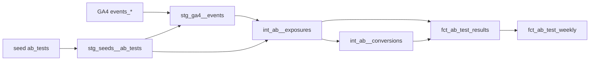

# dbt — wyniki testów A/B

Liczy to samo co [`sql/03`](../sql/03_po_tescie_warianty.sql), ale dla wszystkich testów naraz. Konfigurację testu zapisujesz w seedzie, nie w `DECLARE`, a zamiast `ASSERT` działają testy danych. Tagowanie, kalkulatory i znaczenie kolumn opisuje [README w katalogu głównym](../README.md).

## Uruchomienie

Wymaga [uv](https://docs.astral.sh/uv/) i konta serwisowego z rolami BigQuery Data Viewer na datasecie GA4, Data Editor na datasecie docelowym i Job User w projekcie.

```bash
cd dbt
uv sync                                  # Python 3.11 + dbt-bigquery 1.12.0 z uv.lock
cp profiles.yml.example profiles.yml     # profiles.yml jest w .gitignore
export BIGQUERY_PROJECT="twoj-projekt-gcp"
export BIGQUERY_KEYFILE="/sciezka/poza/repo/service-account.json"
uv run dbt deps
uv run dbt build --profiles-dir .
```

Przed pierwszym uruchomieniem ustaw w `dbt_project.yml`:

| Zmienna / pole | Co wpisać |
|---|---|
| `vars.ga4_project`, `vars.ga4_dataset` | projekt i dataset eksportu GA4 (`events_YYYYMMDD`) |
| `vars.ga4_start_date` | najwcześniejszy `test_start` z seeda — od tego dnia czyta `--full-refresh` |
| `location` w `profiles.yml` | region datasetu GA4 (domyślnie `EU`); BigQuery nie łączy danych między regionami |

Target `prod` ma osobne zmienne (`BIGQUERY_PROD_PROJECT`, `BIGQUERY_PROD_KEYFILE`) bez fallbacku na dev. W dev tabele wygasają po godzinie, z wyjątkiem `stg_ga4__events`.

## Pliki

Każdy plik albo piszesz ręcznie (✍), albo generuje go komenda (⚙) — wygenerowanego nie edytujesz.

```
dbt/
├── pyproject.toml          ✍                wersja Pythona i dbt-bigquery dla uv
├── .python-version         ✍                wersja interpretera (3.11)
├── uv.lock                 ⚙ uv lock        pełne drzewo pakietów Pythona z pyproject.toml
├── .venv/                  ⚙ uv sync        środowisko Pythona z dbt, odtworzone z uv.lock (poza gitem)
├── dbt_project.yml         ✍                nazwa projektu, zmienne GA4, materializacje folderów
├── profiles.yml.example    ✍                szablon połączenia z BigQuery
├── profiles.yml            ✍ cp z .example  Twoje połączenie (poza gitem)
├── packages.yml            ✍                pakiety makr dbt (dbt_utils)
├── package-lock.yml        ⚙ dbt deps       dokładne wersje pakietów z packages.yml
├── dbt_packages/           ⚙ dbt deps       pobrane pakiety dbt (poza gitem)
├── target/                 ⚙ dbt parse/build skompilowany SQL i manifest (poza gitem)
├── .gitignore              ✍                co nie trafia do gita
├── seeds/                  ✍                rejestr testów ab_tests.csv i jego opis
├── models/                 ✍                modele SQL, ich opisy, testy i unit testy (.yml)
└── tests/                  ✍                testy singularne i generyczny variant_in_seed
```

Kolejność: `pyproject.toml` → `uv lock` → `uv sync` → `packages.yml` → `uv run dbt deps` → modele → `uv run dbt build`.

## Rejestr testów: `seeds/ab_tests.csv`

Jeden wiersz to jeden test. Nowy test dodajesz nowym wierszem, a potem uruchamiasz `dbt build`. Listy rozdziela się znakiem `|`, bo CSV nie ma typu tablicowego.

```csv
test_name,test_start,test_end,control_variant,variants,conversion_event,exposure_events
ab3,2026-11-02,2026-12-13,v0,v0|v1,purchase,ab_assign|view_item
ab4,2026-11-02,2026-11-29,v0,v0|v1,purchase,ab_assign|begin_checkout
```

`test_name` to slot `ab1`–`ab10`, który wraca w kolejnych testach. Kluczem jest więc `test_id` = slot + `test_start` (np. `ab1_20260907`), a `test_start` w formacie RRRRMMDD to `RUN` w tagu GTM. Testy w różnych slotach mogą się nakładać, jak `ab3` i `ab4` wyżej. Ekspozycję wyznacza `exposure_events`: `view_item` z parametrem `ab4` nie wciąga nikogo do testu checkoutu.

`assert_ab_tests_config_valid` zatrzyma build, gdy:
- `test_start` nie wypada w poniedziałek albo `test_end` nie wypada w niedzielę;
- kontroli nie ma na liście wariantów;
- wariantów jest mniej niż dwa;
- test zaczyna się przed `ga4_start_date`;
- `test_name` nie ma postaci `abN`;
- okno nakłada się na poprzedni test w tym samym slocie.

## Modele



| Model | Ziarno | Materializacja | Rola |
|---|---|---|---|
| `stg_ga4__events` | event × test | incremental, partycja dzienna | para (slot, wariant) z `ab_assign` albo z każdego parametru `abN`, plus eventy konwersji z seeda; bez pustego `user_pseudo_id` |
| `stg_seeds__ab_tests` | test (`test_id`) | view | seed z kluczem `test_id`, listami jako `ARRAY<STRING>` i flagą `is_final` |
| `int_ab__exposures` | test × użytkownik | view | pierwsza ekspozycja, jej wariant, `variants_seen`, `mixed_date` |
| `int_ab__conversions` | test × użytkownik | view | pierwsza konwersja po ekspozycji, w oknie testu |
| `fct_ab_test_results` | test × wariant | table, kontrakt | liczby do kalkulatora Po teście |
| `fct_ab_test_weekly` | test × wariant × tydzień | table | te same liczby narastająco; ostatni tydzień = wynik końcowy |

`fct_ab_test_results` ma wiersz dla każdego wariantu z seeda, także gdy wariant ma 0 użytkowników. Ma też wiersz dla wariantu, który jest w danych, ale nie w seedzie — po to, żeby testy go wyłapały, a nie żeby zniknął po cichu. W `fct_ab_test_weekly` użytkownik wylosowany ponownie w tygodniu 3 liczy się w tygodniach 1–2 jako zwykły użytkownik, a od tygodnia 3 trafia do `excluded_mixed`.

## Przyrost i pełny rebuild

`stg_ga4__events` używa strategii `insert_overwrite`. Każdy przebieg nadpisuje ostatnie 3 dni licząc od najnowszej partycji w tabeli, bo GA4 dopisuje dane do 72 h, a eksport nie ma klucza eventu, który pozwoliłby na `merge`. Liczenie od najnowszej partycji, a nie od dzisiejszej daty, sprawia, że kilkudniowa przerwa w harmonogramie nie zostawia dziury.

`--full-refresh -s stg_ga4__events` jest potrzebny, gdy:
- dodajesz test z `conversion_event`, którego nie ma jeszcze żaden test — staging trzyma tylko znane eventy konwersji;
- przesuwasz `ga4_start_date` wstecz;
- zmieniasz logikę stagingu.

Limit kosztu: `maximum_bytes_billed` 10 GiB w dev, 100 GiB w prod. Zapytanie ponad limit pada bez opłaty. Przy dużym ruchu pełny rebuild może go przekroczyć — wtedy podnieś limit świadomie, zamiast go usuwać.

## Testy

| Test | Ważność | Co łapie |
|---|---|---|
| `assert_ab_tests_config_valid` | error | błędna konfiguracja w seedzie |
| `assert_ga4_days_complete` | error | brak dziennej tabeli eksportu w oknie testu (do dziś − 3 dni) |
| `variant_in_seed` (generyczny) | error | wariant w danych spoza seeda: inny tag albo literówka w zmiennej GTM |
| `assert_all_variants_have_users` | error | wariant z 0 użytkowników, gdy inne warianty ich mają |
| `assert_weekly_matches_results` | error | rozjazd między ostatnim tygodniem a wynikiem końcowym |
| `assert_srm` | warn | ta sama reguła co kalkulator: para kontrola–wariant, χ² > 10,828 (p < 0,001) |
| `assert_excluded_mixed_balanced` | warn | różnica `excluded_mixed` względem kontroli > 2 × √(suma) |
| `unique_combination_of_columns`, `not_null` | error | klucze modeli |

SRM i `excluded_mixed` mają ważność warn: build się kończy, a o tym, czy wynikowi ufać, decyduje człowiek. Wiersze z wynikiem testu pokazują, którą parę sprawdzić: `dbt test --select assert_srm --store-failures`.

Unit testy (`models/**/_*_unit_tests.yml`) sprawdzają logikę na zamockowanych wierszach:
- ponowne losowanie;
- równoległe testy w różnych slotach i ten sam slot w dwóch przebiegach;
- ekspozycja poza oknem albo tylko na evencie spoza `exposure_events`;
- zakup przed ekspozycją;
- zdublowany `purchase`;
- wariant bez użytkowników;
- wykluczenie od tygodnia ponownego losowania.

Biegną w BigQuery bez czytania GA4. dbt bierze typy kolumn z modeli nadrzędnych, więc najpierw muszą one istnieć:

```bash
uv run dbt run --select +fct_ab_test_weekly --empty --profiles-dir .
uv run dbt test --select test_type:unit --profiles-dir .
```

## CI/CD i harmonogram

| | CI | Continuous deployment | Harmonogram | Continuous delivery — benchmark, nie wdrażamy |
|---|---|---|---|---|
| Pytanie | czy kod jest poprawny? | czy zmiana już działa na prod? | czy dzisiejsze dane są przeliczone? | czy zmiana jest gotowa do wdrożenia? |
| Wyzwalacz | push na `main` / PR zmieniający `dbt/` | push na `main`, po zielonym CI | cron 10:00 UTC albo ręcznie | push na `main`, po zielonym CI |
| Co robi | `dbt parse` + unit testy w `dbt_ci_ab_testing` | `dbt build` zmienionych modeli i wszystkiego za nimi na prod | `dbt build` całości na prod | jak deployment, ale prod dopiero po kliknięciu „Approve” |

Continuous delivery nie ma sensu przy jednej osobie pushującej prosto na `main` — zatwierdzałbyś własny commit. Ochroną przed złą zmianą jest CI, które blokuje deploy.

[`.github/workflows/dbt.yml`](../.github/workflows/dbt.yml) to trzy joby po kolei — każdy startuje tylko, gdy poprzedni przeszedł:
1. **parse** — SQL, Jinja, YAML i `ref()`, bez BigQuery.
2. **unit-tests** — `dbt build --empty` buduje seed i modele bez wierszy (unit testy biorą z nich typy kolumn), potem `dbt test --select test_type:unit`. Dataset `dbt_ci_ab_testing`, tabele wygasają po godzinie. Pod `--empty` staging pomija filtry na `_TABLE_SUFFIX`, bo dbt owija źródło w podzapytanie bez pseudokolumn.
3. **deploy** (tylko push na `main`) — `dbt parse` wersji sprzed pushu daje manifest do porównania, a `dbt build --select state:modified+` buduje to, co się zmieniło, i wszystko za tym. Zmiana w `dbt_project.yml` dotyka konfiguracji każdego modelu, więc przebuduje całość. Zmieniony `stg_ga4__events` jest pomijany z ostrzeżeniem: zmiana logiki modelu incremental wymaga `--full-refresh`, czyli pełnego skanu GA4 — odpalasz go ręcznie: Actions → dbt build → Run workflow → `full_refresh`.

Deploy i harmonogram są w jednej grupie `concurrency`, więc nie nadpisują partycji jednocześnie. CI i deploy czytają GA4 z `vars` w `dbt_project.yml` — przed pierwszym pushem wpisz tam prawdziwy projekt i dataset.

### Harmonogram i konfiguracja GCP

[`.github/workflows/dbt-build.yml`](../.github/workflows/dbt-build.yml) uruchamia codziennie o 10:00 UTC `dbt build --target prod_ci`, bez unit testów. Ręcznie odpalisz go z zakładki Actions → dbt build → Run workflow, z opcją `full_refresh` po zmianie stagingu. Gdy przebieg padnie, GitHub wyśle maila, a `run_results.json` zostaje jako artefakt na 14 dni.

Jednorazowa konfiguracja dla CI, deployu i harmonogramu (`PROJECT` = projekt prod, `PROJECT_NUMBER` z `gcloud projects describe $PROJECT`):

```bash
# 1. konto serwisowe, z którego dbt buduje prod
gcloud iam service-accounts create dbt-prod --project=$PROJECT
SA=dbt-prod@$PROJECT.iam.gserviceaccount.com
for ROLE in roles/bigquery.jobUser roles/bigquery.dataEditor roles/bigquery.dataViewer; do
  gcloud projects add-iam-policy-binding $PROJECT --member=serviceAccount:$SA --role=$ROLE
done

# 2. pula i dostawca Workload Identity: GCP ufa tokenom GitHuba, ale tylko z tego repo
gcloud iam workload-identity-pools create github --project=$PROJECT --location=global
gcloud iam workload-identity-pools providers create-oidc github --project=$PROJECT \
  --location=global --workload-identity-pool=github \
  --issuer-uri=https://token.actions.githubusercontent.com \
  --attribute-mapping=google.subject=assertion.sub,attribute.repository=assertion.repository \
  --attribute-condition="assertion.repository=='<owner>/ab-test-bigquery'"

# 3. workflow z tego repo może działać jako konto dbt-prod
gcloud iam service-accounts add-iam-policy-binding $SA --project=$PROJECT \
  --role=roles/iam.workloadIdentityUser \
  --member=principalSet://iam.googleapis.com/projects/$PROJECT_NUMBER/locations/global/workloadIdentityPools/github/attribute.repository/<owner>/ab-test-bigquery
```

Sekrety w GitHub → Settings → Secrets and variables → Actions:

| Sekret | Wartość |
|---|---|
| `GCP_WORKLOAD_IDENTITY_PROVIDER` | `projects/PROJECT_NUMBER/locations/global/workloadIdentityPools/github/providers/github` |
| `GCP_SERVICE_ACCOUNT` | `dbt-prod@PROJECT.iam.gserviceaccount.com` |
| `BIGQUERY_PROD_PROJECT` | `PROJECT` |

Gdy eksport GA4 leży w innym projekcie, rolę `roles/bigquery.dataViewer` nadaj kontu na tamtym datasecie zamiast w projekcie prod.

## Niesprawdzone

- Czy filtr przyrostowy na `_TABLE_SUFFIX` ze zmienną `_dbt_max_partition` ogranicza, ile tabel dziennych czyta BigQuery. Sprawdzisz to w `total_bytes_billed` drugiego przebiegu w `INFORMATION_SCHEMA.JOBS`.
- Unit testy i modele nie były jeszcze uruchomione na BigQuery — dotąd przechodzi tylko `dbt parse`.
- Workflow `dbt-build.yml` i joby `unit-tests`/`deploy` nie przeszły jeszcze ani jednego przebiegu — pierwszy harmonogram odpal ręcznie po konfiguracji WIF.
- Czy `flags.EMPTY` w Jinja stagingu wyłącza filtry `_TABLE_SUFFIX` pod `--empty`. Porównanie stanu w deployu sprawdziłem lokalnie (`dbt ls --select state:modified`).
