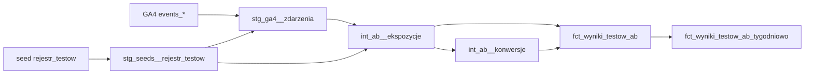
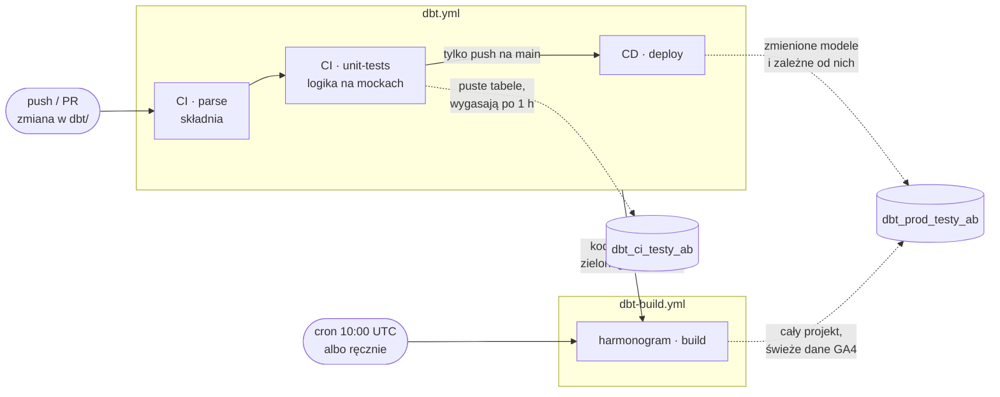

# dbt — wyniki testów A/B

To samo co [`sql/03`](../sql/03_po_tescie_warianty.sql), ale dla wszystkich testów naraz: konfiguracja w seedzie zamiast `DECLARE`, testy danych zamiast `ASSERT`. Tagowanie i kalkulatory: [README główne](../README.md).

## Uruchomienie

Wymaga [uv](https://docs.astral.sh/uv/) i konta serwisowego z rolami BigQuery Data Viewer (GA4), Data Editor (dataset docelowy) i Job User.

```bash
cd dbt
uv sync                                  # Python 3.11 + dbt-bigquery 1.12.0 z uv.lock
cp profiles.yml.example profiles.yml     # profiles.yml jest w .gitignore
export BIGQUERY_PROJECT="twoj-projekt-gcp"
export BIGQUERY_KEYFILE="/sciezka/poza/repo/service-account.json"
uv run dbt deps
uv run dbt build --profiles-dir .
```

Przed pierwszym uruchomieniem ustaw w `dbt_project.yml`:

| Zmienna / pole | Co wpisać |
|---|---|
| `vars.ga4_projekt`, `vars.ga4_zbior_danych` | projekt i dataset eksportu GA4 (`events_YYYYMMDD`) |
| `vars.ga4_data_startu` | najwcześniejszy `start_testu` z seeda — od tego dnia czyta `--full-refresh` |
| `location` w `profiles.yml` | region datasetu GA4 (domyślnie `EU`) |

Target `prod` ma osobne zmienne (`BIGQUERY_PROD_*`) bez fallbacku na dev. W dev tabele wygasają po godzinie, z wyjątkiem `stg_ga4__zdarzenia`.

## Pliki

✍ piszesz ręcznie, ⚙ generuje komenda (nie edytujesz).

```
dbt/
├── pyproject.toml          ✍                wersja Pythona i dbt-bigquery dla uv
├── .python-version         ✍                wersja interpretera (3.11)
├── uv.lock                 ⚙ uv lock        pełne drzewo pakietów Pythona z pyproject.toml
├── .venv/                  ⚙ uv sync        środowisko Pythona z dbt, odtworzone z uv.lock (poza gitem)
├── dbt_project.yml         ✍                nazwa projektu, zmienne GA4, materializacje folderów
├── profiles.yml.example    ✍                szablon połączenia z BigQuery
├── profiles.yml            ✍ cp z .example  Twoje połączenie (poza gitem)
├── packages.yml            ✍                pakiety makr dbt (dbt_utils)
├── package-lock.yml        ⚙ dbt deps       dokładne wersje pakietów z packages.yml
├── dbt_packages/           ⚙ dbt deps       pobrane pakiety dbt (poza gitem)
├── target/                 ⚙ dbt parse/build skompilowany SQL i manifest (poza gitem)
├── .gitignore              ✍                co nie trafia do gita
├── seeds/                  ✍                rejestr testów rejestr_testow.csv i jego opis
├── models/                 ✍                modele SQL, ich opisy, testy i unit testy (.yml)
└── tests/                  ✍                testy singularne i generyczny wariant_w_seedzie
```

## Rejestr testów: `seeds/rejestr_testow.csv`

Wiersz = test; nowy test to nowy wiersz + `dbt build`. Listy rozdziela `|`.

```csv
slot,start_testu,koniec_testu,wariant_kontrolny,warianty,zdarzenie_konwersji,zdarzenia_ekspozycji
ab3,2026-11-02,2026-12-13,v0,v0|v1,purchase,ab_assign|view_item
ab4,2026-11-02,2026-11-29,v0,v0|v1,purchase,ab_assign|begin_checkout
```

`slot` (`ab1`–`ab10`) wraca w kolejnych testach, więc kluczem jest `id_testu` = slot + `start_testu` (np. `ab1_20260907`); `start_testu` jako RRRRMMDD to `RUN` w tagu GTM. Ekspozycję wyznacza `zdarzenia_ekspozycji`: `view_item` z parametrem `ab4` nie wciąga nikogo do testu checkoutu.

`sprawdz_konfiguracje_testow` zatrzyma build, gdy start nie jest poniedziałkiem albo koniec niedzielą, kontroli nie ma wśród wariantów, wariantów jest mniej niż dwa, test zaczyna się przed `ga4_data_startu`, `slot` nie ma postaci `abN` albo okno nakłada się na poprzedni test w tym samym slocie.

## Modele



| Model | Ziarno | Materializacja | Rola |
|---|---|---|---|
| `stg_ga4__zdarzenia` | event × test | incremental, partycja dzienna | para (slot, wariant) z `ab_assign` albo parametru `abN` + eventy konwersji z seeda |
| `stg_seeds__rejestr_testow` | test | view | seed z `id_testu`, listami jako `ARRAY<STRING>` i flagą `czy_koncowy` |
| `int_ab__ekspozycje` | test × użytkownik | view | pierwsza ekspozycja, jej wariant, `liczba_wariantow`, `data_mieszania` |
| `int_ab__konwersje` | test × użytkownik | view | pierwsza konwersja po ekspozycji, w oknie testu |
| `fct_wyniki_testow_ab` | test × wariant | table, kontrakt | liczby do kalkulatora Po teście |
| `fct_wyniki_testow_ab_tygodniowo` | test × wariant × tydzień | table | te same liczby narastająco |

`fct_wyniki_testow_ab` ma wiersz dla każdego wariantu z seeda (także z 0 użytkowników) i dla wariantu spoza seeda, żeby testy go wyłapały. W `fct_wyniki_testow_ab_tygodniowo` ponownie wylosowany trafia do `wykluczeni_mieszani` od tygodnia losowania.

## Przyrost i pełny rebuild

`stg_ga4__zdarzenia` (`insert_overwrite`) nadpisuje ostatnie 3 dni od najnowszej partycji w tabeli, bo GA4 dopisuje dane do 72 h, a eksport nie ma klucza eventu do `merge`. Liczenie od partycji, nie od dziś, sprawia, że przerwa w harmonogramie nie zostawia dziury.

`--full-refresh -s stg_ga4__zdarzenia` jest potrzebny, gdy:
- dodajesz `zdarzenie_konwersji`, którego nie ma jeszcze żaden test;
- przesuwasz `ga4_data_startu` wstecz;
- zmieniasz plik stagingu — pilnuje tego strażnik: build zapisuje sumę kontrolną pliku w etykiecie tabeli (`suma_logiki`), a przebieg przyrostowy z inną sumą przerywa się błędem, zamiast zostawić mieszankę starej i nowej logiki. Zmiana samego komentarza też się liczy.

`maximum_bytes_billed`: 10 GiB dev, 100 GiB prod — zapytanie ponad limit pada bez opłaty.

## Testy

Czym jest każdy typ, co sprawdza i kiedy biegnie, opisują komentarze na początku plików z testami: w `tests/` (generic i singular) oraz w `models/` (użycie generic w `_*_modele.yml`, unit testy w `_*_testy_jednostkowe.yml`). Testy generic mają dwa miejsca: definicję (makro, jak sprawdzać) i użycie w YAML modelu (`data_tests:`, co sprawdzać) — dlatego `not_null`, `unique` i `unique_combination_of_columns` widać tylko w `models/`, a w `tests/generic/` jest jedynie własny `wariant_w_seedzie`.

```
generic — sprawdza dane
├── (wbudowane w dbt)                                  not_null, unique — bez pliku w repo
├── dbt_packages/dbt_utils/                            unique_combination_of_columns — z dbt deps, poza gitem
├── tests/generic/test_wariant_w_seedzie.sql           wariant_w_seedzie — własny
└── models/**/_*_modele.yml                            użycie: data_tests: przy kolumnach i modelach (23)
singular — sprawdza dane, jeden plik .sql = jeden test
└── tests/
    ├── sprawdz_konfiguracje_testow.sql                konfiguracja seeda
    ├── sprawdz_komplet_dni_ga4.sql                    brakujące dni eksportu GA4
    ├── sprawdz_uzytkownikow_kazdego_wariantu.sql      wariant z 0 użytkowników
    ├── sprawdz_zgodnosc_tygodniowych_z_wynikiem.sql   tygodniowo = wynik końcowy
    ├── sprawdz_srm.sql                                SRM (warn)
    └── sprawdz_rownowage_wykluczonych.sql             nierówne wykluczeni_mieszani (warn)
unit — sprawdza logikę na mockach
└── models/
    ├── intermediate/_int_ab__testy_jednostkowe.yml    ekspozycje_*, konwersje_* (4)
    └── marts/_marts__testy_jednostkowe.yml            wyniki_*, tygodniowo_* (2)
```

Przy warn decyduje człowiek; parę wskaże `dbt test --select sprawdz_srm --store-failures`. Unit testy biorą typy kolumn z modeli nadrzędnych, więc te muszą istnieć:

```bash
uv run dbt run --select +fct_wyniki_testow_ab_tygodniowo --empty --profiles-dir .
uv run dbt test --select test_type:unit --profiles-dir .
```

## CI/CD i harmonogram



Linia ciągła: kolejność i źródło kodu. Przerywana: zapis do BigQuery.

| Plik | Job | Rola | Wyzwalacz | Co robi |
|---|---|---|---|---|
| `dbt.yml` | `parse` | CI | push / PR w `dbt/` | SQL, Jinja, YAML, bez BigQuery |
| `dbt.yml` | `unit-tests` | CI | zielony `parse` | `dbt build --empty`, potem unit testy |
| `dbt.yml` | `deploy` | CD | zielony `unit-tests` + push na `main` | `dbt build --select state:modified+`, bez zmienionego `stg_ga4__zdarzenia` |
| `dbt-build.yml` | `build` | harmonogram | cron 10:00 UTC albo ręcznie (`full_refresh`) | `dbt build` bez unit testów |

- Czerwone CI: prod zostaje na ostatnim zielonym kodzie, ale dostaje świeże dane.
- `deploy` i `build` dzielą grupę `concurrency: dbt-prod` — nigdy naraz; nowszy anuluje oczekujący.
- Zmiana `stg_ga4__zdarzenia` czeka na Actions → dbt build → Run workflow → `full_refresh`.
- Continuous delivery (prod po „Approve”) tylko jako benchmark — zatwierdzałbyś własny commit.
- Alternatywy: GitLab CI/CD, Bitbucket Pipelines (ten sam model), dbt Cloud (płatny w zespole), Jenkins (własny serwer).

### Konfiguracja GCP

Jednorazowo dla CI, deployu i harmonogramu (`PROJECT` = projekt prod, `PROJECT_NUMBER` z `gcloud projects describe $PROJECT`):

```bash
# 1. konto serwisowe, z którego dbt buduje prod
gcloud iam service-accounts create dbt-prod --project=$PROJECT
SA=dbt-prod@$PROJECT.iam.gserviceaccount.com
for ROLE in roles/bigquery.jobUser roles/bigquery.dataEditor roles/bigquery.dataViewer; do
  gcloud projects add-iam-policy-binding $PROJECT --member=serviceAccount:$SA --role=$ROLE
done

# 2. Workload Identity: GCP ufa tokenom GitHuba, ale tylko z tego repo
gcloud iam workload-identity-pools create github --project=$PROJECT --location=global
gcloud iam workload-identity-pools providers create-oidc github --project=$PROJECT \
  --location=global --workload-identity-pool=github \
  --issuer-uri=https://token.actions.githubusercontent.com \
  --attribute-mapping=google.subject=assertion.sub,attribute.repository=assertion.repository \
  --attribute-condition="assertion.repository=='<owner>/ab-test-bigquery'"

# 3. workflow z tego repo może działać jako dbt-prod
gcloud iam service-accounts add-iam-policy-binding $SA --project=$PROJECT \
  --role=roles/iam.workloadIdentityUser \
  --member=principalSet://iam.googleapis.com/projects/$PROJECT_NUMBER/locations/global/workloadIdentityPools/github/attribute.repository/<owner>/ab-test-bigquery
```

| Sekret (Settings → Secrets and variables → Actions) | Wartość |
|---|---|
| `GCP_WORKLOAD_IDENTITY_PROVIDER` | `projects/PROJECT_NUMBER/locations/global/workloadIdentityPools/github/providers/github` |
| `GCP_SERVICE_ACCOUNT` | `dbt-prod@PROJECT.iam.gserviceaccount.com` |
| `BIGQUERY_PROD_PROJECT` | `PROJECT` |

Eksport GA4 w innym projekcie → `roles/bigquery.dataViewer` na tamtym datasecie.

## Niesprawdzone

Poza `dbt parse` nic jeszcze nie biegło — `unit-tests`, `deploy` i harmonogram czekają na WIF. Do potwierdzenia:
- czy `_dbt_max_partition` w filtrze na `_TABLE_SUFFIX` ogranicza czytane tabele (`total_bytes_billed` w `INFORMATION_SCHEMA.JOBS`);
- czy `flags.EMPTY` wyłącza filtry na `_TABLE_SUFFIX` pod `--empty`;
- czy strażnik logiki zapisuje etykietę w `post_hook` i czyta ją z `INFORMATION_SCHEMA.TABLE_OPTIONS`.
