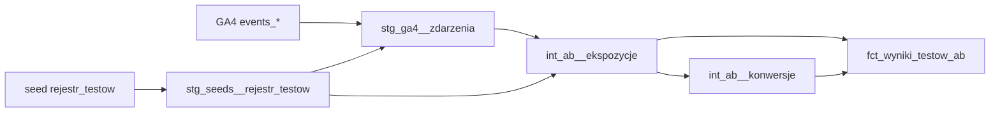
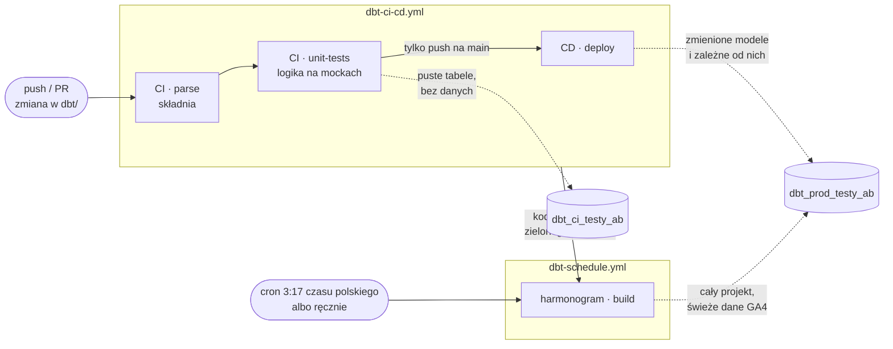

# dbt — wyniki testów A/B

To samo co [`sql/03`](../sql/03_po_tescie_warianty.sql), ale dla wszystkich testów naraz: konfiguracja w seedzie zamiast `DECLARE`, testy danych zamiast `ASSERT`. Tagowanie: [`gtm/`](../gtm/README.md), kalkulatory: [`sql/`](../sql/README.md).

## Uruchomienie

Wymaga [uv](https://docs.astral.sh/uv/), [gcloud](https://cloud.google.com/sdk/docs/install) i dostępu do projektu `ab-test-sandbox` (BigQuery sandbox, bez billingu). Logowanie kontem Google, bez klucza konta serwisowego.

```bash
cd dbt
uv sync                                  # Python 3.11 + dbt-bigquery 1.12.0 z uv.lock
cp profiles.yml.example profiles.yml     # profiles.yml jest w .gitignore
gcloud auth application-default login    # oauth dla targetu sandbox (domyślny)
uv run dbt deps
uv run dbt build --target sandbox --profiles-dir .
uv run dbt docs generate --target sandbox --profiles-dir .   # dokumentacja: graf, opisy kolumn, SQL
uv run dbt docs serve --profiles-dir . --port 8080            # http://localhost:8080
```

Strona startowa dokumentacji to `models/overview.md` (blok `__overview__`): jak czytać dane, bez kroków wdrożenia.

Przed pierwszym uruchomieniem ustaw w `dbt_project.yml`:

| Zmienna / pole | Co wpisać |
|---|---|
| `vars.ga4_projekt`, `vars.ga4_zbior_danych` | projekt i dataset eksportu GA4 (`events_YYYYMMDD`) |
| `vars.ga4_data_startu` | najwcześniejszy `start_testu` z seeda — od tego dnia czyta `--full-refresh` |
| `location` w `profiles.yml` | region datasetu GA4 (domyślnie `EU`) |

Targety `ci` i `prod_ci` działają tylko w GitHub Actions (projekt z sekretu `BIGQUERY_PROD_PROJECT`, [Konfiguracja GCP](#konfiguracja-gcp)).

## Pliki

✍ piszesz ręcznie, ⚙ generuje komenda (nie edytujesz).

```
dbt/
├── pyproject.toml          ✍                wersja Pythona i dbt-bigquery dla uv
├── .python-version         ✍                wersja interpretera (3.11)
├── uv.lock                 ⚙ uv lock        pełne drzewo pakietów Pythona z pyproject.toml
├── .venv/                  ⚙ uv sync        środowisko Pythona z dbt, odtworzone z uv.lock (poza gitem)
├── dbt_project.yml         ✍                nazwa projektu, zmienne GA4, materializacje folderów
├── profiles.yml.example    ✍                szablon połączenia z BigQuery
├── profiles.yml            ✍ cp z .example  Twoje połączenie (poza gitem)
├── packages.yml            ✍                pakiety makr dbt (dbt_utils)
├── package-lock.yml        ⚙ dbt deps       dokładne wersje pakietów z packages.yml
├── dbt_packages/           ⚙ dbt deps       pobrane pakiety dbt (poza gitem)
├── target/                 ⚙ dbt parse/build skompilowany SQL i manifest (poza gitem)
├── .gitignore              ✍                co nie trafia do gita
├── seeds/                  ✍                rejestr testów rejestr_testow.csv i jego opis
├── models/                 ✍                modele SQL, ich opisy, testy i unit testy (.yml), overview.md dla dbt docs
└── tests/                  ✍                testy singularne i generyczny wariant_w_seedzie
```

## Rejestr testów: `seeds/rejestr_testow.csv`

Wiersz = test; nowy test to nowy wiersz + `dbt build`. Listy rozdziela `|`.

```csv
slot,start_testu,koniec_testu,wariant_kontrolny,warianty,zdarzenie_konwersji,zdarzenia_ekspozycji
ab4,2026-11-02,2026-12-13,v0,v0|v1,purchase,ab_assign|view_item
ab5,2026-11-02,2026-11-29,v0,v0|v1,purchase,ab_assign|begin_checkout
```

`slot` (`ab1`–`ab10`) wraca w kolejnych testach, więc kluczem jest `id_testu` = slot + `start_testu` (np. `ab2_20260907`); tagi GTM nie znają dat, okno bierze się z rejestru. Ekspozycję wyznacza `zdarzenia_ekspozycji`: `view_item` z parametrem `ab5` nie wciąga do testu checkoutu.

`sprawdz_konfiguracje_testow` zatrzyma build, gdy: start ≠ poniedziałek albo koniec ≠ niedziela; kontroli brak wśród wariantów; wariantów < 2; start przed `ga4_data_startu`; `slot` nie ma postaci `abN`; okno nachodzi na poprzedni test w slocie albo startuje do 60 dni po jego końcu (ciasteczko testu żyje 60 dni).

## Modele



| Model | Ziarno | Materializacja | Rola |
|---|---|---|---|
| `stg_ga4__zdarzenia` | event × test | incremental, partycja dzienna | (slot, wariant) z `ab_assign` albo parametru `abN` + eventy konwersji |
| `stg_seeds__rejestr_testow` | test | view | seed z `id_testu`, listami jako `ARRAY<STRING>` i flagą `czy_koncowy` |
| `int_ab__ekspozycje` | test × użytkownik | view | pierwsza ekspozycja, jej wariant, `liczba_wariantow`, `liczba_przydzialow` |
| `int_ab__konwersje` | test × użytkownik | view | pierwsza konwersja po ekspozycji w oknie testu, przychód osoby (`transaction_id` raz) |
| `fct_wyniki_testow_ab` | test × wariant | table | do kalkulatora Po teście: konwersja albo przychód na użytkownika z odchyleniem (przycięty do 99,9 percentyla) |

`fct_wyniki_testow_ab` ma wiersz dla każdego wariantu z seeda (także z 0 użytkowników) i spoza seeda, żeby wyłapały go testy.

## Przyrost i pełny rebuild

`stg_ga4__zdarzenia` (`insert_overwrite`) nadpisuje 3 dni od najnowszej partycji (GA4 dopisuje dane do 72 h), nie od dziś, więc przerwa w harmonogramie nie zostawia dziury; pusta tabela czyta od `ga4_data_startu`.

`merge` przyjmie złożony `unique_key` (np. `user_pseudo_id` + `ga_session_id` + `event_timestamp` + `event_name`), ale eksport GA4 nie gwarantuje unikalności zdarzenia:
- zdarzenia z jednego żądania mogą mieć ten sam `event_timestamp`; pola `batch_page_id`, `batch_ordering_id`, `batch_event_index` ustalają kolejność, nie identyfikator, a starsze eksporty ich nie mają ([schemat](https://support.google.com/firebase/answer/7029846), [zapytania](https://developers.google.com/analytics/bigquery/basic-queries));
- duplikat klucza w źródle → błąd „UPDATE/MERGE must match at most one source row for each target row” ([MERGE](https://cloud.google.com/bigquery/docs/reference/standard-sql/dml-syntax));
- przy `analytics_storage = denied` (advanced consent mode) tagi „Won't read or write first-party analytics cookies” ([consent mode](https://developers.google.com/tag-platform/security/concepts/consent-mode)), więc `user_pseudo_id` i `ga_session_id` są puste ([obserwacja](https://twitter.com/SimoAhava/status/1501500798085341185)); NULL w kluczu się nie łączy i wiersz dublowałby się co przebieg (staging i tak je odfiltrowuje);
- `merge` nie usuwa wierszy skasowanych przez GA4 przy ponownym przetworzeniu dnia; `insert_overwrite` podmienia cały dzień.

`merge` ma sens dalej w potoku, gdzie ziarno ma prawdziwy klucz (np. data + `id_testu` + `wariant`).

`--full-refresh -s stg_ga4__zdarzenia` jest potrzebny, gdy:
- dodajesz `zdarzenie_konwersji`, którego nie ma jeszcze żaden test;
- przesuwasz `ga4_data_startu` wstecz;
- zmieniasz logikę stagingu — przebieg przyrostowy przeliczyłby nową logiką tylko ostatnie dni, bez błędu; deploy wtedy pomija staging i ostrzega.

`maximum_bytes_billed`: 10 GiB sandbox, 1 GiB ci, 100 GiB prod_ci — zapytanie ponad limit pada bez opłaty.

Ta sama decyzja co przy ładowaniu z API w Pythonie — inna składnia, ten sam mechanizm:

| Metoda | Gdzie, parametry | Istniejące dane | Wymaga klucza | Kiedy |
|---|---|---|---|---|
| `insert_overwrite` | dbt: `partition_by`, okno od `_dbt_max_partition` (`dni_wstecz = 3`) | podmienia całe dni z okna, także usuwa skasowane przez GA4 | nie | źródło oddaje cały dzień; **u nas** |
| `merge` (domyślna w dbt-bigquery) | dbt: `unique_key` = ziarno | aktualizuje pasujące, dopisuje nowe, nie usuwa | tak, unikalny w każdym przebiegu | dane kawałkami albo zmiany; nie u nas (wyżej) |
| `microbatch` (dbt ≥ 1.9) | dbt: `event_time`, `batch_size`, `begin`, `lookback`, `partition_by` | jak `insert_overwrite`, zapytanie na dzień, partie ponawiasz osobno | nie (`unique_key` w BigQuery nie dotyczy) | długa historia ponad jeden przebieg |
| load job `WRITE_TRUNCATE` na `tabela$RRRRMMDD` | Python: `write_disposition` + dekorator partycji | podmienia tę partycję; bez dekoratora całą tabelę | nie | jak `insert_overwrite`: dzień z API |
| `MERGE` po kluczu | Python (SQL): `ON` = ziarno, np. `date` + `campaign_id` | jak dbt `merge`; usuwa tylko z `WHEN NOT MATCHED BY SOURCE THEN DELETE` | tak; grubszy (sama data) → błąd przy drugim uruchomieniu | zmiany (`updated_since`), wymiary po ID |
| `insert_rows_json` / append | Python | tylko dopisuje, ponowne uruchomienie dubluje (`insertId` ~1 min, bez gwarancji) | nie, ale nic nie chroni | logi z deduplikacją dalej |

Ziarno raportu z API = data + wszystkie wymiary zapytania. Kontrola po ładowaniu: `GROUP BY` po kluczu + `HAVING COUNT(*) > 1` = zero wierszy.

Źródła: [dbt — BigQuery configs](https://docs.getdbt.com/reference/resource-configs/bigquery-configs), [dbt — microbatch](https://docs.getdbt.com/docs/build/incremental-microbatch), [BigQuery — ładowanie do partycji](https://cloud.google.com/bigquery/docs/load-data-partitioned-tables), [BigQuery — MERGE](https://cloud.google.com/bigquery/docs/reference/standard-sql/dml-syntax), [BigQuery — streaming](https://cloud.google.com/bigquery/docs/streaming-data-into-bigquery).

## Testy

Typ testu wynika z miejsca pliku: `tests/generic/` = generic, pozostałe `tests/*.sql` = singular, `*__unit_test.yml` = unit. Generic ma definicję (makro, jak sprawdzać) i użycie w YAML modelu (`data_tests:`, co sprawdzać), więc wbudowane i z `dbt_utils` widać tylko w `models/`. Unit testy leżą w `<model>__unit_test.yml` obok modelu.

```
generic — sprawdza dane
├── (wbudowane w dbt)                                  not_null, unique — bez pliku w repo
├── dbt_packages/dbt_utils/                            unique_combination_of_columns — z dbt deps, poza gitem
├── tests/generic/test_wariant_w_seedzie.sql           wariant_w_seedzie — własny
└── models/**/_*_modele.yml                            użycie: data_tests: przy kolumnach i modelach (22)
singular — sprawdza dane, jeden plik .sql = jeden test
└── tests/
    ├── sprawdz_konfiguracje_testow.sql                konfiguracja seeda
    ├── sprawdz_komplet_dni_ga4.sql                    brakujące dni eksportu GA4
    └── sprawdz_srm.sql                                SRM (warn)
unit — sprawdza logikę na mockach
└── models/
    ├── intermediate/int_ab__ekspozycje__unit_test.yml ekspozycje_* (2)
    ├── intermediate/int_ab__konwersje__unit_test.yml  konwersje_* (4) — pierwszy najprostszy, wzór do nauki
    └── marts/fct_wyniki_testow_ab__unit_test.yml      wyniki_* (3)
```

Każdy test danych zwraca wiersze z błędami; zero wierszy = zielony.

| Test | Wiersz wyniku | Przykład |
|---|---|---|
| `wariant_w_seedzie` (generic, przy kolumnie z `id_testu`) | wariant spoza `warianty` w seedzie: zły tag albo literówka w GTM | `ab2_20260907`, `V1` |
| `sprawdz_komplet_dni_ga4` | brakująca dzienna tabela eksportu w dniach testu (do dziś minus 3); czyta tylko `_TABLE_SUFFIX`, więc kosztuje minimum | `ab2_20260907`, `2026-09-15` |
| `sprawdz_konfiguracje_testow` | błąd konfiguracji w seedzie, reguły jak `ASSERT` w `sql/03` | `ab3_20261006`, `start_testu musi być poniedziałkiem` |
| `sprawdz_srm` (warn) | podział kontrola–wariant odbiega od 50/50 bardziej niż przypadek: χ² = (a − b)² / (a + b) > 10,828 (p < 0,001), ta sama reguła co w kalkulatorze | `ab2_20260907`, v1, 10 850 vs 10 198, χ² 20,2 |

### Jak czytać unit test

Wzór to `int_ab__konwersje__unit_test.yml`, pierwszy test: dwóch użytkowników, jeden test A/B, jedna reguła — zakup liczy się jako konwersja tylko po pierwszej ekspozycji. Osoba, która kupiła, zanim zobaczyła test, nie kupiła „dzięki” wariantowi; doliczona zawyżyłaby CR swojego wariantu.

- `model` — który model sprawdzamy.
- `given` — sztuczne wejścia, po jednym bloku na każdy `ref()` w SQL modelu (brak któregoś = błąd kompilacji). W `rows` wystarczą kolumny, których model używa. Tu: rejestr testów (zdarzenie konwersji i koniec testu), ekspozycje (obaj użytkownicy zobaczyli test 10 września o 12:00) i zdarzenia GA4 (u1 kupił o 11:00, u2 o 13:00).
- `expect` — wiersze, które model musi zwrócić. Tu tylko u2; gdyby model liczył zakupy sprzed ekspozycji, pojawiłby się u1 i test by padł.

Kolejne testy w pliku mają tę samą budowę: zakup po `koniec_testu` się nie liczy, a przychód liczy każde zamówienie (`id_transakcji`) raz, z pierwszą niepustą kwotą. Unit testy biegną w BigQuery, ale nie czytają GA4 — dbt wstawia wiersze z `given` jako CTE. W GitHub Actions biegną tylko w CI (job `unit-tests`); deploy i harmonogram je pomijają.

Przy warn decyduje człowiek; parę wskaże `dbt test --select sprawdz_srm --store-failures`. Unit testy biorą typy kolumn z modeli nadrzędnych, więc najpierw zbuduj je puste, z seedem (`dbt run` go nie ładuje) i `--full-refresh` (inaczej staging zostaje pusty):

```bash
uv run dbt build --select +fct_wyniki_testow_ab --empty --full-refresh --resource-type seed --resource-type model --profiles-dir .
uv run dbt test --select test_type:unit --profiles-dir .
```

## CI/CD i harmonogram



Linia ciągła: kolejność i źródło kodu. Przerywana: zapis do BigQuery.

| Plik | Job | Rola | Wyzwalacz | Co robi |
|---|---|---|---|---|
| `dbt-ci-cd.yml` | `parse` | CI | push / PR w `dbt/` | SQL, Jinja, YAML, bez BigQuery |
| `dbt-ci-cd.yml` | `unit-tests` | CI | zielony `parse` | `dbt build --empty`, potem unit testy |
| `dbt-ci-cd.yml` | `deploy` | CD | zielony `unit-tests` + push na `main` | `dbt build --select state:modified+`, bez zmienionego `stg_ga4__zdarzenia` |
| `dbt-schedule.yml` | `build` | harmonogram | cron 3:17 czasu polskiego albo ręcznie (`full_refresh`) | `dbt build` bez unit testów |

- Czerwone CI: prod zostaje na ostatnim zielonym kodzie, dane są świeże.
- `deploy` i `build` dzielą `concurrency: dbt-prod`: nigdy naraz, nowszy anuluje oczekujący.
- Zmiana `stg_ga4__zdarzenia` czeka na Actions → dbt schedule → Run workflow → `full_refresh`.
- Continuous delivery (prod po „Approve”) tylko jako benchmark: zatwierdzałbyś własny commit.
- Alternatywy: GitLab CI/CD, Bitbucket Pipelines (ten sam model), dbt Cloud (płatny w zespole), Jenkins (własny serwer).

### Konfiguracja GCP

Jednorazowo: GitHub Actions (CI, deploy, harmonogram) loguje się do BigQuery przez Workload Identity Federation, bez pliku klucza w sekretach. Działa też w sandboxie bez billingu — tak stoi `ab-test-sandbox`. W nawiasach nazwy z konsoli GCP po polsku.

1. **Zmienne** — projekt docelowy, jego numer, repo i konto serwisowe:
   ```bash
   PROJECT=ab-test-sandbox
   PROJECT_NUMBER=$(gcloud projects describe $PROJECT --format='value(projectNumber)')
   REPO=pmackowka/ga4-ab-testing-template
   SA=dbt-prod@$PROJECT.iam.gserviceaccount.com
   ```
2. **API** — IAM, Security Token Service i IAM Service Account Credentials (w konsoli: „Identity and Access Management (IAM) API”, „Security Token Service API”, „IAM Service Account Credentials API”):
   ```bash
   gcloud services enable iam.googleapis.com sts.googleapis.com iamcredentials.googleapis.com --project=$PROJECT
   ```
3. **Konto serwisowe `dbt-prod`**, bez kluczy. `bigquery.jobUser` uruchamia zapytania, `bigquery.dataEditor` tworzy i nadpisuje tabele (obejmuje uprawnienia `dataViewer`, więc tej roli nie dodajesz):
   ```bash
   gcloud iam service-accounts create dbt-prod --project=$PROJECT
   for ROLE in roles/bigquery.jobUser roles/bigquery.dataEditor; do
     gcloud projects add-iam-policy-binding $PROJECT --member=serviceAccount:$SA --role=$ROLE
   done
   ```
4. **Pula i dostawca OIDC `github`** — GCP przyjmuje tokeny GitHuba, ale tylko z tego repo (`attribute-condition`):
   ```bash
   gcloud iam workload-identity-pools create github --project=$PROJECT --location=global
   gcloud iam workload-identity-pools providers create-oidc github --project=$PROJECT \
     --location=global --workload-identity-pool=github \
     --issuer-uri=https://token.actions.githubusercontent.com \
     --attribute-mapping=google.subject=assertion.sub,attribute.repository=assertion.repository \
     --attribute-condition="assertion.repository=='$REPO'"
   ```
5. **Powiązanie** — workflow z tego repo działa jako `dbt-prod`. W konsoli widać je na koncie usługi → „Podmioty zabezpieczeń z dostępem”, nie w uprawnieniach projektu:
   ```bash
   gcloud iam service-accounts add-iam-policy-binding $SA --project=$PROJECT \
     --role=roles/iam.workloadIdentityUser \
     --member=principalSet://iam.googleapis.com/projects/$PROJECT_NUMBER/locations/global/workloadIdentityPools/github/attribute.repository/$REPO
   ```
6. **Sekrety GitHuba** (Settings → Secrets and variables → Actions):

   | Sekret | Wartość |
   |---|---|
   | `GCP_WORKLOAD_IDENTITY_PROVIDER` | `projects/PROJECT_NUMBER/locations/global/workloadIdentityPools/github/providers/github` |
   | `GCP_SERVICE_ACCOUNT` | `dbt-prod@PROJECT.iam.gserviceaccount.com` |
   | `BIGQUERY_PROD_PROJECT` | `PROJECT` |

   Albo z terminala:
   ```bash
   gh secret set GCP_WORKLOAD_IDENTITY_PROVIDER --body "projects/$PROJECT_NUMBER/locations/global/workloadIdentityPools/github/providers/github"
   gh secret set GCP_SERVICE_ACCOUNT --body "$SA"
   gh secret set BIGQUERY_PROD_PROJECT --body "$PROJECT"
   ```
7. **Eksport GA4 w innym projekcie** — `dbt-prod` dostaje tam `roles/bigquery.dataViewer` na datasecie eksportu.
8. **Sprawdzenie**:
   - `gcloud iam service-accounts get-iam-policy $SA` pokazuje `roles/iam.workloadIdentityUser` dla `principalSet` z repo;
   - push zmiany w `dbt/` na `main` → dbt CI/CD: `parse`, `unit-tests` i `deploy` na zielono (pierwszy `deploy` buduje cały projekt);
   - Actions → dbt schedule → Run workflow → zielony `build` w `dbt_prod_testy_ab`.

## Dane syntetyczne

[`dane_syntetyczne/generuj_eksport_ga4.sql`](../dane_syntetyczne/generuj_eksport_ga4.sql) tworzy w osobnym datasecie tabele `events_RRRRMMDD` w schemacie eksportu GA4, ze scenariuszem z seeda i znanym efektem każdego wariantu. Jego zmiana odpala CI, bo harmonogram uruchamia generator z ostatniego commita z zielonym CI; bez tego dalej biegłaby stara wersja.

Działa w darmowym [sandboxie BigQuery](https://docs.cloud.google.com/bigquery/docs/sandbox) (bez karty): przy `vars.sandbox: true` w `dbt_project.yml` (każdy target, także `ci` i `prod_ci` w GitHub Actions) staging to zwykła tabela odtwarzana co build, bo sandbox nie ma `MERGE` (`insert_overwrite`) i od razu usuwa partycje starsze niż 60 dni. Limit 10 GiB zapisu na całe konto; tabele znikają 60 dni po utworzeniu — wtedy wygeneruj zbiór od nowa z `data_od = '2026-08-24'`.

1. Ustaw `projekt_docelowy` i uruchom skrypt w konsoli BigQuery z Więcej → Ustawienia zapytania → lokalizacja danych = EU (czyta zbiór tylko przez `EXECUTE IMMEDIATE`, więc BigQuery może wybrać US). Generuje dni od 2026-08-24 do wczoraj. Starszy zbiór od 2026-09-07 (bez A/A) uzupełnij z `data_od = '2026-08-24'`, inaczej `sprawdz_komplet_dni_ga4` zgłosi 14 brakujących dni.
2. `uv run dbt build --target sandbox --profiles-dir . --full-refresh` — `vars` w `dbt_project.yml` wskazują już `ab-test-sandbox.ga4_syntetyczny`.
3. Przyrost: przed każdą sesją skrypt bez zmian (nadrobi dni do wczoraj, także po przerwie) i `dbt build --target sandbox`, bez `--full-refresh`. Bez tego `sprawdz_komplet_dni_ga4` zgłosi brakujące dni.
4. Ponowne przetworzenie dnia przez GA4: `data_od` = dziś minus 3, inne `ziarno`, potem `dbt build --target sandbox` — zmieniają się tylko te dni.

Skrypt tworzy tylko kolumny czytane przez `stg_ga4__zdarzenia`. Wizyta to `view_item` → `begin_checkout` → `purchase`, a losowość z `FARM_FINGERPRINT` sprawia, że ten sam dzień generuje się zawsze tak samo. Parametry w `DECLARE` na początku skryptu:

| Parametr | Znaczenie |
|---|---|
| `projekt_docelowy`, `zbior_docelowy`, `data_startu` | to samo co `ga4_projekt`, `ga4_zbior_danych` i `ga4_data_startu` w `vars` dbt |
| `data_od` | `NULL` = dzień po ostatniej tabeli `events_` w zbiorze; podana data podmienia dni od niej |
| `data_do` | ostatni generowany dzień, domyślnie wczoraj |
| `wizyty_dziennie` | liczba wizyt na dzień |
| `udzial_powracajacych` | udział wizyt osób z poprzednich 28 dni, poniżej 0,8 |
| `cr_koszyka`, `cr_zakupu` | przejścia `view_item` → `begin_checkout` i `begin_checkout` → `purchase` |
| `koszyk_mediana`, `koszyk_sigma` | wartość zamówienia w zł, rozkład logarytmiczno-normalny |
| `ziarno` | inne zachowanie tych samych użytkowników |
| `testy` | kopia seeda z efektem wariantu (względna zmiana CR); kontrola pierwsza z efektem 0, ab1 = A/A; etap `karta` zmienia przejście do checkoutu, `checkout` przejście do zakupu |

Wyniki testu ab2 z tych danych (`sql/01`–`03`, domyślne parametry) są danymi przykładowymi kalkulatorów na pmdata.pl. Zmiana generatora, seeda albo SQL rozjedzie je z kalkulatorami.

Prawda w `fct_wyniki_testow_ab`: CR wariantu / CR kontroli ≈ 1 + efekt z `DECLARE testy` (ab1 v1 0% — A/A, ab2 v1 +10%, ab3 v1 0%, ab3 v2 +12%, ab4 v1 −5%, ab5 v1 +10%), rozrzut ok. ±5 pp w ab2 i ab3 przy 10 000 wizyt dziennie; ab4 i ab5 dopiero ruszyły. `przychod_na_uzytkownika` idzie za CR (zamówienie logarytmiczno-normalne, mediana 200 zł, niezależne od wariantu), z ok. 1,9× większym względnym rozrzutem. Kolumny jakości to ok. 0,5–1% użytkowników testu, w ab4 i ab5 jeszcze 0 (utrata ciasteczek zaczyna się 7 dni po przydziale). Zerujesz je: oba udziały na 0, skrypt z `data_od = '2026-08-24'` i `dbt build --full-refresh`.

Oczekiwany `fct_wyniki_testow_ab` (ab2 z przebiegu w BigQuery 2026-11-08, ab3 z symulacji tej samej logiki — `FARM_FINGERPRINT` da liczby inne, ale bliskie):

| id_testu | wariant | uzytkownicy | konwertujacy | CR | prawda | przychod_na_uzytkownika | odchylenie_przychodu | wykluczeni_mieszani | ponownie_przydzieleni | bez_przydzialu |
|---|---|---|---|---|---|---|---|---|---|---|
| ab2_20260907 | v0 | 64266 | 2038 | 3,17% | kontrola | 8,78 | 67,30 | 68 | 143 | 148 |
| ab2_20260907 | v1 | 64070 | 2313 | 3,61% | +10% | 9,97 | 70,79 | 85 | 161 | 143 |
| ab3_20261005 | v0 | 78115 | 2770 | 3,55% | kontrola | 9,88 | 72,06 | 467 | 720 | 655 |
| ab3_20261005 | v1 | 78718 | 2769 | 3,52% | 0% | 9,56 | 67,69 | 503 | 757 | 667 |
| ab3_20261005 | v2 | 78925 | 3018 | 3,82% | +12% | 10,73 | 74,30 | 471 | 704 | 691 |

| Parametr w skrypcie | Co psuje w danych | Co to pokazuje |
|---|---|---|
| `usterka_srm_slot` | kontrola dostaje 53% ruchu zamiast 50% | `sprawdz_srm` (warn) |
| `usterka_brak_dnia` | brak tabeli dziennej; wymaga `data_od` ≤ tego dnia, bo nadrabianie zaczyna od dnia po ostatniej tabeli | `sprawdz_komplet_dni_ga4` (error) |
| `udzial_utraty_ciasteczka_testu` (domyślnie 0,10) | ciasteczko testu znika 7 dni po przydziale, tag losuje ponownie | `ponownie_przydzieleni` i `wykluczeni_mieszani` |
| `udzial_utraty_ga` (domyślnie 0,10) | `_ga` znika 7 dni po pierwszej wizycie, ciasteczko testu zostaje | `bez_przydzialu` |

## Niesprawdzone

Na żywo w BigQuery (sandbox, EU) biegły generator, `dbt build --target sandbox` (39 PASS: testy danych i unit testy) oraz GitHub Actions przez WIF: `unit-tests` i `deploy` w CI/CD i ręczny przebieg harmonogramu (po 31 PASS w `prod_ci`). Do potwierdzenia:
- czy `_dbt_max_partition` w filtrze na `_TABLE_SUFFIX` ogranicza czytane tabele (`total_bytes_billed` w `INFORMATION_SCHEMA.JOBS`);
- czy `flags.EMPTY` wyłącza filtry na `_TABLE_SUFFIX` pod `--empty`;
- puste `user_pseudo_id` i `ga_session_id` przy `analytics_storage = denied` — potwierdzają tylko relacje praktyków; od kiedy eksport ma pola `batch_*` — dokumentacja nie podaje daty;
- liczby z generatora (CR, kolumny jakości) pochodzą z symulacji w Pythonie, na żywo jeszcze niezmierzone (krok 5);
- czy load job z `WRITE_TRUNCATE` na `tabela$RRRRMMDD` podmienia tylko tę partycję — dokumentacja opisuje to dla `bq load --replace` z dekoratorem, nie dla `write_disposition` w kliencie Pythona.
