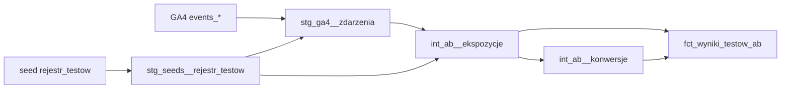
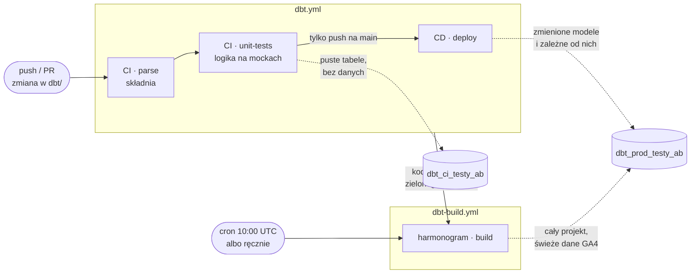

# dbt — wyniki testów A/B

To samo co [`sql/03`](../sql/03_po_tescie_warianty.sql), ale dla wszystkich testów naraz: konfiguracja w seedzie zamiast `DECLARE`, testy danych zamiast `ASSERT`. Tagowanie i kalkulatory: [README główne](../README.md).

## Uruchomienie

Wymaga [uv](https://docs.astral.sh/uv/) i konta serwisowego z rolami BigQuery Data Viewer (GA4), Data Editor (dataset docelowy) i Job User.

```bash
cd dbt
uv sync                                  # Python 3.11 + dbt-bigquery 1.12.0 z uv.lock
cp profiles.yml.example profiles.yml     # profiles.yml jest w .gitignore
export BIGQUERY_PROJECT="twoj-projekt-gcp"
export BIGQUERY_KEYFILE="/sciezka/poza/repo/service-account.json"
uv run dbt deps
uv run dbt build --profiles-dir .
```

Przed pierwszym uruchomieniem ustaw w `dbt_project.yml`:

| Zmienna / pole | Co wpisać |
|---|---|
| `vars.ga4_projekt`, `vars.ga4_zbior_danych` | projekt i dataset eksportu GA4 (`events_YYYYMMDD`) |
| `vars.ga4_data_startu` | najwcześniejszy `start_testu` z seeda — od tego dnia czyta `--full-refresh` |
| `location` w `profiles.yml` | region datasetu GA4 (domyślnie `EU`) |

Target `prod` ma osobne zmienne (`BIGQUERY_PROD_*`) bez fallbacku na dev.

## Pliki

✍ piszesz ręcznie, ⚙ generuje komenda (nie edytujesz).

```
dbt/
├── pyproject.toml          ✍                wersja Pythona i dbt-bigquery dla uv
├── .python-version         ✍                wersja interpretera (3.11)
├── uv.lock                 ⚙ uv lock        pełne drzewo pakietów Pythona z pyproject.toml
├── .venv/                  ⚙ uv sync        środowisko Pythona z dbt, odtworzone z uv.lock (poza gitem)
├── dbt_project.yml         ✍                nazwa projektu, zmienne GA4, materializacje folderów
├── profiles.yml.example    ✍                szablon połączenia z BigQuery
├── profiles.yml            ✍ cp z .example  Twoje połączenie (poza gitem)
├── packages.yml            ✍                pakiety makr dbt (dbt_utils)
├── package-lock.yml        ⚙ dbt deps       dokładne wersje pakietów z packages.yml
├── dbt_packages/           ⚙ dbt deps       pobrane pakiety dbt (poza gitem)
├── target/                 ⚙ dbt parse/build skompilowany SQL i manifest (poza gitem)
├── .gitignore              ✍                co nie trafia do gita
├── seeds/                  ✍                rejestr testów rejestr_testow.csv i jego opis
├── models/                 ✍                modele SQL, ich opisy, testy i unit testy (.yml)
└── tests/                  ✍                testy singularne i generyczny wariant_w_seedzie
```

## Rejestr testów: `seeds/rejestr_testow.csv`

Wiersz = test; nowy test to nowy wiersz + `dbt build`. Listy rozdziela `|`.

```csv
slot,start_testu,koniec_testu,wariant_kontrolny,warianty,zdarzenie_konwersji,zdarzenia_ekspozycji
ab3,2026-11-02,2026-12-13,v0,v0|v1,purchase,ab_assign|view_item
ab4,2026-11-02,2026-11-29,v0,v0|v1,purchase,ab_assign|begin_checkout
```

`slot` (`ab1`–`ab10`) wraca w kolejnych testach, więc kluczem jest `id_testu` = slot + `start_testu` (np. `ab1_20260907`); `start_testu` jako RRRRMMDD to `RUN` w tagu GTM. Ekspozycję wyznacza `zdarzenia_ekspozycji`: `view_item` z parametrem `ab4` nie wciąga nikogo do testu checkoutu.

`sprawdz_konfiguracje_testow` zatrzyma build, gdy start nie jest poniedziałkiem albo koniec niedzielą, kontroli nie ma wśród wariantów, wariantów jest mniej niż dwa, test zaczyna się przed `ga4_data_startu`, `slot` nie ma postaci `abN` albo okno nakłada się na poprzedni test w tym samym slocie.

## Modele



| Model | Ziarno | Materializacja | Rola |
|---|---|---|---|
| `stg_ga4__zdarzenia` | event × test | incremental, partycja dzienna | para (slot, wariant) z `ab_assign` albo parametru `abN` + eventy konwersji z seeda |
| `stg_seeds__rejestr_testow` | test | view | seed z `id_testu`, listami jako `ARRAY<STRING>` i flagą `czy_koncowy` |
| `int_ab__ekspozycje` | test × użytkownik | view | pierwsza ekspozycja, jej wariant, `liczba_wariantow` |
| `int_ab__konwersje` | test × użytkownik | view | pierwsza konwersja po ekspozycji, w oknie testu |
| `fct_wyniki_testow_ab` | test × wariant | table | liczby do kalkulatora Po teście |

`fct_wyniki_testow_ab` ma wiersz dla każdego wariantu z seeda (także z 0 użytkowników) i dla wariantu spoza seeda, żeby testy go wyłapały.

## Przyrost i pełny rebuild

`stg_ga4__zdarzenia` (`insert_overwrite`) nadpisuje ostatnie 3 dni od najnowszej partycji w tabeli, bo GA4 dopisuje dane do 72 h. Liczenie od partycji, nie od dziś, sprawia, że przerwa w harmonogramie nie zostawia dziury; pusta tabela (brak partycji) czyta od `ga4_data_startu`.

`merge` jest możliwy składniowo — dbt przyjmie złożony `unique_key` (np. `user_pseudo_id` + `ga_session_id` + `event_timestamp` + `event_name`) — ale eksport GA4 nie ma klucza, który gwarantuje unikalność zdarzenia:
- kilka zdarzeń z jednego żądania może mieć ten sam `event_timestamp`; do kolejności Google dodał `batch_page_id`, `batch_ordering_id`, `batch_event_index`, nie unikalny identyfikator, a w starszych eksportach tych pól nie ma ([schemat eksportu](https://support.google.com/firebase/answer/7029846), [przykładowe zapytania](https://developers.google.com/analytics/bigquery/basic-queries));
- duplikat klucza w źródle → `MERGE` pada błędem „UPDATE/MERGE must match at most one source row for each target row” ([MERGE](https://cloud.google.com/bigquery/docs/reference/standard-sql/dml-syntax));
- w advanced consent mode przy `analytics_storage = denied` tagi „Won't read or write first-party analytics cookies” ([consent mode](https://developers.google.com/tag-platform/security/concepts/consent-mode)), więc takie zdarzenia mają w eksporcie pusty `user_pseudo_id` i `ga_session_id` ([obserwacja](https://twitter.com/SimoAhava/status/1501500798085341185)); NULL w kluczu nie łączy się w `MERGE`, więc te wiersze dublowałyby się przy każdym przebiegu (u nas staging i tak je odfiltrowuje);
- `merge` nie usuwa wierszy, które GA4 skasował przy ponownym przetworzeniu dnia; `insert_overwrite` podmienia cały dzień.

`merge` ma sens dalej w potoku, gdzie ziarno ma prawdziwy klucz (np. data + `id_testu` + `wariant`).

`--full-refresh -s stg_ga4__zdarzenia` jest potrzebny, gdy:
- dodajesz `zdarzenie_konwersji`, którego nie ma jeszcze żaden test;
- przesuwasz `ga4_data_startu` wstecz;
- zmieniasz logikę pliku stagingu — przebieg przyrostowy przeliczyłby nową logiką tylko ostatnie dni, bez błędu; deploy w takim przypadku pomija staging i ostrzega.

`maximum_bytes_billed`: 10 GiB dev, 100 GiB prod — zapytanie ponad limit pada bez opłaty.

Ta sama decyzja co przy ładowaniu z API w Pythonie — dbt i skrypt różnią się składnią, nie mechanizmem:

| Metoda | Gdzie | Parametry | Co robi z istniejącymi danymi | Czego wymaga od ziarna | Kiedy |
|---|---|---|---|---|---|
| `insert_overwrite` | dbt | `incremental_strategy='insert_overwrite'`, `partition_by`, okno od `_dbt_max_partition` (u nas `dni_wstecz = 3`) | podmienia całe partycje-dni z okna; usuwa też wiersze, które GA4 skasował przy ponownym przetworzeniu | nic — klucz zbędny | źródło oddaje cały dzień naraz; **u nas** |
| `merge` (domyślna w dbt-bigquery) | dbt | `unique_key` = ziarno modelu (np. `data_zdarzenia` + `id_sesji`) | aktualizuje pasujące, dopisuje nowe; nie usuwa wierszy, których nie ma już w źródle | klucz unikalny w każdym przebiegu | dane kawałkami albo jako zmiany; nie u nas — eksport GA4 nie gwarantuje unikalnego klucza zdarzenia (wyżej) |
| `microbatch` (dbt ≥ 1.9) | dbt | `event_time`, `batch_size`, `begin`, `lookback` + `partition_by` | jak `insert_overwrite`, ale osobne zapytanie na każdy dzień — partie można ponawiać pojedynczo | nic — `unique_key` w BigQuery nie dotyczy | długa historia, której jeden przebieg nie uniesie |
| load job `WRITE_TRUNCATE` na `tabela$RRRRMMDD` | Python | `write_disposition`, dekorator partycji w nazwie tabeli | podmienia tylko wskazaną partycję; bez dekoratora nadpisuje całą tabelę | nic | odpowiednik `insert_overwrite`: dzień z API w całości |
| `MERGE` po kluczu | Python (SQL) | `ON` = ziarno (np. `date` + `campaign_id`) | jak dbt `merge`; usuwanie tylko z jawnym `WHEN NOT MATCHED BY SOURCE THEN DELETE` | klucz = ziarno; grubszy (sama data) → przy drugim uruchomieniu błąd „UPDATE/MERGE must match at most one source row for each target row” | odpowiednik dbt `merge`: zmiany (`updated_since`), wymiary po ID |
| `insert_rows_json` / append | Python | brak | tylko dopisuje — ponowne uruchomienie dubluje dane (`insertId` deduplikuje najwyżej przez ~1 min, bez gwarancji) | nic, ale też nic nie chroni | logi zdarzeń z deduplikacją dalej w potoku |

Zasada: partycja, gdy źródło oddaje cały dzień naraz; merge, gdy dane przychodzą kawałkami, jako zmiany albo dla tabel wymiarów po ID. Ziarno raportu zagregowanego z API = data + wszystkie wymiary zapytania. Kontrola po każdym ładowaniu: `GROUP BY` po kluczu + `HAVING COUNT(*) > 1` zwraca zero wierszy.

Źródła: [dbt — BigQuery configs](https://docs.getdbt.com/reference/resource-configs/bigquery-configs), [dbt — microbatch](https://docs.getdbt.com/docs/build/incremental-microbatch), [BigQuery — ładowanie do partycji](https://cloud.google.com/bigquery/docs/load-data-partitioned-tables), [BigQuery — MERGE](https://cloud.google.com/bigquery/docs/reference/standard-sql/dml-syntax), [BigQuery — streaming](https://cloud.google.com/bigquery/docs/streaming-data-into-bigquery).

## Testy

Czym jest każdy typ, co sprawdza i kiedy biegnie, opisują komentarze na początku plików z testami: w `tests/` (generic i singular) oraz w `models/` (użycie generic w `_*_modele.yml`, unit testy w `_*_testy_jednostkowe.yml`). Testy generic mają dwa miejsca: definicję (makro, jak sprawdzać) i użycie w YAML modelu (`data_tests:`, co sprawdzać) — dlatego `not_null`, `unique` i `unique_combination_of_columns` widać tylko w `models/`, a w `tests/generic/` jest jedynie własny `wariant_w_seedzie`.

```
generic — sprawdza dane
├── (wbudowane w dbt)                                  not_null, unique — bez pliku w repo
├── dbt_packages/dbt_utils/                            unique_combination_of_columns — z dbt deps, poza gitem
├── tests/generic/test_wariant_w_seedzie.sql           wariant_w_seedzie — własny
└── models/**/_*_modele.yml                            użycie: data_tests: przy kolumnach i modelach (22)
singular — sprawdza dane, jeden plik .sql = jeden test
└── tests/
    ├── sprawdz_konfiguracje_testow.sql                konfiguracja seeda
    ├── sprawdz_komplet_dni_ga4.sql                    brakujące dni eksportu GA4
    └── sprawdz_srm.sql                                SRM (warn)
unit — sprawdza logikę na mockach
└── models/
    ├── intermediate/_int_ab__testy_jednostkowe.yml    ekspozycje_*, konwersje_* (2) — konwersje_* to wzór do nauki
    └── marts/_marts__testy_jednostkowe.yml            wyniki_* (1)
```

Przy warn decyduje człowiek; parę wskaże `dbt test --select sprawdz_srm --store-failures`. Unit testy biorą typy kolumn z modeli nadrzędnych, więc te muszą istnieć — z seedem, bo `dbt run` go nie ładuje, i z `--full-refresh`, bo pusta tabela stagingu bez niego zostaje pusta:

```bash
uv run dbt build --select +fct_wyniki_testow_ab --empty --full-refresh --resource-type seed --resource-type model --profiles-dir .
uv run dbt test --select test_type:unit --profiles-dir .
```

## CI/CD i harmonogram



Linia ciągła: kolejność i źródło kodu. Przerywana: zapis do BigQuery.

| Plik | Job | Rola | Wyzwalacz | Co robi |
|---|---|---|---|---|
| `dbt.yml` | `parse` | CI | push / PR w `dbt/` | SQL, Jinja, YAML, bez BigQuery |
| `dbt.yml` | `unit-tests` | CI | zielony `parse` | `dbt build --empty`, potem unit testy |
| `dbt.yml` | `deploy` | CD | zielony `unit-tests` + push na `main` | `dbt build --select state:modified+`, bez zmienionego `stg_ga4__zdarzenia` |
| `dbt-build.yml` | `build` | harmonogram | cron 10:00 UTC albo ręcznie (`full_refresh`) | `dbt build` bez unit testów |

- Czerwone CI: prod zostaje na ostatnim zielonym kodzie, ale dostaje świeże dane.
- `deploy` i `build` dzielą grupę `concurrency: dbt-prod` — nigdy naraz; nowszy anuluje oczekujący.
- Zmiana `stg_ga4__zdarzenia` czeka na Actions → dbt build → Run workflow → `full_refresh`.
- Continuous delivery (prod po „Approve”) tylko jako benchmark — zatwierdzałbyś własny commit.
- Alternatywy: GitLab CI/CD, Bitbucket Pipelines (ten sam model), dbt Cloud (płatny w zespole), Jenkins (własny serwer).

### Konfiguracja GCP

Jednorazowo dla CI, deployu i harmonogramu (`PROJECT` = projekt prod, `PROJECT_NUMBER` z `gcloud projects describe $PROJECT`):

```bash
# 1. konto serwisowe, z którego dbt buduje prod
gcloud iam service-accounts create dbt-prod --project=$PROJECT
SA=dbt-prod@$PROJECT.iam.gserviceaccount.com
for ROLE in roles/bigquery.jobUser roles/bigquery.dataEditor roles/bigquery.dataViewer; do
  gcloud projects add-iam-policy-binding $PROJECT --member=serviceAccount:$SA --role=$ROLE
done

# 2. Workload Identity: GCP ufa tokenom GitHuba, ale tylko z tego repo
gcloud iam workload-identity-pools create github --project=$PROJECT --location=global
gcloud iam workload-identity-pools providers create-oidc github --project=$PROJECT \
  --location=global --workload-identity-pool=github \
  --issuer-uri=https://token.actions.githubusercontent.com \
  --attribute-mapping=google.subject=assertion.sub,attribute.repository=assertion.repository \
  --attribute-condition="assertion.repository=='<owner>/ab-test-bigquery'"

# 3. workflow z tego repo może działać jako dbt-prod
gcloud iam service-accounts add-iam-policy-binding $SA --project=$PROJECT \
  --role=roles/iam.workloadIdentityUser \
  --member=principalSet://iam.googleapis.com/projects/$PROJECT_NUMBER/locations/global/workloadIdentityPools/github/attribute.repository/<owner>/ab-test-bigquery
```

| Sekret (Settings → Secrets and variables → Actions) | Wartość |
|---|---|
| `GCP_WORKLOAD_IDENTITY_PROVIDER` | `projects/PROJECT_NUMBER/locations/global/workloadIdentityPools/github/providers/github` |
| `GCP_SERVICE_ACCOUNT` | `dbt-prod@PROJECT.iam.gserviceaccount.com` |
| `BIGQUERY_PROD_PROJECT` | `PROJECT` |

Eksport GA4 w innym projekcie → `roles/bigquery.dataViewer` na tamtym datasecie.

## Dane syntetyczne

[`dane_syntetyczne/generuj_eksport_ga4.sql`](../dane_syntetyczne/generuj_eksport_ga4.sql) tworzy w osobnym datasecie tabele `events_RRRRMMDD` w schemacie eksportu GA4, ze scenariuszem testów z seeda i znanym efektem każdego wariantu. Plik leży poza `dbt/`, więc zmiana w nim nie odpala CI.

Wymaga projektu z billingiem: [sandbox BigQuery](https://cloud.google.com/bigquery/docs/sandbox) nie obsługuje DML, a `insert_overwrite` w dbt generuje `MERGE` ([dbt — BigQuery configs](https://docs.getdbt.com/reference/resource-configs/bigquery-configs)).

1. W skrypcie ustaw `projekt_docelowy` i uruchom go w konsoli BigQuery z Więcej → Ustawienia zapytania → lokalizacja danych = EU: skrypt czyta zbiór tylko przez `EXECUTE IMMEDIATE`, więc BigQuery nie wywnioskuje regionu i może uruchomić zadanie w US. Pierwszy raz generuje dni od 2026-09-07 do wczoraj.
2. `uv run dbt build --profiles-dir . --full-refresh --vars '{ga4_projekt: twoj-projekt, ga4_zbior_danych: ga4_syntetyczny}'`.
3. Przyrost: przed każdą sesją uruchom skrypt bez zmian — sam nadrobi dni od ostatniej tabeli do wczoraj, także po kilku dniach przerwy — i `dbt build` z tymi samymi `--vars`, bez `--full-refresh`. Bez tego `sprawdz_komplet_dni_ga4` zgłosi brakujące dni.
4. Ponowne przetworzenie dnia przez GA4: `data_od` = dziś minus 3, inne `ziarno`, potem `dbt build` z `--vars` — liczby z tych dni się zmieniają, starsze nie.

Prawda do odtworzenia w `fct_wyniki_testow_ab`: CR wariantu / CR kontroli ≈ 1 + efekt z `DECLARE testy` (ab1 v1 +10%, ab2 v1 0%, ab2 v2 +12%, ab3 v1 −5%, ab4 v1 +10%). Przy 10 000 wizyt dziennie rozrzut w ab1 i ab2 to ok. ±5 pp; ab3 i ab4 dopiero ruszyły, więc ich wynik jeszcze szumi.

| Usterka w skrypcie | Co psuje w danych | Test dbt, który ją łapie |
|---|---|---|
| `usterka_srm_slot` | kontrola dostaje 53% ruchu zamiast 50% | `sprawdz_srm` (warn) |
| `usterka_brak_dnia` | brak tabeli dziennej; działa z `data_od` ≤ tego dnia, bo nadrabianie zaczyna od dnia po ostatniej tabeli | `sprawdz_komplet_dni_ga4` (error) |

## Niesprawdzone

Poza `dbt parse` nic jeszcze nie biegło — `unit-tests`, `deploy` i harmonogram czekają na WIF. Do potwierdzenia:
- czy `_dbt_max_partition` w filtrze na `_TABLE_SUFFIX` ogranicza czytane tabele (`total_bytes_billed` w `INFORMATION_SCHEMA.JOBS`);
- czy `flags.EMPTY` wyłącza filtry na `_TABLE_SUFFIX` pod `--empty`;
- puste `user_pseudo_id` i `ga_session_id` przy `analytics_storage = denied` — dokumentacja Google tego nie opisuje, a wpis na X wymaga logowania; potwierdzają to tylko relacje praktyków; od kiedy eksport ma pola `batch_*` — dokumentacja nie podaje daty;
- `dane_syntetyczne/generuj_eksport_ga4.sql` nie był uruchomiony — oczekiwane liczby pochodzą z symulacji tej samej logiki w Pythonie; m.in. czy `EXECUTE IMMEDIATE` widzi tabelę tymczasową skryptu (dokumentacja tego nie rozstrzyga);
- czy load job z `WRITE_TRUNCATE` na `tabela$RRRRMMDD` podmienia tylko tę partycję — dokumentacja BigQuery opisuje to dla `bq load --replace` z dekoratorem, nie dla `write_disposition` w kliencie Pythona.
