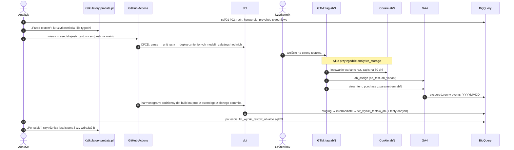

# Diagram sekwencji UML: test A/B od planu do decyzji

Kto co robi przed testem, w trakcie i po nim. W tym repo kroki 5–9 zastępuje `dane_syntetyczne/generuj_eksport_ga4.sql`: syntetyczny eksport GA4 ze znanym efektem wariantów, więc wynik modelu da się porównać z prawdą (`dbt/README.md`). Kroki testu: [README](README.md).

| Krok | Kto | Po co |
|---|---|---|
| 1–2 | analityk | długość testu znana przed startem — bez zaglądania do wyniku w trakcie |
| 3–4 | analytics engineer | test dopisany do rejestru trafia do modelu przez CI/CD, nie ręcznie |
| 5–8 | tag GTM | wariant raz na użytkownika, widoczny na każdym zdarzeniu lejka |
| 9–11 | GA4, GitHub Actions, dbt | wynik przeliczany codziennie dla wszystkich testów z rejestru |
| 12–13 | analityk | decyzja na liczbach liczonych tak samo jak w kalkulatorze |
